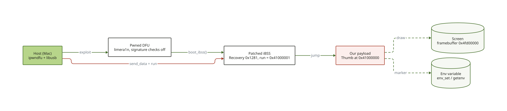
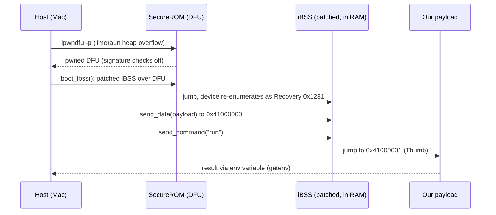

# 1. Boot chain: from DFU to our code

Goal: run code we wrote on a 3GS, with nothing written to the phone's storage.

## The path (DEVICE, 2026-10-14/15)





1. **Pwned DFU.** The 3GS S5L8920 bootrom is vulnerable to limera1n. Host-direct,
   no helper board. The exploit fails some of the time and is simply repeated.
2. **Patched iBSS.** `boot_ibss()` from ipwndfu sends an iBSS decrypted with the
   device's own key and patched so the Recovery command `run` jumps to
   `0x41000001` instead of the stock behaviour. The Recovery command `go` is not used.
3. **Payload.** `send_data` copies raw Thumb code to `0x41000000`, `run` jumps to it.
   Entry state: MMU and caches on, vectors at VA 0 (the iBSS image at `0x84000000`),
   running in SVC mode, `SCTLR = 0x00C5187D`, IRQs not masked.
4. **Result channel.** The payload calls the iBSS internal `env_set()`
   (`0x84011799`, Thumb) to publish a marker, read back with `getenv`.
   **Trap:** the iBSS keeps the variable across runs. Read it unset *before* the run,
   otherwise a stale value proves nothing (see [field notes](05-field-notes.md)).

## What is not persistent

Nothing. The bootrom exploit and the RAM payload vanish at reboot (a logo means
the device left Recovery and must be put back in DFU). This is tethered boot.
Making it untethered on this SoC is **HYPOTHESIS**: see
[`../research/2026-10-13-untethered-boot.md`](../research/2026-10-13-untethered-boot.md).

## Reproduce

One-time setup, with the pinned version and the patch kept in this repository
([`tools/ipwndfu/README.md`](https://github.com/SebE585/trognon/blob/main/tools/ipwndfu/README.md)):
ipwndfu at commit `0e28932`, plus `tools/ipwndfu/python3-arm64.patch` (a Python 3 port and a libusb path
override, GPL-3.0 like ipwndfu). Then:

```sh
tools/boot.sh                               # device in DFU: pwn it, boot the patched iBSS (Recovery)
tools/send.sh tools/payloads/trace.bin      # send a payload, then check its nonce
```

`tools/boot.sh` refuses to run if ipwndfu is not at the pinned commit with the patch applied. `tools/send.sh`
appends a random 32-bit nonce to the binary, the payload republishes it, and the script confirms it
(exit status 3 and `NONCE NOT CONFIRMED` otherwise). It also prints the SHA-256 of the binary and appends
the outcome to `~/trognon-runs.log`. A run is proven only when the nonce comes back.
