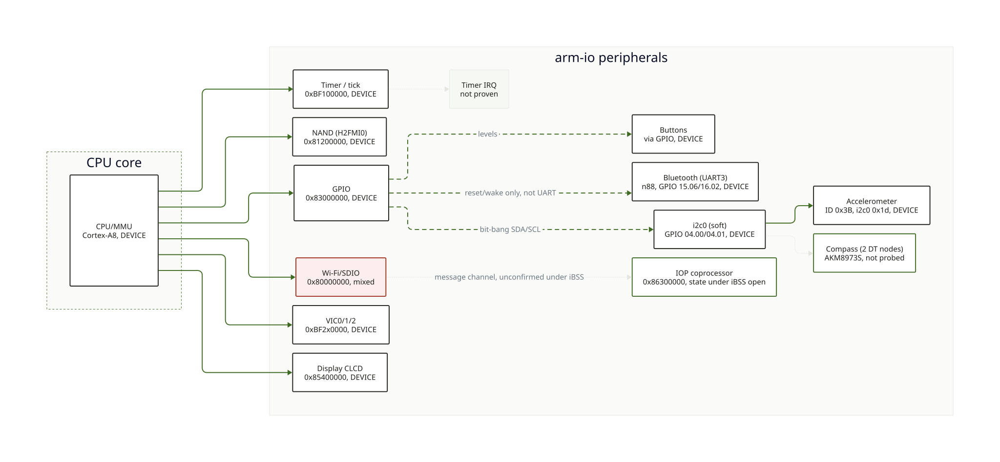

# 3. Hardware map: what is verified

[Open the diagram full-size](../img/soc-map.svg) — addresses and subtitles are small in an
inline render.

## At a glance

| Component | Obtained | Remaining | Section |
|---|---|---|---|
| CPU/MMU | Control registers and page-table descriptors read | No code-level check beyond register reads | [CPU and MMU](#cpu-and-mmu-device) |
| Display (CLCD) | Framebuffer draws, confirmed by a visible fill | Panel init is the iBSS's; no driver of our own | [Display controller](#display-controller-clcd_base-0x85400000-device) |
| GPIO and clock gates | Base mapped, several offsets read | Most pins' roles unknown; `GPIOIC` not re-read since it dropped the USB link | [GPIO and clock gates](#gpio-and-clock-gates-device-partial) |
| VIC0/1/2 | Full read-only survey; a software IRQ raised and handled | Which peripheral owns each of the 14 enabled bits | [Interrupt controllers](#interrupt-controllers-vic012-device-2026-10-15) |
| Timer block | Tick rate confirmed at 24 MHz | Timer interrupt not proven; IRQ-ack offsets and sequence not validated on this SoC | [Timer block](#timer-block-timer_base-0xbf100000-device-2026-10-15) |
| NAND | Chip ID read on CE0/CE1 | CE2-CE15, bus 1, and any page access | [NAND](#nand-h2fmi0_base-0x81200000-device-2026-10-15) |
| Buttons | All 5 buttons mapped by GPIO difference | Mapping found by observed difference, not by name | [Buttons](#buttons-same-gpio-base-as-above-device-2026-10-15) |
| Accelerometer | Identifier read; powered up with a verified write; all three axes read with both signs or a known direction: +X right edge, +Y top, +Z out of the screen, about 56 counts per g, offsets near +1.5 / -6 / +3 counts | Exact chip model, axis directions, scale and calibration | [Accelerometer](#accelerometer-i2c0-address-0x1d-device-2026-10-16) |
| Wi-Fi/SDIO | Base address and GPIO lines confirmed; SDHCI layout confirmed in the IOP's own firmware | Which register window the IOP's SDHCI driver actually uses, and why CPU-side writes don't stick | [Wi-Fi/SDIO](#wi-fisdio-sdio0_base-0x80000000-mixed-devicehypothesis-2026-10-1516) |
| Magnetometer | A device at `0x1e` returns the AK8973's documented reset state in 12 registers; `0x1f` is silent; no gyroscope on `i2c0` | A measurement (needs EEPROM-derived setup), the role of `0x1f` | [Magnetometer](#magnetometer-i2c0-address-0x1e-device-2026-10-16) |
| Touch controller | Reset and chip-select GPIO levels read (one run) | Polarity, power and clock via the PMU, SPI transaction, any response | [Bluetooth](#bluetooth-uart3-reset-1506-wake-1602-device-2026-10-16) |

**Reading the tags**: **DEVICE** means observed on this real phone (a read, or a write
with its result read back) — never assume a DEVICE tag on one line of a section means
every claim on that line is proven; read the line itself. **SOURCE** means read in
firmware or driver code, not yet checked here on this device. **HYPOTHESIS** means our own
reasoning, not confirmed either way. A tag is never a checkmark: "DEVICE" on the
accelerometer means the identifier byte came back, nothing about whether the axes work.
"How to reproduce" in a section names two separate steps: building the payload
(`make <payload>.bin`, from `tools/payloads/`) and running it on a device in DFU
(`tools/go.sh tools/payloads/<payload>.bin`) — building does not run anything on the phone.
"Links to evidence" is the bundle under [`evidence/`](08-evidence.md) with the raw screen
output and build manifest from that run.

Base addresses alone, with no narrative, are kept in the stabilised
[SoC memory map](../spec/soc-s5l8920.md) — look there for a quick address lookup; this
page is where the reasoning and the evidence for each one live.

Register addresses come from OpenIBoot (`plat-s5l8920`). They are **SOURCE** until read
on the phone. This page lists what we checked. Most entries are plain reads, each one
armed as an expected data abort so an unmapped register prints `ABORT` instead of
resetting the phone — but not all: a few sections deliberately write to the hardware
(a GPIO toggle, a software-triggered interrupt, a NAND chip-ID command) and say so
explicitly where they occur. "No persistent write" (nothing stored to flash) is not the
same claim as "no write at all".

## CPU and MMU (DEVICE)

*The CPU core and its memory-management unit: what runs the code and how it sees memory.*

| Item | Value | Meaning |
|---|---|---|
| `MIDR` | `0x412FC081` | ARM, part `0xC08`, variant 2, revision 1: Cortex-A8 r2p1 |
| `SCTLR` | `0x00C5187D` | M=1 (MMU), C=1 (D-cache), I=1 (I-cache), Z=1, A=0 (no alignment check), V=0 (vectors at VA 0) |
| `DACR` | `0x00000003` | domain 0 manager, other domains no access |
| Page table | 1 MiB sections, all in domain 0 | nothing unmapped in indexes 1..0xfff |

## Display controller, `CLCD_BASE = 0x85400000` (DEVICE)

*The CLCD block drives the physical screen from the framebuffer in RAM.*

| Offset | Value read | Meaning |
|---|---|---|
| `+0x0` | `0x00020085` | bit 0 set: enabled (OpenIBoot writes `0x20084`) |
| `+0x24` | `0x4fd00000` | framebuffer address, confirmed by a visible fill |
| `+0x1B10` | `0x00000001` | enable |
| `+0x1B14` | varies per read | **live counter**, not configuration: low byte `0xE0` stable, high bits advance. Bits 0-3 are 0, as OpenIBoot writes |
| `+0x1B1C` | `0x00050507` | vertical porches (value stored minus 1) |
| `+0x1B20` | `0x000b0b0f` | horizontal porches (stored minus 1) |
| `+0x1B24` | `0x013f01df` | 320 x 480 (0x13f, 0x1df) |

The panel itself is driven over MIPI DSI (reset line probably GPIO `0x500`): the
controller is already initialised by the iBSS, which is why we can just draw.
Writing our own panel init is a much larger job (**HYPOTHESIS**, see OpenIBoot `pinot_init`).

## GPIO and clock gates (DEVICE, partial)

*GPIO reads or drives individual pins; a clock gate turns a peripheral's clock on or off.*

| Address | Value | Status |
|---|---|---|
| GPIO base `0x83000000` | readable, no abort | mapped, offsets `(8*port+pin)*4` answer |
| `GPIO+0xA0` (pin `0x500`) | bit 0 = 1 | consistent with a released panel reset, **not proven** |
| `GPIO+0x00 / +0x80 / +0x320` | read, role unknown | do not interpret |
| Clock gate `0xBF100128` | `0x0000000F` | read only |

Values read by eye from the screen; field widths were assumed to be 8 hex digits.

## Not re-read, on purpose

`GPIOIC` (`0x39A00000`): the one read tried so far dropped the USB link (cause
undetermined). Not retried since that incident. Treat as dangerous until understood.

## Interrupt controllers VIC0/1/2 (DEVICE, 2026-10-15)

*The VIC routes a peripheral's interrupt request to the CPU.*

Read-only survey. All registers answered, no abort.

| Register | VIC0 `0xBF200000` | VIC1 `0xBF210000` | VIC2 `0xBF220000` |
|---|---|---|---|
| `STATUS` (`+0x00`) | `0` | `0` | `0` |
| `RAW` (`+0x08`) | `0` | `0` | `0` |
| `SELECT` (`+0x0C`, 0 = IRQ) | `0` | `0` | `0` |
| `ENABLE` (`+0x10`) | `0x3FFA4040` | `0` | `0` |
| `SOFTINT` (`+0x18`) | `0` | `0` | `0` |

- The iBSS left **14 sources enabled in VIC0** (bits 6, 14, 17 and 19 to 29), all routed to IRQ,
  none pending, and IRQs are unmasked in the CPU: interrupts are live while our code runs.
- `SOFTINT` works: writing bit 0 made `RAW` and `STATUS` read 1 and raised a real IRQ, taken by our handler
  (see the [IRQ test](02-exception-console.md)). `INTENCLEAR` clears `ENABLE`, `SOFTINTCLEAR` clears the soft
  interrupt, both read back on the device.
- The iBSS handlers sit at `0x8400F9EC` (IRQ vector word `0x38`) and `0x8400FA34` (FIQ vector word `0x3C`).
- Which peripheral each enabled bit is stays unknown.

Timer registers are the least understood part of OpenIBoot (its own comment says they are copied from an older SoC).

## Timer block, `TIMER_BASE = 0xBF100000` (DEVICE, 2026-10-15)

*Free-running counters and per-timer state, used for timing and, potentially, periodic
interrupts.*

| Register | Offset | Observed |
|---|---|---|
| Free-running tick, low | `+0x200` | advances; **24.001 MHz measured against the host clock** (3 samples, 12.2 s, 0.004 % off 24 MHz) |
| Free-running tick, high | `+0x204` | `0` (the 32-bit low word wraps every ~179 s) |
| Timer 0 `STATE` | `+0x04` | `0x00669601` |
| Timer 1 `STATE` | `+0x24` | `0x00000E02` |
| Timers 2 and 3 `STATE` | `+0x44`, `+0x64` | `0x00000B00` each |
| Timer 5 `STATE` | `+0xC4` | `0` (looks unused) |
| Timer 4 `STATE`, `CFG`, `CNT`, `CNT2`; Timer 6 `STATE`; clock gate `0x25` | `+0xA4, +0xA0, +0xA8, +0xAC, +0xE4, +0x10C` | all exactly `0x0000000F`; Timer 4 `PRES` (`+0xB0`) reads `0` |

- The tick runs at 24 MHz. OpeniBoot says the same (`TicksPerSec = PLLFrequencies[3]`, **SOURCE**), which is why
  the measurement is a confirmation, not a surprise.
- The `STATE` words of timers 0 to 3 look structured (they are probably not just a start bit); we do not decode them.
- The wall of `0x0000000F` on timer 4 and 6 is not explained: it resembles the clock-gate registers (`0xF`
  everywhere), so those registers may be aliased or not implemented. Do not interpret them.
- **A timer interrupt is not proven.** Line 6 of VIC0 (the timer line in OpeniBoot) can be taken by our
  handler, but the source is not ours: with timer 5 never started, the interrupt still arrived 127 ticks
  (5 microseconds) after we enabled the line, because it was already asserted. `IRQSTAT` (`+0x10000`) *was*
  read as part of this test — it reads `0xFFFFFF81` before, during and after, whatever we do, so it is not
  a timer status register, and the acknowledge sequence copied from OpeniBoot (`IRQSTAT`, `IRQLATCH`) clears
  nothing. `IRQLATCH` (`+0xF8`) itself was only ever written as part of that same acknowledge sequence, never
  read in isolation to see what it holds. OpeniBoot's own timer handler for this SoC is commented out. Treat
  both offsets as wrong until proven otherwise.
- Measurement tool: `make trace_ticks.bin` plus `tools/tick_rate.py`. It publishes the counter through an
  environment variable read with `getenv`, so no photo is needed. Two samples taken in two separate
  invocations: one process cannot hold the device across a pause (the second acquire fails).

## NAND, `H2FMI0_BASE = 0x81200000` (DEVICE, 2026-10-15)

*The NAND controller talks to the flash chips that hold the device's own iOS image.*

Chip ID read: reset + READ ID command (control writes, but no program and no erase) across
all 16 chip-select lines on bus 0, then its geometry looked up in OpeniBoot's own hardcoded
table.

| Item | Value | Meaning |
|---|---|---|
| CE0, CE1 | `98 DE 95 32 7A 54 0C 00` | Toshiba (JEDEC manufacturer `0x98`); the same ID on both, cross-check |
| CE2 to CE15 | `00 00 00 00` | no exploitable identification response under these conditions |
| Geometry (OpeniBoot table, `nand_chip_info[]`, exact ID match) | `blocks_per_ce=0x2068`, `pages_per_block=0x80`, `bytes_per_page=0x2000`, `banks_per_ce=2` | SOURCE match, not read from the device |
| Capacity, computed | 8296 x 128 x 8192 x 2 banks x 2 CE = 34.8 GB raw | matches the 32 GB label on this unit after the usual ECC/spare margin (~8%) |

Bus 1 (`H2FMI1_BASE = 0x81300000`) not swept yet: same ID-read-only approach, no program and
no erase, this project's NOR-equivalent caution (`tools/boot.sh` never calls `flash_nor()`)
applies here too, with a larger margin, since NAND holds the device's own iOS image.

## Buttons, same GPIO base as above (DEVICE, 2026-10-15)

*Physical buttons are just GPIO pins, read like any other input line.*

Found by difference, not by name: OpeniBoot's own button names for this SoC look copied from
an older one, so every readable GPIO bit (`(8*port+pin)*4` from the base above) was sampled,
noise measured with hands off, then each button asked for in turn.

| Button | Pin (`port.pin`) |
|---|---|
| HOME | `16.6` |
| POWER | `16.7` |
| VOL UP | `16.0` |
| VOL DOWN | `16.1` |
| RINGER (toggle) | `14.3` |

376 pins read, zero noise over a 3-second hands-off window. A long payload (this sweep takes
close to 3 minutes) killed the USB control endpoint afterwards; a host-side USB port reset
(`dev.reset()`, no DFU needed) revived it — see [evidence](08-evidence.md).

## Accelerometer, i2c0 address `0x1d` (DEVICE, 2026-10-16)

*The accelerometer reports motion/orientation over a two-wire I2C bus.*

**Status**: DEVICE, first try, exact chip model still open. Everything below came from this
device's own decrypted device tree, then a real bit-banged I2C transaction over GPIO.

**What's confirmed**: the device tree names a bus (`i2c0`, `compatible = "i2c,s5l8920x",
"iic,soft"`: software, bit-banged, not a dedicated hardware controller) with SDA/SCL on
GPIO `04.01`/`04.00`, and an accelerometer on it (`compatible =
"accelerometer,lis331dl","accelerometer,lis302dl"`) at I2C address `0x1d`. A full I2C
transaction (START, address+write, register `0x0F`, repeated START, address+read, one
byte, STOP) got a real answer: all three software ACK flags read `1` (each slave-address
and register byte was acknowledged by the device), and the byte read back was `0x3B`. That
is the documented `WHO_AM_I` value for the LIS331DL — but ST's LIS302DL datasheet (table 16)
also lists `0x3B` as a valid value for some revisions of that part, so the read confirms a
working transaction and an identifier consistent with both compatible strings in the device
tree, not which of the two chips is actually on the board.

| Item | Value | Status |
|---|---|---|
| Bus | `i2c0`, SDA `04.01`, SCL `04.00` | device tree gives the name/pins; DEVICE: both read idle-high before the transaction |
| I2C address | `0x1d` | device tree `reg` property |
| `WHO_AM_I` (register `0x0F`) | `0x3B` | DEVICE: full I2C read, all three software ACK flags `1` |

**What remains hypothesis**: which of the two compatible-string chips (LIS331DL vs LIS302DL)
is actually present, reading actual axis data (the three accelerations), and the
`orientation` device-tree property's exact meaning. A compass (AKM8973S, address `0x1e`)
and a second `compass1` (`0x1f`, no `interrupts` property) share the same bus, device tree
only, not probed at all yet — two device-tree nodes do not by themselves prove two separate
physical chips.

**Axis data (DEVICE, 2026-10-16, one run, phone not moved)**: `STAGE 31` powers the part up
(first write to this device: `CTRL_REG1`), reads it back, then reads the status and the three
axis bytes. The write landed (`CTRL_REG1` read back `0x47`: power-down bit cleared, X/Y/Z
enabled, other bits at their reset state, the default ±2 g range assumed), every ACK flag was
`1`, and the nonce was confirmed. Raw values: status `0xFF`, X `0x0B` (+11), Y `0xF7` (-9),
Z `0x3A` (+58), signed 8-bit.

| Item | Value | Status |
|---|---|---|
| `CTRL_REG1` after the write | `0x47` | DEVICE: read back, not assumed |
| `STATUS_REG` | `0xFF` | DEVICE: all data-available and overrun bits set; not interpreted further |
| X, Y, Z (signed counts) | +11, -9, +58 | DEVICE: one sample each |
| Magnitude | about 59 counts | arithmetic on the three bytes |

With the datasheet's nominal 18 mg per count at ±2 g (a datasheet figure, not measured here)
that is about 1.07 g, with Z dominant: consistent with gravity on one axis, which says the
chip is alive and the data is plausible. It does **not** say which physical face is up, the
axis signs, or that the scale is right: one still sample cannot separate those.

**Second run, phone moved (DEVICE, same day, bundle `20261016T150844Z-trace_accel_axes`)**: the
same payload, the same register readback (`0x47`), after the phone was moved to another
orientation (not recorded precisely: held by hand, which face was up was not noted).

| Run | X | Y | Z | Dominant axis | Magnitude (counts) |
|---|---|---|---|---|---|
| 1, as first held | +11 | -9 | +58 | Z | about 59 |
| 2, after moving it | +19 | +47 | +8 | Y | about 51 |
| 3 and 4, phone resting, two consecutive runs | +2 | -16 | +59 | Z | about 61 (both) |
| 5 and 6, flat, screen up (stated by the person holding it), two runs | +3 | -6 | +59 | Z | about 59 (both) |
| 7 and 8, flat, screen against the table (stated), two runs | +2 | -6 | -53 | Z | about 53 (both) |
| 9 and 10, on the left edge (stated; taken as portrait, screen facing the person), two runs | +57, +58 | -7, -6 | +6 | X | about 57 to 58 |
| 11 and 12, on the right edge (stated; the rounded sides are why the bottom and top edges were not used: the cable is in the way), two runs | -55, -54 | -6, -7 | -5, -4 | X | about 54 to 55 |
| 13 and 14, on the top edge (stated; taken as the top end of the phone on the table, the cable end up), two runs | +3, +4 | -60, -61 | +11 | Y | about 61 |

The dominant axis moved from Z to Y with the phone, which is what a gravity vector does and
what a stuck or constant output would not do. Runs 3 and 4 (bundles `20261016T150944Z` and
`20261016T150947Z`, phone left resting, which face was up not recorded) returned exactly the
same three bytes, so the readout is repeatable at rest at this resolution. Z dominant again
with Y at -16 counts means a slight tilt or a different resting position from run 1.

Taken together, the magnitude at rest is about 60 counts (59 and 61 in the two resting
positions), and the 51 of run 2 is the outlier, taken while the phone was being moved; that
is the likeliest cause and was not tested. At the nominal 18 mg per count, 60 counts is
about 1.1 g, a little above 1 g: the scale or the offsets may differ from the datasheet's
typical values, and nothing here measures them.

What this still does not give: the direction of each axis relative to the case, the actual
scale and offsets, or any calibration. No axis-to-face mapping is claimed.

**Z axis, both signs (runs 5 to 8, bundles `20261016T151058Z`, `20261016T151101Z`,
`20261016T151159Z`, `20261016T151202Z`; the faces are as stated by the person holding the
phone)**: flat screen up Z read +59, screen against the table Z read -53, each identical
twice. The sign flips with the face, so the Z axis measures along the screen normal and
+Z points out of the screen (the sign follows the usual convention that a resting
accelerometer reports +1 g along the axis pointing up; the flip itself is the observation).

Two points on one axis give a first estimate, with the caveat that the table was assumed
level and that each value is a single 8-bit count (an error of about one count):

- scale: (59 - (-53)) / 2 = 56 counts per g, i.e. about 17.9 mg per count, which agrees with
  the datasheet's nominal 18 mg per count at the +-2 g range;
- Z offset: (59 + (-53)) / 2 = +3 counts.

X and Y barely changed between the two faces (+3, -6 then +2, -6). If the table was level,
that points to offsets of about +2 to +3 counts on X and -6 on Y rather than to tilt, which
would have changed sign on flipping. This is a reading of four numbers, not a calibration.
The earlier "a little above 1 g" at rest is explained by these offsets, not by a different
scale.

**X axis (runs 9 and 10, bundles `20261016T151312Z`, `20261016T151315Z`)**: on its left
edge, X read +57 and +58 (one count apart between the two runs), Y -7 and -6, Z +6. "Left
edge" was said by the person holding it, and is taken here as portrait with the screen
facing them. With the left edge down, the up direction is toward the right edge, so under the
same convention as for Z, **+X points toward the right edge**. Subtracting the roughly +2.5
count X offset estimated above leaves about 55 counts, which agrees with the 56 counts per
g from the Z axis. Y stays near its -6 offset and Z near +3 plus a small remainder, as
expected for an edge position.

**X axis, both signs (runs 11 and 12, bundles `20261016T151438Z`, `20261016T151441Z`)**: on
the right edge X read -55 and -54. With +57.5 on the left edge (mean of runs 9 and 10) and
-54.5 on the right edge (mean of runs 11 and 12), the X axis gives 56.0 counts per g
(half the span) and an offset of +1.5 counts. That is the same 56 counts per g as the Z axis,
from an independent pair of positions, and it fixes the sign: **+X points toward the right
edge**, under the convention already stated for Z. Z read +6 on the left edge and -4.5 on
the right, which is a lean of about 5 counts (0.09 g) either way, plausible on rounded edges.

**Y axis (runs 13 and 14, bundles `20261016T151540Z`, `20261016T151542Z`)**: on the top
edge, Y read -60 and -61, X +3 and +4, Z +11. "Top edge" was said by the person holding it;
it is taken as the top end of the phone on the table, which puts the cable end up (this is
why that edge was possible after all). With the top end down, the up direction is toward
the bottom, so under the same convention as for X and Z, **+Y points toward the top of the
phone**. Net of the roughly -6 count offset seen on every flat or edge position, the Y span is
about 54 to 55 counts, close to the 56 counts per g of the other two axes; the remaining
gap is within one or two counts and a small lean (Z reads +11).

**Frame**: +X toward the right edge, +Y toward the top, +Z out of the screen, for a phone
held upright with the screen facing the person. That triple is right-handed, which is a
consistency check on the Y reading (a left-handed result would have pointed at a mistake
in the stated positions or the convention), not a proof of it.

**What this does not give**: calibrated offsets (X about +1.5, Y about -6, Z about +3 counts,
each assuming a level table, within about one count), a temperature or time stability, or
any filtering. It is enough to compute a tilt angle to a few degrees.

**What remains hypothesis**: which of the two compatible-string chips (LIS331DL vs LIS302DL)
is actually present, reading actual axis data (the three accelerations), and the
`orientation` device-tree property's exact meaning. A compass (AKM8973S, address `0x1e`)
and a second `compass1` (`0x1f`, no `interrupts` property) share the same bus, device tree
only, not probed at all yet — two device-tree nodes do not by themselves prove two separate
physical chips.

**Axis data (DEVICE, 2026-10-16, one run, phone not moved)**: `STAGE 31` powers the part up
(first write to this device: `CTRL_REG1`), reads it back, then reads the status and the three
axis bytes. The write landed (`CTRL_REG1` read back `0x47`: power-down bit cleared, X/Y/Z
enabled, other bits at their reset state, the default ±2 g range assumed), every ACK flag was
`1`, and the nonce was confirmed. Raw values: status `0xFF`, X `0x0B` (+11), Y `0xF7` (-9),
Z `0x3A` (+58), signed 8-bit.

| Item | Value | Status |
|---|---|---|
| `CTRL_REG1` after the write | `0x47` | DEVICE: read back, not assumed |
| `STATUS_REG` | `0xFF` | DEVICE: all data-available and overrun bits set; not interpreted further |
| X, Y, Z (signed counts) | +11, -9, +58 | DEVICE: one sample each |
| Magnitude | about 59 counts | arithmetic on the three bytes |

With the datasheet's nominal 18 mg per count at ±2 g (a datasheet figure, not measured here)
that is about 1.07 g, with Z dominant: consistent with gravity on one axis, which says the
chip is alive and the data is plausible. It does **not** say which physical face is up, the
axis signs, or that the scale is right: one still sample cannot separate those.

**Second run, phone moved (DEVICE, same day, bundle `20261016T150844Z-trace_accel_axes`)**: the
same payload, the same register readback (`0x47`), after the phone was moved to another
orientation (not recorded precisely: held by hand, which face was up was not noted).

| Run | X | Y | Z | Dominant axis | Magnitude (counts) |
|---|---|---|---|---|---|
| 1, as first held | +11 | -9 | +58 | Z | about 59 |
| 2, after moving it | +19 | +47 | +8 | Y | about 51 |
| 3 and 4, phone resting, two consecutive runs | +2 | -16 | +59 | Z | about 61 (both) |
| 5 and 6, flat, screen up (stated by the person holding it), two runs | +3 | -6 | +59 | Z | about 59 (both) |
| 7 and 8, flat, screen against the table (stated), two runs | +2 | -6 | -53 | Z | about 53 (both) |
| 9 and 10, on the left edge (stated; taken as portrait, screen facing the person), two runs | +57, +58 | -7, -6 | +6 | X | about 57 to 58 |
| 11 and 12, on the right edge (stated; the rounded sides are why the bottom and top edges were not used: the cable is in the way), two runs | -55, -54 | -6, -7 | -5, -4 | X | about 54 to 55 |
| 13 and 14, on the top edge (stated; taken as the top end of the phone on the table, the cable end up), two runs | +3, +4 | -60, -61 | +11 | Y | about 61 |

The dominant axis moved from Z to Y with the phone, which is what a gravity vector does and
what a stuck or constant output would not do. Runs 3 and 4 (bundles `20261016T150944Z` and
`20261016T150947Z`, phone left resting, which face was up not recorded) returned exactly the
same three bytes, so the readout is repeatable at rest at this resolution. Z dominant again
with Y at -16 counts means a slight tilt or a different resting position from run 1.

Taken together, the magnitude at rest is about 60 counts (59 and 61 in the two resting
positions), and the 51 of run 2 is the outlier, taken while the phone was being moved; that
is the likeliest cause and was not tested. At the nominal 18 mg per count, 60 counts is
about 1.1 g, a little above 1 g: the scale or the offsets may differ from the datasheet's
typical values, and nothing here measures them.

What this still does not give: the direction of each axis relative to the case, the actual
scale and offsets, or any calibration. No axis-to-face mapping is claimed.

**Z axis, both signs (runs 5 to 8, bundles `20261016T151058Z`, `20261016T151101Z`,
`20261016T151159Z`, `20261016T151202Z`; the faces are as stated by the person holding the
phone)**: flat screen up Z read +59, screen against the table Z read -53, each identical
twice. The sign flips with the face, so the Z axis measures along the screen normal and
+Z points out of the screen (the sign follows the usual convention that a resting
accelerometer reports +1 g along the axis pointing up; the flip itself is the observation).

Two points on one axis give a first estimate, with the caveat that the table was assumed
level and that each value is a single 8-bit count (an error of about one count):

- scale: (59 - (-53)) / 2 = 56 counts per g, i.e. about 17.9 mg per count, which agrees with
  the datasheet's nominal 18 mg per count at the +-2 g range;
- Z offset: (59 + (-53)) / 2 = +3 counts.

X and Y barely changed between the two faces (+3, -6 then +2, -6). If the table was level,
that points to offsets of about +2 to +3 counts on X and -6 on Y rather than to tilt, which
would have changed sign on flipping. This is a reading of four numbers, not a calibration.
The earlier "a little above 1 g" at rest is explained by these offsets, not by a different
scale.

**X axis (runs 9 and 10, bundles `20261016T151312Z`, `20261016T151315Z`)**: on its left
edge, X read +57 and +58 (one count apart between the two runs), Y -7 and -6, Z +6. "Left
edge" was said by the person holding it, and is taken here as portrait with the screen
facing them. With the left edge down, the up direction is toward the right edge, so under the
same convention as for Z, **+X points toward the right edge**. Subtracting the roughly +2.5
count X offset estimated above leaves about 55 counts, which agrees with the 56 counts per
g from the Z axis. Y stays near its -6 offset and Z near +3 plus a small remainder, as
expected for an edge position.

**X axis, both signs (runs 11 and 12, bundles `20261016T151438Z`, `20261016T151441Z`)**: on
the right edge X read -55 and -54. With +57.5 on the left edge (mean of runs 9 and 10) and
-54.5 on the right edge (mean of runs 11 and 12), the X axis gives 56.0 counts per g
(half the span) and an offset of +1.5 counts. That is the same 56 counts per g as the Z axis,
from an independent pair of positions, and it fixes the sign: **+X points toward the right
edge**, under the convention already stated for Z. Z read +6 on the left edge and -4.5 on
the right, which is a lean of about 5 counts (0.09 g) either way, plausible on rounded edges.

**What is left for the Y axis**: the bottom edge and the top edge cannot be used (rounded
sides and the cable). A usable alternative is flat, screen up, with the top end raised by a
known amount (a book under it): the sign of Y then says whether +Y points toward the top.
Y has so far read about -6 in every position that was not tilted along it, which is its
offset (about -6.5 counts if the table was level), not a direction.

**What remains hypothesis**: which of the two compatible-string chips (LIS331DL vs LIS302DL)
is actually present, reading actual axis data (the three accelerations), and the
`orientation` device-tree property's exact meaning. A compass (AKM8973S, address `0x1e`)
and a second `compass1` (`0x1f`, no `interrupts` property) share the same bus, device tree
only, not probed at all yet — two device-tree nodes do not by themselves prove two separate
physical chips.

**Axis data (DEVICE, 2026-10-16, one run, phone not moved)**: `STAGE 31` powers the part up
(first write to this device: `CTRL_REG1`), reads it back, then reads the status and the three
axis bytes. The write landed (`CTRL_REG1` read back `0x47`: power-down bit cleared, X/Y/Z
enabled, other bits at their reset state, the default ±2 g range assumed), every ACK flag was
`1`, and the nonce was confirmed. Raw values: status `0xFF`, X `0x0B` (+11), Y `0xF7` (-9),
Z `0x3A` (+58), signed 8-bit.

| Item | Value | Status |
|---|---|---|
| `CTRL_REG1` after the write | `0x47` | DEVICE: read back, not assumed |
| `STATUS_REG` | `0xFF` | DEVICE: all data-available and overrun bits set; not interpreted further |
| X, Y, Z (signed counts) | +11, -9, +58 | DEVICE: one sample each |
| Magnitude | about 59 counts | arithmetic on the three bytes |

With the datasheet's nominal 18 mg per count at ±2 g (a datasheet figure, not measured here)
that is about 1.07 g, with Z dominant: consistent with gravity on one axis, which says the
chip is alive and the data is plausible. It does **not** say which physical face is up, the
axis signs, or that the scale is right: one still sample cannot separate those.

**Second run, phone moved (DEVICE, same day, bundle `20261016T150844Z-trace_accel_axes`)**: the
same payload, the same register readback (`0x47`), after the phone was moved to another
orientation (not recorded precisely: held by hand, which face was up was not noted).

| Run | X | Y | Z | Dominant axis | Magnitude (counts) |
|---|---|---|---|---|---|
| 1, as first held | +11 | -9 | +58 | Z | about 59 |
| 2, after moving it | +19 | +47 | +8 | Y | about 51 |
| 3 and 4, phone resting, two consecutive runs | +2 | -16 | +59 | Z | about 61 (both) |
| 5 and 6, flat, screen up (stated by the person holding it), two runs | +3 | -6 | +59 | Z | about 59 (both) |
| 7 and 8, flat, screen against the table (stated), two runs | +2 | -6 | -53 | Z | about 53 (both) |
| 9 and 10, on the left edge (stated; taken as portrait, screen facing the person), two runs | +57, +58 | -7, -6 | +6 | X | about 57 to 58 |
| 11 and 12, on the right edge (stated; the rounded sides are why the bottom and top edges were not used: the cable is in the way), two runs | -55, -54 | -6, -7 | -5, -4 | X | about 54 to 55 |

The dominant axis moved from Z to Y with the phone, which is what a gravity vector does and
what a stuck or constant output would not do. Runs 3 and 4 (bundles `20261016T150944Z` and
`20261016T150947Z`, phone left resting, which face was up not recorded) returned exactly the
same three bytes, so the readout is repeatable at rest at this resolution. Z dominant again
with Y at -16 counts means a slight tilt or a different resting position from run 1.

Taken together, the magnitude at rest is about 60 counts (59 and 61 in the two resting
positions), and the 51 of run 2 is the outlier, taken while the phone was being moved; that
is the likeliest cause and was not tested. At the nominal 18 mg per count, 60 counts is
about 1.1 g, a little above 1 g: the scale or the offsets may differ from the datasheet's
typical values, and nothing here measures them.

What this still does not give: the direction of each axis relative to the case, the actual
scale and offsets, or any calibration. No axis-to-face mapping is claimed.

**Z axis, both signs (runs 5 to 8, bundles `20261016T151058Z`, `20261016T151101Z`,
`20261016T151159Z`, `20261016T151202Z`; the faces are as stated by the person holding the
phone)**: flat screen up Z read +59, screen against the table Z read -53, each identical
twice. The sign flips with the face, so the Z axis measures along the screen normal and
+Z points out of the screen (the sign follows the usual convention that a resting
accelerometer reports +1 g along the axis pointing up; the flip itself is the observation).

Two points on one axis give a first estimate, with the caveat that the table was assumed
level and that each value is a single 8-bit count (an error of about one count):

- scale: (59 - (-53)) / 2 = 56 counts per g, i.e. about 17.9 mg per count, which agrees with
  the datasheet's nominal 18 mg per count at the +-2 g range;
- Z offset: (59 + (-53)) / 2 = +3 counts.

X and Y barely changed between the two faces (+3, -6 then +2, -6). If the table was level,
that points to offsets of about +2 to +3 counts on X and -6 on Y rather than to tilt, which
would have changed sign on flipping. This is a reading of four numbers, not a calibration.
The earlier "a little above 1 g" at rest is explained by these offsets, not by a different
scale.

**X axis (runs 9 and 10, bundles `20261016T151312Z`, `20261016T151315Z`)**: on its left
edge, X read +57 and +58 (one count apart between the two runs), Y -7 and -6, Z +6. "Left
edge" was said by the person holding it, and is taken here as portrait with the screen
facing them. With the left edge down, the up direction is toward the right edge, so under the
same convention as for Z, **+X points toward the right edge**. Subtracting the roughly +2.5
count X offset estimated above leaves about 55 counts, which agrees with the 56 counts per
g from the Z axis. Y stays near its -6 offset and Z near +3 plus a small remainder, as
expected for an edge position.

**Next observation**: the bottom edge (or the top edge) on the table, still, two runs, for
the direction of Y. That is the last axis.

**What remains hypothesis**: which of the two compatible-string chips (LIS331DL vs LIS302DL)
is actually present, reading actual axis data (the three accelerations), and the
`orientation` device-tree property's exact meaning. A compass (AKM8973S, address `0x1e`)
and a second `compass1` (`0x1f`, no `interrupts` property) share the same bus, device tree
only, not probed at all yet — two device-tree nodes do not by themselves prove two separate
physical chips.

**Axis data (DEVICE, 2026-10-16, one run, phone not moved)**: `STAGE 31` powers the part up
(first write to this device: `CTRL_REG1`), reads it back, then reads the status and the three
axis bytes. The write landed (`CTRL_REG1` read back `0x47`: power-down bit cleared, X/Y/Z
enabled, other bits at their reset state, the default ±2 g range assumed), every ACK flag was
`1`, and the nonce was confirmed. Raw values: status `0xFF`, X `0x0B` (+11), Y `0xF7` (-9),
Z `0x3A` (+58), signed 8-bit.

| Item | Value | Status |
|---|---|---|
| `CTRL_REG1` after the write | `0x47` | DEVICE: read back, not assumed |
| `STATUS_REG` | `0xFF` | DEVICE: all data-available and overrun bits set; not interpreted further |
| X, Y, Z (signed counts) | +11, -9, +58 | DEVICE: one sample each |
| Magnitude | about 59 counts | arithmetic on the three bytes |

With the datasheet's nominal 18 mg per count at ±2 g (a datasheet figure, not measured here)
that is about 1.07 g, with Z dominant: consistent with gravity on one axis, which says the
chip is alive and the data is plausible. It does **not** say which physical face is up, the
axis signs, or that the scale is right: one still sample cannot separate those.

**Second run, phone moved (DEVICE, same day, bundle `20261016T150844Z-trace_accel_axes`)**: the
same payload, the same register readback (`0x47`), after the phone was moved to another
orientation (not recorded precisely: held by hand, which face was up was not noted).

| Run | X | Y | Z | Dominant axis | Magnitude (counts) |
|---|---|---|---|---|---|
| 1, as first held | +11 | -9 | +58 | Z | about 59 |
| 2, after moving it | +19 | +47 | +8 | Y | about 51 |
| 3 and 4, phone resting, two consecutive runs | +2 | -16 | +59 | Z | about 61 (both) |
| 5 and 6, flat, screen up (stated by the person holding it), two runs | +3 | -6 | +59 | Z | about 59 (both) |
| 7 and 8, flat, screen against the table (stated), two runs | +2 | -6 | -53 | Z | about 53 (both) |
| 9 and 10, on the left edge (stated; taken as portrait, screen facing the person), two runs | +57, +58 | -7, -6 | +6 | X | about 57 to 58 |

The dominant axis moved from Z to Y with the phone, which is what a gravity vector does and
what a stuck or constant output would not do. Runs 3 and 4 (bundles `20261016T150944Z` and
`20261016T150947Z`, phone left resting, which face was up not recorded) returned exactly the
same three bytes, so the readout is repeatable at rest at this resolution. Z dominant again
with Y at -16 counts means a slight tilt or a different resting position from run 1.

Taken together, the magnitude at rest is about 60 counts (59 and 61 in the two resting
positions), and the 51 of run 2 is the outlier, taken while the phone was being moved; that
is the likeliest cause and was not tested. At the nominal 18 mg per count, 60 counts is
about 1.1 g, a little above 1 g: the scale or the offsets may differ from the datasheet's
typical values, and nothing here measures them.

What this still does not give: the direction of each axis relative to the case, the actual
scale and offsets, or any calibration. No axis-to-face mapping is claimed.

**Z axis, both signs (runs 5 to 8, bundles `20261016T151058Z`, `20261016T151101Z`,
`20261016T151159Z`, `20261016T151202Z`; the faces are as stated by the person holding the
phone)**: flat screen up Z read +59, screen against the table Z read -53, each identical
twice. The sign flips with the face, so the Z axis measures along the screen normal and
+Z points out of the screen (the sign follows the usual convention that a resting
accelerometer reports +1 g along the axis pointing up; the flip itself is the observation).

Two points on one axis give a first estimate, with the caveat that the table was assumed
level and that each value is a single 8-bit count (an error of about one count):

- scale: (59 - (-53)) / 2 = 56 counts per g, i.e. about 17.9 mg per count, which agrees with
  the datasheet's nominal 18 mg per count at the +-2 g range;
- Z offset: (59 + (-53)) / 2 = +3 counts.

X and Y barely changed between the two faces (+3, -6 then +2, -6). If the table was level,
that points to offsets of about +2 to +3 counts on X and -6 on Y rather than to tilt, which
would have changed sign on flipping. This is a reading of four numbers, not a calibration.
The earlier "a little above 1 g" at rest is explained by these offsets, not by a different
scale.

**Next observation**: each edge in turn, still, two runs each, for the directions of X and
Y.

**What remains hypothesis**: which of the two compatible-string chips (LIS331DL vs LIS302DL)
is actually present, reading actual axis data (the three accelerations), and the
`orientation` device-tree property's exact meaning. A compass (AKM8973S, address `0x1e`)
and a second `compass1` (`0x1f`, no `interrupts` property) share the same bus, device tree
only, not probed at all yet — two device-tree nodes do not by themselves prove two separate
physical chips.

**Axis data (DEVICE, 2026-10-16, one run, phone not moved)**: `STAGE 31` powers the part up
(first write to this device: `CTRL_REG1`), reads it back, then reads the status and the three
axis bytes. The write landed (`CTRL_REG1` read back `0x47`: power-down bit cleared, X/Y/Z
enabled, other bits at their reset state, the default ±2 g range assumed), every ACK flag was
`1`, and the nonce was confirmed. Raw values: status `0xFF`, X `0x0B` (+11), Y `0xF7` (-9),
Z `0x3A` (+58), signed 8-bit.

| Item | Value | Status |
|---|---|---|
| `CTRL_REG1` after the write | `0x47` | DEVICE: read back, not assumed |
| `STATUS_REG` | `0xFF` | DEVICE: all data-available and overrun bits set; not interpreted further |
| X, Y, Z (signed counts) | +11, -9, +58 | DEVICE: one sample each |
| Magnitude | about 59 counts | arithmetic on the three bytes |

With the datasheet's nominal 18 mg per count at ±2 g (a datasheet figure, not measured here)
that is about 1.07 g, with Z dominant: consistent with gravity on one axis, which says the
chip is alive and the data is plausible. It does **not** say which physical face is up, the
axis signs, or that the scale is right: one still sample cannot separate those.

**Second run, phone moved (DEVICE, same day, bundle `20261016T150844Z-trace_accel_axes`)**: the
same payload, the same register readback (`0x47`), after the phone was moved to another
orientation (not recorded precisely: held by hand, which face was up was not noted).

| Run | X | Y | Z | Dominant axis | Magnitude (counts) |
|---|---|---|---|---|---|
| 1, as first held | +11 | -9 | +58 | Z | about 59 |
| 2, after moving it | +19 | +47 | +8 | Y | about 51 |
| 3 and 4, phone resting, two consecutive runs | +2 | -16 | +59 | Z | about 61 (both) |
| 5 and 6, flat, screen up (stated by the person holding it), two runs | +3 | -6 | +59 | Z | about 59 (both) |
| 7 and 8, flat, screen against the table (stated), two runs | +2 | -6 | -53 | Z | about 53 (both) |

The dominant axis moved from Z to Y with the phone, which is what a gravity vector does and
what a stuck or constant output would not do. Runs 3 and 4 (bundles `20261016T150944Z` and
`20261016T150947Z`, phone left resting, which face was up not recorded) returned exactly the
same three bytes, so the readout is repeatable at rest at this resolution. Z dominant again
with Y at -16 counts means a slight tilt or a different resting position from run 1.

Taken together, the magnitude at rest is about 60 counts (59 and 61 in the two resting
positions), and the 51 of run 2 is the outlier, taken while the phone was being moved; that
is the likeliest cause and was not tested. At the nominal 18 mg per count, 60 counts is
about 1.1 g, a little above 1 g: the scale or the offsets may differ from the datasheet's
typical values, and nothing here measures them.

What this still does not give: the direction of each axis relative to the case, the actual
scale and offsets, or any calibration. No axis-to-face mapping is claimed.

**Axis direction, first piece (runs 5 and 6, bundles `20261016T151058Z`, `20261016T151101Z`)**:
flat with the screen up, Z read +59 and X, Y read +3 and -6, identically twice. If the part
follows the usual convention for a static accelerometer (it reports +1 g along the axis that
points up), then +Z points out of the screen. That convention was not checked here: the
direct test is the same measurement screen down, where Z should read about -59. X and Y
directions are still open.

**Next observation**: screen down, then each edge in turn, still, two runs each.

**What remains hypothesis**: which of the two compatible-string chips (LIS331DL vs LIS302DL)
is actually present, reading actual axis data (the three accelerations), and the
`orientation` device-tree property's exact meaning. A compass (AKM8973S, address `0x1e`)
and a second `compass1` (`0x1f`, no `interrupts` property) share the same bus, device tree
only, not probed at all yet — two device-tree nodes do not by themselves prove two separate
physical chips.

**Axis data (DEVICE, 2026-10-16, one run, phone not moved)**: `STAGE 31` powers the part up
(first write to this device: `CTRL_REG1`), reads it back, then reads the status and the three
axis bytes. The write landed (`CTRL_REG1` read back `0x47`: power-down bit cleared, X/Y/Z
enabled, other bits at their reset state, the default ±2 g range assumed), every ACK flag was
`1`, and the nonce was confirmed. Raw values: status `0xFF`, X `0x0B` (+11), Y `0xF7` (-9),
Z `0x3A` (+58), signed 8-bit.

| Item | Value | Status |
|---|---|---|
| `CTRL_REG1` after the write | `0x47` | DEVICE: read back, not assumed |
| `STATUS_REG` | `0xFF` | DEVICE: all data-available and overrun bits set; not interpreted further |
| X, Y, Z (signed counts) | +11, -9, +58 | DEVICE: one sample each |
| Magnitude | about 59 counts | arithmetic on the three bytes |

With the datasheet's nominal 18 mg per count at ±2 g (a datasheet figure, not measured here)
that is about 1.07 g, with Z dominant: consistent with gravity on one axis, which says the
chip is alive and the data is plausible. It does **not** say which physical face is up, the
axis signs, or that the scale is right: one still sample cannot separate those.

**Second run, phone moved (DEVICE, same day, bundle `20261016T150844Z-trace_accel_axes`)**: the
same payload, the same register readback (`0x47`), after the phone was moved to another
orientation (not recorded precisely: held by hand, which face was up was not noted).

| Run | X | Y | Z | Dominant axis | Magnitude (counts) |
|---|---|---|---|---|---|
| 1, as first held | +11 | -9 | +58 | Z | about 59 |
| 2, after moving it | +19 | +47 | +8 | Y | about 51 |
| 3 and 4, phone resting, two consecutive runs | +2 | -16 | +59 | Z | about 61 (both) |
| 5 and 6, flat, screen up (stated by the person holding it), two runs | +3 | -6 | +59 | Z | about 59 (both) |

The dominant axis moved from Z to Y with the phone, which is what a gravity vector does and
what a stuck or constant output would not do. Runs 3 and 4 (bundles `20261016T150944Z` and
`20261016T150947Z`, phone left resting, which face was up not recorded) returned exactly the
same three bytes, so the readout is repeatable at rest at this resolution. Z dominant again
with Y at -16 counts means a slight tilt or a different resting position from run 1.

Taken together, the magnitude at rest is about 60 counts (59 and 61 in the two resting
positions), and the 51 of run 2 is the outlier, taken while the phone was being moved; that
is the likeliest cause and was not tested. At the nominal 18 mg per count, 60 counts is
about 1.1 g, a little above 1 g: the scale or the offsets may differ from the datasheet's
typical values, and nothing here measures them.

What this still does not give: the direction of each axis relative to the case, the actual
scale and offsets, or any calibration. No axis-to-face mapping is claimed.

**Next observation**: hold the phone still in known positions (flat face up, flat face down,
on each edge), several samples each, to get the axis directions and a scale estimate.

**What remains hypothesis**: which of the two compatible-string chips (LIS331DL vs LIS302DL)
is actually present, reading actual axis data (the three accelerations), and the
`orientation` device-tree property's exact meaning. A compass (AKM8973S, address `0x1e`)
and a second `compass1` (`0x1f`, no `interrupts` property) share the same bus, device tree
only, not probed at all yet — two device-tree nodes do not by themselves prove two separate
physical chips.

**Axis data (DEVICE, 2026-10-16, one run, phone not moved)**: `STAGE 31` powers the part up
(first write to this device: `CTRL_REG1`), reads it back, then reads the status and the three
axis bytes. The write landed (`CTRL_REG1` read back `0x47`: power-down bit cleared, X/Y/Z
enabled, other bits at their reset state, the default ±2 g range assumed), every ACK flag was
`1`, and the nonce was confirmed. Raw values: status `0xFF`, X `0x0B` (+11), Y `0xF7` (-9),
Z `0x3A` (+58), signed 8-bit.

| Item | Value | Status |
|---|---|---|
| `CTRL_REG1` after the write | `0x47` | DEVICE: read back, not assumed |
| `STATUS_REG` | `0xFF` | DEVICE: all data-available and overrun bits set; not interpreted further |
| X, Y, Z (signed counts) | +11, -9, +58 | DEVICE: one sample each |
| Magnitude | about 59 counts | arithmetic on the three bytes |

With the datasheet's nominal 18 mg per count at ±2 g (a datasheet figure, not measured here)
that is about 1.07 g, with Z dominant: consistent with gravity on one axis, which says the
chip is alive and the data is plausible. It does **not** say which physical face is up, the
axis signs, or that the scale is right: one still sample cannot separate those.

**Next observation**: repeat with the phone held in a different, known orientation and check
that the dominant axis moves accordingly. Until then this is "plausible gravity vector", not
a calibrated sensor.

**How to reproduce**: build with `make trace_accel_i2c.bin` (see `tools/payloads/`, STAGE
29), then run it on a device in DFU with `tools/go.sh tools/payloads/trace_accel_i2c.bin`. The axes
run is `make trace_accel_axes.bin` (STAGE 31), run the same way.
On that run it reads the bus idle level first and only attempts the transaction if it looks
plausibly pulled-up, so a mis-wired guess cannot look like a silent success.

**Links to evidence**: [evidence bundle `20261016T101710Z-trace_accel_i2c`](https://github.com/SebE585/trognon/tree/main/evidence/20261016T101710Z-trace_accel_i2c) and [`20261016T150615Z-trace_accel_axes`](https://github.com/SebE585/trognon/tree/main/evidence/20261016T150615Z-trace_accel_axes) and [`20261016T150844Z-trace_accel_axes`](https://github.com/SebE585/trognon/tree/main/evidence/20261016T150844Z-trace_accel_axes), plus `20261016T150944Z` and `20261016T150947Z` in the same directory, indexed on the [evidence page](08-evidence.md).

## Wi-Fi/SDIO, `SDIO0_BASE = 0x80000000` (mixed DEVICE/HYPOTHESIS, 2026-10-15/16)

*SDIO is the bus protocol most embedded Wi-Fi chips use; on this SoC it may be mediated by a
second, embedded processor rather than driven directly.*

**Status**: mixed DEVICE/HYPOTHESIS. No OpeniBoot source exists for this block on the
S5L8920 at all (unlike NAND). Everything below the address itself came from this device's
own decrypted device tree and kernelcache (owner's IPSW, never redistributed), not from
source code.

**What's confirmed (DEVICE)**: the block's base address; that every probed offset reads `0`
and that re-reads never reflect a value written to them; that the reset and wake GPIO lines
are real and one of them is writable.

**What the IOP firmware's own disassembly shows (SOURCE)**: the [Wi-Fi/IOP architecture
report](../research/2026-10-16-wifi-iop-architecture.md) traces the IOP's own SDIO opcode
handlers dereferencing a pointer (received at runtime, not a fixed constant in the
disassembly) and accessing it at offsets that line up exactly with the real, standard SDHCI
register layout — `+0x08` `ARGUMENT`, `+0x0e` `COMMAND`, `+0x10` `RESPONSE`, `+0x24` bit 0
`PRESENT_STATE`/`CMD_INHIBIT`, `+0x2f` mask `7` `SOFTWARE_RESET`, `+0x30`/`+0x32`
`INT_STATUS`, `+0x34`/`+0x36` `INT_ENABLE` — offset for offset, too precise to be a pattern
match. This is real evidence that an SDHCI-layout register window exists on this SoC and
that the IOP's own driver uses it; it comes from reading firmware code, not from a register
on this device.

**Not established**: whether the pointer the IOP firmware dereferences at runtime is the
same `0x80000000` window the Cortex-A8 probes directly, or a different address only
reachable from the IOP's side. "SDHCI was never tried directly from the CPU" is not the
same claim as "no evidence for the SDHCI layout" — the firmware disassembly above is
evidence, just not a CPU-side register read.

| Item | Value | Status |
|---|---|---|
| Base address, size | `0x80000000`, `0x1000` | from this device's own decrypted device tree (owner's IPSW), not a register read |
| `compatible` | `"sdio,s5l8920x"` | device tree, same caveat |
| `clock-gates` | `0x10` | device tree value; DEVICE: enabling it alone did not make any register respond |
| `interrupts` | `0x22` | device tree, same caveat |
| Reset GPIO (`gpio_baseband_wlan_reset`) | `16.5` | device tree gives the name/pin; DEVICE: read at `0`, then toggled low 12 ms / high 150 ms, read back `1` — confirmed write |
| Wake GPIO (`gpio_sdio_device_wake`) | `14.4` | device tree gives the name/pin; DEVICE: read at `0` |
| Any probed register at `0x80000000`, tried under the legacy `plat-s5l8900`-style layout (STAGE 22) and as a raw write straight to the base address (STAGE 24) | reads `0`, re-reads don't reflect values written | DEVICE, repeatedly confirmed (clock-gate on, legacy-layout init sequence, raw write-then-readback) — neither attempt used the SDHCI-standard offsets |
| SDHCI-standard register layout (`ARGUMENT`/`COMMAND`/`RESPONSE`/`PRESENT_STATE`/`SOFTWARE_RESET`/`INT_STATUS`/`INT_ENABLE`) | offset-for-offset match | SOURCE: confirmed used by the IOP firmware's own code, at a base pointer not confirmed to be `0x80000000`; never tried directly from the CPU at that address |

**What remains hypothesis**: *why* writes to `0x80000000` don't stick, and whether that
address is the same window the IOP's SDHCI-layout driver uses. The leading explanation is
that a second, embedded ARM processor (Apple's "IOP") owns the real SDHCI window directly
and runs its own real-time OS, with the application CPU only posting messages to it over a
shared command channel — not yet fully proven.

**How to reproduce**: build with `make trace_sdio_init.bin` (see `tools/payloads/`, STAGE
22), then run it on a device in DFU with `tools/go.sh tools/payloads/trace_sdio_init.bin`.
It runs the clock-gate enable and the legacy `plat-s5l8900`-style init sequence at
`0x80000000` — not the SDHCI-standard offsets above. The raw write-then-readback on the
base address is a separate build (STAGE 24, `trace_write_test.bin`).

**Links to evidence**: see the
[Wi-Fi/IOP architecture report](../research/2026-10-16-wifi-iop-architecture.md) for the full
chain of evidence and what is confirmed versus still a hypothesis. That report's own firmware
analysis finds NAND the dominant subsystem by debug-string count in the IOP's firmware image —
a scoped, string-count observation, not a claim that the coprocessor was designed for NAND or
that Wi-Fi is secondary to it; no evidence either way on original design intent exists.

## Bluetooth, UART3, reset `15.06` / wake `16.02` (DEVICE, 2026-10-16)

*Bluetooth here is a separate radio on its own UART link, not the Wi-Fi chip's SDIO bus.*

**Status**: DEVICE, read-only GPIO levels. No UART traffic attempted yet.

**What's confirmed**: the device tree names a `bluetooth` node under `uart3`
(`compatible = "bluetooth,n88"`, `product-id = 0x1294`, `vendor-id = 0x5ac`,
`transport-speed = 0x2dc6c0` — 3,000,000 baud, `coex = 1`): this confirms the transport is
UART, not SDIO, and that this device tree expects Wi-Fi/Bluetooth coexistence signalling.
Reading the reset (`15.06`) and wake (`16.02`) lines, decoded the same `8*port+pin` way as
the already-proven Wi-Fi reset/wake pair, gave a real result: reset reads `1`, wake reads
`0`. Reading `1` as "not held in reset" assumes the line is active-low — a common
convention for reset pins, but not established for this specific line.

| Item | Value | Status |
|---|---|---|
| Transport | UART3, 3,000,000 baud | device tree `transport-speed`, not yet exercised |
| Reset GPIO (`function-bt_reset`) | `15.06` | device tree gives the name/pin (same physical line as the baseband node's own `function-bt_reset`); DEVICE: read `1` (polarity, hence what "not asserted" means here, not established) |
| Wake GPIO (`function-bt_wake`) | `16.02` | device tree gives the name/pin; DEVICE: read `0` |

**What remains hypothesis**: everything about the UART link itself — whether the chip
answers at all, any HCI handshake, whether toggling reset or wake changes anything. This is
a read-only GPIO level check, nothing more.

**How to reproduce**: build with `make trace_bt_gpio.bin` (see `tools/payloads/`, STAGE 30),
then run it on a device in DFU with `tools/go.sh tools/payloads/trace_bt_gpio.bin`. Same
pattern as the Wi-Fi reset/wake read (STAGE 15): plain reads, no write, no UART touched.

**Links to evidence**: [evidence bundle `20261016T124101Z-trace_bt_gpio`](https://github.com/SebE585/trognon/tree/main/evidence/20261016T124101Z-trace_bt_gpio), indexed on the [evidence page](08-evidence.md).

## Magnetometer, i2c0 address `0x1e` (DEVICE for presence, 2026-10-16)

*The magnetometer measures the magnetic field, from which a compass heading can be computed.*

**Status**: a device at `0x1e` returns exactly the AK8973's documented reset state. No measurement yet.

**What's confirmed (first probe, STAGE 34)**: the device tree has two nodes on `i2c0`, `compass` (address `0x1e`, with an
interrupt) and `compass1` (`0x1f`, no interrupt), both `compass,akm8973s`. A read-only probe
on the same bit-banged bus as the accelerometer tried four addresses with two minimal
transactions each (address + write then stop; if acknowledged, address + read, one byte,
stop), writing no register:

| Address | Role in the run | Acknowledged (write / read) | Byte read |
|---|---|---|---|
| `0x1c` | negative control, no node | no / no | none |
| `0x1d` | accelerometer, positive control (answered in the earlier runs) | yes / yes | `0x00` |
| `0x1e` | `compass` node | **yes / yes** | `0x00` |
| `0x1f` | `compass1` node | **no** / no | none |

The controls behaved as expected, the bus was idle high before the probe, and the nonce was
confirmed. So **one** device acknowledges at `0x1e`, and nothing acknowledges at `0x1f`: the
second node does not correspond to a responding chip in this state, which is the caveat
already noted (two device-tree nodes do not prove two chips). Why `0x1f` is silent (absent on
this board, not powered, or a variant node) is not established.

**Datasheet (read 2026-10-16)**: AKM AK8973, document MS0561-E-01, preliminary, 2007/01 (copy
at `hallaweb.jlab.org/tech/Detectors/public_html/manuals/chip_specs/A-L/asahi_kasei/AK8973.pdf`;
not stored in this repository). Facts used here: the 7-bit slave address is `00111` followed by
the CAD1 and CAD0 pins, so `0x1c` to `0x1f`, which fits the `0x1e` node; **the chip has no
identification register**; the read-only registers are ST `0xC0`, TMPS `0xC1`, H1X/H1Y/H1Z
`0xC2`..`0xC4` (reset value 0 each); MS1 `0xE0` holds the mode (reset value `0x03` = power-down,
`00` = sensor measurement, `10` = EEPROM access); HXDA..HZDA `0xE1`..`0xE3` and HXGA..HZGA
`0xE4`..`0xE6` (offset DACs and gains, reset 0). A random read is a write of the register
address then a repeated start and a read. Factory correction values live in an EEPROM that is
read in EEPROM mode and must never be written.

**Register-state probe (DEVICE, STAGE 35, bundle `20261016T152515Z-trace_i2c_scan`)**: random
reads at `0x1e`, all three transactions acknowledged for each of the 12 registers:

| Register | Read | Datasheet reset value |
|---|---|---|
| ST `0xC0`, TMPS `0xC1`, H1X/H1Y/H1Z `0xC2`..`0xC4` | `0x00` each | `0x00` each |
| MS1 `0xE0` | `0x03` | `0x03` (power-down) |
| HXDA..HZDA `0xE1`..`0xE3`, HXGA..HZGA `0xE4`..`0xE6` | `0x00` each | `0x00` each |

All twelve match the AK8973's documented state after reset. Since the chip has no ID register,
this identifies it by reset state: strong consistency with an AK8973 (the `0x03` in MS1 in
particular), not an identifier. The chip is in power-down, so the data registers hold nothing
yet; a measurement needs a mode write and the per-chip setup from the EEPROM, not attempted.

**Bus scan (same run)**: address-only transactions (nothing written) over `0x08`..`0x77` on
`i2c0` were acknowledged at `0x1d` (accelerometer), `0x1e` (magnetometer), `0x39` (the `mikey`
node) and `0x74` (the `pmu` node), and nowhere else. Not acknowledged although the device tree
lists them: `0x1f` (`compass1`), `0x4a` (`audio0`, a CS42L61 codec) and `0x29` (`tethered`);
a powered-down or held-in-reset part does not answer, so silence is not absence. In particular
**no device answered at the usual gyroscope addresses (`0x68`, `0x69`) or anywhere else
unexpected, and the device tree names no gyroscope on any bus** (`i2c0`, `i2c2`, `spi0` to
`spi2`). The only other sensor node is an ambient-light sensor (`als`, TSL2561 at `0x49`) on
`i2c2`, not scanned. So this phone, as far as the tree and `i2c0` show, has an accelerometer
and a magnetometer and no gyroscope.

**How to reproduce**: build with `make trace_compass_i2c.bin` (STAGE 34) and `make trace_i2c_scan.bin`
(STAGE 35, see `tools/payloads/`), run each on a device in DFU with `tools/go.sh`.

**Links to evidence**: [evidence bundle `20261016T151941Z-trace_compass_i2c`](https://github.com/SebE585/trognon/tree/main/evidence/20261016T151941Z-trace_compass_i2c) and [`20261016T152515Z-trace_i2c_scan`](https://github.com/SebE585/trognon/tree/main/evidence/20261016T152515Z-trace_i2c_scan), indexed on the [evidence page](08-evidence.md).

## Touch controller, `spi1` (DEVICE for two GPIO levels, 2026-10-16)

*The touch panel is read by a dedicated controller on an SPI bus.*

**Status**: two pin levels read once. Nothing about the controller itself.

**What's confirmed**: the device tree has `/device-tree/arm-io/spi1/multi-touch`
(`compatible = "multi-touch,n88"`) with a reset line, a chip-select enable line, an
interrupt, a power function and a clock-enable function (`tools/dt_dump.py`). The pin
words use the notation of the other sections (port and pin are both hexadecimal digits of
the word). A read-only payload read each GPIO register once, with the already-measured
Bluetooth reset line read in the same run as a control (it read `1`, as before).

| Item | Value | Status |
|---|---|---|
| Reset (`function-reset`) | pin word `0x1401` (14.01) | device tree gives the pin; DEVICE: register `0x00000212`, level `0` |
| Chip-select enable (`function-enable_cs`) | pin word `0x1300` (13.00) | device tree gives the pin; DEVICE: register `0x00000212`, level `0` |
| Control: Bluetooth reset (15.06) | register `0x00000213`, level `1` | DEVICE: same as the earlier run |
| Power, clock enable | through the PMU (`pmu,d1755`) | device tree only, PMU never probed |
| Attention line | interrupt `0xb4` on the GPIO interrupt controller | not read: that controller is treated as dangerous |

The three registers differ only in bit 0. The meaning of the other bits (direction, function,
data) is not established here, so no claim is made about whether these pins are inputs or are
driven.

**What remains hypothesis**: everything else. A level of `0` gives neither the polarity nor
who drives the pin; it does not show that the controller is powered, clocked, out of reset
or present. Power and clock sit behind the PMU, so the next preconditions to establish are
the PMU access and the SPI controller, before any transaction.

**How to reproduce**: build with `make trace_touch_gpio.bin` (see `tools/payloads/`, STAGE
33), run it on a device in DFU with `tools/go.sh tools/payloads/trace_touch_gpio.bin`. Plain
reads, nothing written, no SPI traffic.

**Links to evidence**: [evidence bundle `20261016T150631Z-trace_touch_gpio`](https://github.com/SebE585/trognon/tree/main/evidence/20261016T150631Z-trace_touch_gpio), indexed on the [evidence page](08-evidence.md).

## Driver catalog

Which Apple driver (if any) was identified for each block, which of our own files tests it,
whether that code follows an inherited register layout or one we wrote ourselves, and what
was actually exercised. "Not identified" means no named Apple driver turned up in research
for this block, not that none exists.

| Component | Apple driver identified | Trognon code | Init | Actually tested |
|---|---|---|---|---|
| CPU/MMU | not identified (the CPU core itself, no named driver) | `trace.c`, printed on every payload run | n/a, read-only | `MIDR`/`SCTLR`/`DACR`/page table |
| Display (CLCD) | not identified by name (OpeniBoot's own `clcd.c` registers) | `trace.c` STAGE 5 (`trace_regs.bin`) | inherited: the iBSS's own CLCD init already ran; we only read | framebuffer draw, status/timing registers |
| GPIO and clock gates | not identified (OpeniBoot's `gpio.c`/`includes/hardware/gpio.h`) | `trace.c` STAGE 5 (`trace_regs.bin`) | inherited register layout | pin reads, one panel-reset pin read |
| VIC0/1/2 | not identified (standard ARM VIC, OpeniBoot's own offsets) | `trace.c` STAGE 6 (`trace_vic.bin`) | inherited register layout | read-only survey, software-triggered IRQ |
| Timer block | not identified (OpeniBoot's own `timer.h`, itself "copied from an older SoC" per its comment) | `trace.c` STAGE 8 (`trace_timer.bin`) | inherited, and already known wrong for the IRQ-ack offsets | tick-rate measurement, `STATE` registers |
| NAND | host-side `com.apple.driver.AppleIOPFMI` named in the IOP firmware report, not the code used here | `trace.c` STAGE 13 (`trace_nand.bin`) | inherited: OpeniBoot's own `h2fmi.c` reset + READ ID sequence | chip ID on CE0/CE1 |
| Buttons | not identified (OpeniBoot's own button names for this SoC were found wrong) | `trace.c` STAGE 12 (`trace_buttons.bin`) | our own: found by observed GPIO difference, no driver's pin table used | 5 buttons mapped |
| Accelerometer | not identified by name (device tree only) | `trace.c` STAGE 29 (`trace_accel_i2c.bin`) | our own: I2C bit-bang written for this project | `WHO_AM_I` register |
| Wi-Fi/SDIO | `AppleIOPSDIO` (host-side driver that talks to the IOP, named in the IOP firmware report; not reimplemented here) | `trace.c` STAGE 17-24 (`trace_sdio_*.bin`, `trace_write_test.bin`) | inherited `plat-s5l8900`-style layout for the direct CPU attempts; the SDHCI-standard layout is confirmed only in the IOP's own firmware, never used by our code | register dump, `CMD0` attempt, GPIO reset toggle, raw write-then-readback |
| Bluetooth | not identified (device tree only; no Apple Bluetooth driver traced) | `trace.c` STAGE 30 (`trace_bt_gpio.bin`) | our own: plain GPIO read | reset/wake GPIO levels only |
