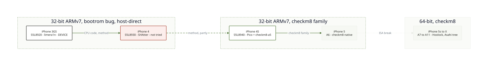

# 6. Support by chip

Trognon is built **bottom-up from the iPhone 3GS**, then widens one chip family at a time. This
page says, per family, what is known, how it boots, and what carries over from the neighbour.
Evidence tags as in the [index](README.md). Only the 3GS has been touched by us: everything about
the other families is **SOURCE** (read in our research notes) or **HYPOTHESIS**.

## Overlap at a glance

| | 3GS (S5L8920) | iPhone 4 (A4, S5L8930) | iPhone 4S (A5, S5L8940) | A6 (5, 5c) | A7 to A11 |
|---|---|---|---|---|---|
| Our status | **DEVICE**: code runs | not tried | not tried | not tried | not tried |
| CPU core | Cortex-A8 r2p1 (**DEVICE**, `MIDR`) | Cortex-A8 class (**HYPOTHESIS**, read `MIDR` first) | dual core, Cortex-A9 class (**HYPOTHESIS**) | 32-bit (**SOURCE**) | arm64 (**SOURCE**) |
| Instruction set | 32-bit ARMv7 | 32-bit ARMv7 | 32-bit ARMv7 | 32-bit ARMv7 | 64-bit: a different track |
| Boot exploit | limera1n (**DEVICE**) | SHAtter per ipwndfu (**SOURCE**) | checkm8-a5, needs a Pico (**SOURCE**) | checkm8, native over USB (**SOURCE**) | checkm8 (**SOURCE**) |
| Helper board | none | none | RP2040 Pico + OTG Y-cable | none | none |
| Boot method reusable? | the reference | yes: same shape (pwned DFU, patched iBSS, run) | partly: a staged loader instead of `run` (**HYPOTHESIS**) | partly | no: pongoOS, m1n1, Linux |
| CPU code, exception console | reusable between 3GS and A4 (**HYPOTHESIS**) | reusable | reusable if still ARMv7 (**HYPOTHESIS**) | reusable | not reusable (arm64) |
| Device addresses, display, iBSS | verified | **to redo** | **to redo** | **to redo** | **to redo** |
| Existing OS work | OpeniBoot/iDroid, dormant (**SOURCE**) | partial in OpeniBoot, dormant (**SOURCE**) | Project Cascadia on the iPad mini 1 (**SOURCE**) | none found (**SOURCE**) | Hoolock, Asahi tree, postmarketOS (**SOURCE**) |

What carries over is the *method* and the *CPU-level code*. What never carries over is every
address, the display path and the iBSS patch offsets: they are re-read on each chip (see
[code layout](07-code-layout.md)).

## iPhone 3GS, S5L8920: the reference (DEVICE)

- Pwned DFU with limera1n, patched iBSS, Recovery `run`, payload at `0x41000000`:
  [boot chain](01-boot-chain.md). Registers, display, GPIO and interrupt controllers:
  [hardware map](03-hardware-map.md). Exceptions: [console](02-exception-console.md).
- 320 x 480 screen, framebuffer `0x4fd00000`.
- Next rung of the [ladder](04-mods.md): interrupts and a timer.
- OpeniBoot/iDroid is the code we read for addresses, and it is dormant since 2022
  (**SOURCE**, [research](../research/2026-10-14-microkernel-3gs.md)).

## iPhone 4, A4 (S5L8930): the second bench (SOURCE, not tried)

- Same CPU family, so the CPU-level code should port with small changes (**HYPOTHESIS**).
- Exploit: our research found that `ipwndfu` dispatches **CPID 8930 to SHAtter**, not limera1n
  (**SOURCE**, [correction](../research/2026-10-14-pre-a5-limera1n.md)). Older write-ups list limera1n
  for A4 devices as well, so the two sources disagree: `ipwndfu -p` is the arbiter.
  Host-direct either way, no helper board.
- Addresses read in OpenIBoot's `plat-a4` (**SOURCE**, none checked on a phone): framebuffer
  `0x4F700000` or `0x5F700000` (two variants in its `clcd.h`), GPIO `0xBFA00000`,
  four interrupt controllers VIC0 to VIC3 at `0xBF200000`, `0xBF210000`, `0xBF220000`, `0xBF230000`.
  The screen is Retina, 640 x 960 (**HYPOTHESIS**, to confirm): the console font must scale.
- Units are in hand (several iPhone 4 for parts), so a test is cheap. **Success criterion:** a
  console on the screen with only `soc/s5l8930.h` written, nothing else changed. If it works, the
  per-chip split of the code is validated.
- `env_set`, the `run` mapping and every iBSS offset are specific to the 3GS image and must be found
  again in the A4 iBSS (**HYPOTHESIS**).

## iPhone 4S, A5 (S5L8940): the first different boot (SOURCE, not tried)

- Boot needs a **Pico running checkm8-a5** (RP2040 with a per-SoC UF2 and an OTG Y-cable; RP2350 does
  not work). SoC map: 8940 = iPhone 4S and iPad 2 (except iPad2,4) (**SOURCE**,
  [research](../research/2026-10-13-a5-a6-32bit.md)).
- Base: **Project Cascadia** runs mainline Linux 6.12 on the iPad mini 1 (S5L8942), with both cores,
  multitouch and Wi-Fi, booted from the host into RAM. Its path is primepwn, a patched iBSS, an
  `autogo` iBEC, a staging loader, then the kernel (**SOURCE**). No port exists for the 4S.
- The scoped first job is to move Cascadia from S5L8942 to S5L8940 (**SOURCE**, research note).
- Overlap with the 3GS: both are 32-bit and tethered, but the exploit, the helper board and the
  loader chain differ. Our bare-metal payload method may carry over; the boot command may not
  (**HYPOTHESIS**).

## A6 (iPhone 5, 5c): next door to the A5 (SOURCE)

- checkm8 runs natively in `ipwndfu` over plain USB (less reliable from Linux hosts). Tools listed:
  ipwnder32, ipwnder_lite, gaster, primepwn. The iPad 4 (A6X) is Cascadia's stated roadmap
  (**SOURCE**). Nothing known for the iPhone 5 or 5c.

## A7 to A11 (iPhone 5s to X): a different track (SOURCE)

- 64-bit. Device trees for all of them are in mainline Linux since 6.13 (boot framebuffer, buttons,
  brightness, and on A11 internal NVMe). No real display driver, Wi-Fi, audio, camera, GPU or touch.
- Boot: checkm8, then pongoOS, then m1n1, then Linux. Downstream: Hoolock Linux; also postmarketOS
  `apple-idevice`. Tethered.
- Trognon's rule here is to **contribute upstream, not fork**
  ([research](../research/2026-10-13-a7-a11-mainline.md)). Our 32-bit code does not apply; what carries
  over is the documentation method and the idea of per-device evidence.

## Order of work

1. 3GS: finish the interrupt rung (in progress).
2. iPhone 4: prove the per-chip split with a second bench.
3. iPhone 4S: Pico, then Cascadia's path on S5L8940.
4. The rest follows the upstream projects already working there.
