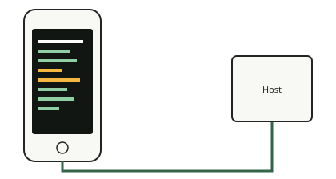

<!-- generated by tools/journey_build.py from docs/journey-src/first-pixel.yaml: do not edit -->

You are exploring: [A 3GS in a drawer](start.md) → [The phone listens: DFU mode](dfu.md) → [Signature checks are off](pwned.md) → [A patched boot stage](ibss.md) → [Our code arrives](payload.md) → [Proof that it ran](proof.md) → [The first pixel](pixel.md) → **A crash you can read**

# A crash you can read

{ .journey-visual }

*A crash ends as a readable dump, not a reboot.*

How sure we are: DEVICE

The phone has no serial port we can reach and no debugger, so a crash would only reboot it. The console hooks the
processor's exception vectors, so an undefined instruction, a data abort, a prefetch abort or an interrupt ends in
a readable dump on the screen, then in a clean return. These four cases were observed on the phone.

## Where to next?

- [Go to the edge of what we knowWhere our knowledge stops](frontier.md)

Proof and reference

**Go deeper in the reference:** [The on-screen exception console](../../en/02-exception-console.md)

**Evidence:** [`20261015T050540Z-trace`](https://github.com/SebE585/trognon/tree/main/evidence/20261015T050540Z-trace) · [`20261015T050541Z-trace_irq`](https://github.com/SebE585/trognon/tree/main/evidence/20261015T050541Z-trace_irq)

[← Previous step](pixel.md) · [Map of the journey](index.md) · [Reference manual](../README.md)

