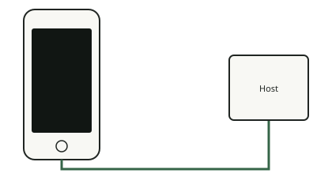

<!-- generated by tools/journey_build.py from docs/journey-src/first-pixel.yaml: do not edit -->

You are exploring: [A 3GS in a drawer](start.md) → **The phone listens: DFU mode**

# The phone listens: DFU mode

{ .journey-visual }

*Black screen. The phone answers over USB all the same.*

How sure we are: DEVICE

In DFU mode the phone's boot ROM waits for an image over USB instead of starting its system. The ROM of the 3GS
(S5L8920) has a known flaw, called limera1n, that lets a host turn the signature checks off. The exploit fails some of
the time and is simply repeated; no helper board is needed.

## Where to next?

- [Use the flawSee what the exploit gives us](pwned.md)
- [Check what will survive a power-offUnderstand why the boot is tethered](persist.md)

Proof and reference

**Go deeper in the reference:** [Boot chain](../../en/01-boot-chain.md)

**Evidence:** [`20261015T050540Z-trace`](https://github.com/SebE585/trognon/tree/main/evidence/20261015T050540Z-trace)

[← Previous step](start.md) · [Map of the journey](index.md) · [Reference manual](../README.md)

