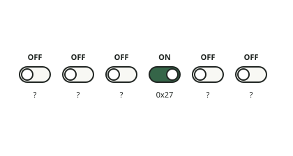

<!-- generated by tools/journey_build.py from docs/journey-src/first-pixel.yaml: do not edit -->

You are exploring: [A 3GS in a drawer](start.md) → [The phone listens: DFU mode](dfu.md) → [Signature checks are off](pwned.md) → [A patched boot stage](ibss.md) → [Our code arrives](payload.md) → [Proof that it ran](proof.md) → [The first pixel](pixel.md) → [A crash you can read](crash.md) → [Here our knowledge stops](frontier.md) → [Wi-Fi: the coprocessor has not been started](f-wifi.md) → **The False Gate**

# The False Gate

<figure class="journey-figure" markdown="1">
{ .journey-visual }
<figcaption>A row of switches with unreliable labels. One is on; whose is it?</figcaption>
</figure>

Imagine a row of switches with unreliable labels. Inside the phone, a *clock gate* is such a switch: it lets the timing
signal reach a block of the phone, or cuts it off. Finding a switch turned on is not enough: we still need to establish
which block it belongs to.

This replays a real correction, made on 16 October 2026, with a guide who has been wrong before, and says so. The
question: was the clock of the Wi-Fi coprocessor (where the [Whisperer](../bestiary.md#the-whisperer) sleeps) already
running? Two sheets carry the same number, `0x27`.

- **Sheet 1, the map: the device tree.** A description of the phone's blocks, carried by the phone's own software. Its
  entry for the coprocessor lists a clock-gate value of `0x27`.
- **Sheet 2, the trace: a capture.** Our own code read the phone's list of gates (the gate array) at position `0x27` and
  got `0xF`, which we read as "on". This was observed on the phone.

Someone linked the two: *"coprocessor's clock already on?"* The question mark is small; everything else about it sounds
certain.

## Where to next?

- [Start from the mapSheet 1 first: what the device tree says](fg-map.md)
- [Start from the traceSheet 2 first: what the phone answered](fg-trace.md)
- [Back to the Wi-Fi questionReturn to the Wi-Fi page](f-wifi.md)

[← Previous step](f-wifi.md) · [Map of the journey](index.md) · [Reference manual](../README.md)

