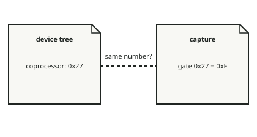

<!-- generated by tools/journey_build.py from docs/journey-src/first-pixel.yaml: do not edit -->

You are exploring: [A 3GS in a drawer](start.md) → [The phone listens: DFU mode](dfu.md) → [Signature checks are off](pwned.md) → [A patched boot stage](ibss.md) → [Our code arrives](payload.md) → [Proof that it ran](proof.md) → [The first pixel](pixel.md) → [A crash you can read](crash.md) → [Here our knowledge stops](frontier.md) → [Wi-Fi: the coprocessor has not been started](f-wifi.md) → [The False Gate](fg-intro.md) → **Following the map**

# Following the map

<figure class="journey-figure" markdown="1">
{ .journey-visual }
<figcaption>Two sheets, one number. Nothing yet says they count the same way.</figcaption>
</figure>

How sure we are: DEVICE

The device tree is the phone's own description of itself. If it says the coprocessor's gate is `0x27`, then `0x27` is
a reasonable place to look. That is why the link looked plausible.

Then sheet 2: reading the gate array at `0x27` returned `0xF`. Side by side, the two sheets seem to say the same thing:
the gate of the coprocessor is on.

One detail is easy to miss. Both sheets use the same number. Nothing, so far, says they count gates the same way.

## Where to next?

- [Draw a conclusionState what you think this shows](fg-conclude.md)

Proof and reference

**Evidence:** [`20261016T094945Z-trace_iop_clkgate`](https://github.com/SebE585/trognon/tree/main/evidence/20261016T094945Z-trace_iop_clkgate)

[← Previous step](fg-intro.md) · [Map of the journey](index.md) · [Reference manual](../README.md)

