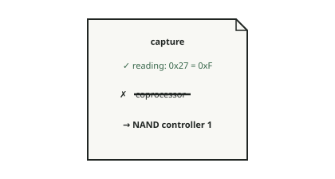

<!-- generated by tools/journey_build.py from docs/journey-src/first-pixel.yaml: do not edit -->

You are exploring: [A 3GS in a drawer](start.md) → [The phone listens: DFU mode](dfu.md) → [Signature checks are off](pwned.md) → [A patched boot stage](ibss.md) → [Our code arrives](payload.md) → [Proof that it ran](proof.md) → [The first pixel](pixel.md) → [A crash you can read](crash.md) → [Here our knowledge stops](frontier.md) → [Wi-Fi: the coprocessor has not been started](f-wifi.md) → [The False Gate](fg-intro.md) → [Following the map](fg-map.md) → [What do you conclude?](fg-conclude.md) → [You linked the two sheets](fg-adopted.md) → [What the boot stage does with gate 0x27](fg-reveal.md) → **The reading stands, the label does not**

# The reading stands, the label does not

<figure class="journey-figure" markdown="1">
{ .journey-visual }
<figcaption>The reading stays. The label “coprocessor” is struck out.</figcaption>
</figure>

How sure we are: SOURCE

The guide lays the two sheets side by side.

*"Same number. We had not checked that it was the same numbering."*

The reading stands: gate `0x27` of the physical gate array, value `0xF`, read as on. The label does not: on both
sources, that gate is the NAND controller's, and nothing here shows that it also feeds the coprocessor. The guide strikes
out "coprocessor" on the capture's reading only, not on the device tree.

The guide does not correct the phone. The guide corrects what we concluded from its answer.

*"And the `0x27` on the other sheet?"* It is still there. Whether the device tree uses another numbering that happens
to give `0x27`, or contains an error, is not shown. Either way, the Wi-Fi does not work yet, and the clock state of the
coprocessor remains unknown.

## Where to next?

- [Why the old line staysWhat a closed lead leaves behind](fg-after.md)

Proof and reference

**Go deeper in the reference:** [Hardware map: Wi-Fi and SDIO](../../en/03-hardware-map.md#wi-fi-and-sdio)

[← Previous step](fg-reveal.md) · [Map of the journey](index.md) · [Reference manual](../README.md)

