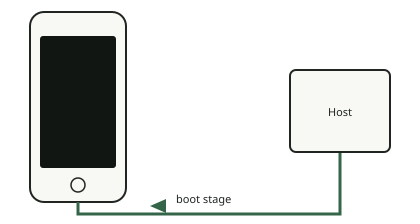

<!-- generated by tools/journey_build.py from docs/journey-src/first-pixel.yaml: do not edit -->

You are exploring: [A 3GS in a drawer](start.md) → [The phone listens: DFU mode](dfu.md) → [Signature checks are off](pwned.md) → **A patched boot stage**

# A patched boot stage

{ .journey-visual }

*The patched boot stage travels over USB.*

How sure we are: DEVICE

We send the phone's own boot stage (the iBSS), decrypted with the device's own key and patched so that the Recovery
command `run` jumps to our code. No Apple firmware is stored in this repository: it is taken from the owner's own phone.
The device then re-enumerates over USB as a Recovery device.

## Where to next?

- [Bring in our own codeHow it gets into the phone's memory](payload.md)

Proof and reference

**Go deeper in the reference:** [Boot chain: patched iBSS](../../en/01-boot-chain.md#the-path-device-2026-10-1415)

**Evidence:** [`20261015T050540Z-trace`](https://github.com/SebE585/trognon/tree/main/evidence/20261015T050540Z-trace)

[← Previous step](pwned.md) · [Map of the journey](index.md) · [Reference manual](../README.md)

