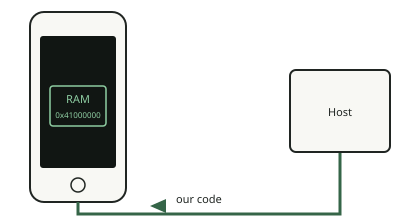

<!-- generated by tools/journey_build.py from docs/journey-src/first-pixel.yaml: do not edit -->

You are exploring: [A 3GS in a drawer](start.md) → [The phone listens: DFU mode](dfu.md) → [Signature checks are off](pwned.md) → [A patched boot stage](ibss.md) → **Our code arrives**

# Our code arrives

<figure class="journey-figure" markdown="1">
{ .journey-visual }
<figcaption>Our code lands in RAM, at 0x41000000.</figcaption>
</figure>

How sure we are: DEVICE

`send_data` copies raw Thumb code to `0x41000000` and `run` jumps to it. The code starts with the MMU and caches on, in
supervisor mode, with interrupts not masked.

## Where to next?

- [Make sure it really ranThe marker and the nonce](proof.md)
- [Check what will survive a power-offUnderstand why the boot is tethered](persist.md)

Proof and reference

**Go deeper in the reference:** [Boot chain: payload](../../en/01-boot-chain.md#the-path-device-2026-10-1415) · [Memory layout used by the payloads](../../en/02-exception-console.md#memory-layout-used-by-the-payloads-device)

**Evidence:** [`20261015T050540Z-trace`](https://github.com/SebE585/trognon/tree/main/evidence/20261015T050540Z-trace)

[← Previous step](ibss.md) · [Map of the journey](index.md) · [Reference manual](../README.md)

