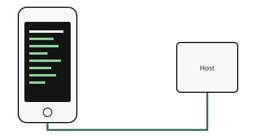

<!-- generated by tools/journey_build.py from docs/journey-src/first-pixel.yaml: do not edit -->

You are exploring: [A 3GS in a drawer](start.md) → [The phone listens: DFU mode](dfu.md) → [Signature checks are off](pwned.md) → [A patched boot stage](ibss.md) → [Our code arrives](payload.md) → [Proof that it ran](proof.md) → **The first pixel**

# The first pixel

{ .journey-visual }

*The screen shows what the code draws.*

How sure we are: DEVICE

The screen is a framebuffer at `0x4fd00000`, 320 by 480 pixels. The display controller was already set up by the boot
stage, so our code only draws. Because the framebuffer is write-back, the code cleans the data cache after drawing, so
that a frozen processor still leaves a truthful screen.

*The console, rebuilt from the payload's own buffer (not a photograph).*

## Where to next?

- [Break something on purposeWhat a crash looks like](crash.md)

Proof and reference

**Go deeper in the reference:** [Hardware map: display](../../en/03-hardware-map.md#display)

**Evidence:** [`20261015T050542Z-trace_regs`](https://github.com/SebE585/trognon/tree/main/evidence/20261015T050542Z-trace_regs) · [`20261015T050540Z-trace`](https://github.com/SebE585/trognon/tree/main/evidence/20261015T050540Z-trace)

[← Previous step](proof.md) · [Map of the journey](index.md) · [Reference manual](../README.md)

