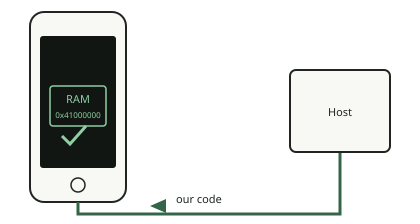

<!-- generated by tools/journey_build.py from docs/journey-src/first-pixel.yaml: do not edit -->

You are exploring: [A 3GS in a drawer](start.md) → [The phone listens: DFU mode](dfu.md) → [Signature checks are off](pwned.md) → [A patched boot stage](ibss.md) → [Our code arrives](payload.md) → **Proof that it ran**

# Proof that it ran

{ .journey-visual }

*The marker comes back with the same nonce.*

How sure we are: DEVICE

The code publishes a marker in a variable of the boot stage and the host reads it back. There is a trap: the boot stage
keeps its variables between runs, so a stale value can look like a result. Trognon therefore appends a random
32-bit number (a nonce) to every binary and writes an evidence folder only when the number comes back identical.

## Where to next?

- [Ask for something to seeDraw on the screen](pixel.md)

Proof and reference

**Go deeper in the reference:** [Evidence: how a bundle is made](../../en/08-evidence.md)

**Evidence:** [`20261015T050540Z-trace`](https://github.com/SebE585/trognon/tree/main/evidence/20261015T050540Z-trace)

[← Previous step](payload.md) · [Map of the journey](index.md) · [Reference manual](../README.md)

