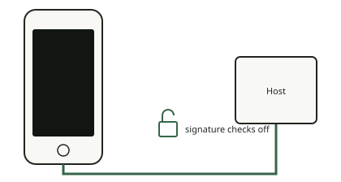

<!-- generated by tools/journey_build.py from docs/journey-src/first-pixel.yaml: do not edit -->

You are exploring: [A 3GS in a drawer](start.md) → [The phone listens: DFU mode](dfu.md) → **Signature checks are off**

# Signature checks are off

<figure class="journey-figure" markdown="1">
{ .journey-visual }
<figcaption>Signature checks off: the phone accepts code Apple did not sign.</figcaption>
</figure>

How sure we are: DEVICE

After the exploit the boot ROM accepts an image that Apple did not sign. This state is called a pwned DFU. The tool
is `ipwndfu`, used as it is; the exploit itself is not ours.

## Where to next?

- [Send something it will runThe patched boot stage](ibss.md)

Proof and reference

**Go deeper in the reference:** [Boot chain: the path](../../en/01-boot-chain.md#the-path-device-2026-10-1415)

**Evidence:** [`20261015T050540Z-trace`](https://github.com/SebE585/trognon/tree/main/evidence/20261015T050540Z-trace)

[← Previous step](dfu.md) · [Map of the journey](index.md) · [Reference manual](../README.md)

