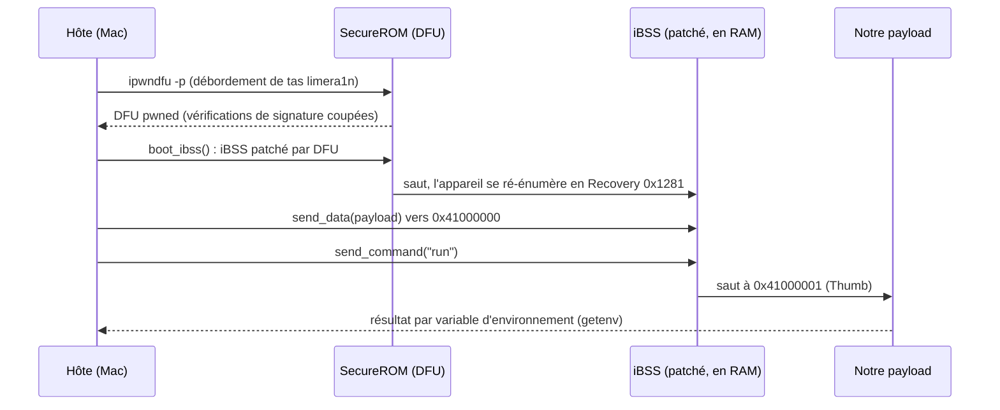

# 1. Chaîne de démarrage : du DFU à notre code

Objectif : exécuter du code écrit par nous sur un 3GS, sans rien écrire dans le stockage du téléphone.

## Le chemin (DEVICE, 2026-10-14/15)




1. **DFU pwned.** La bootrom du 3GS S5L8920 est vulnérable à limera1n. Hôte direct, sans carte
   auxiliaire. L'exploit échoue de temps en temps et se relance simplement.
2. **iBSS patché.** `boot_ibss()` d'ipwndfu envoie un iBSS déchiffré avec la clé de l'appareil et
   patché pour que la commande Recovery `run` saute à `0x41000001`. La commande `go` n'est pas utilisée.
3. **Payload.** `send_data` copie du Thumb brut en `0x41000000`, `run` y saute. État d'entrée : MMU
   et caches actifs, vecteurs en VA 0 (l'image iBSS à `0x84000000`), mode SVC,
   `SCTLR = 0x00C5187D`, IRQ non masquées.
4. **Canal de retour.** Le payload appelle `env_set()` interne de l'iBSS (`0x84011799`, Thumb) pour
   publier un marqueur, relu avec `getenv`. **Piège :** l'iBSS garde la variable d'un run à l'autre.
   La lire vide *avant* le run, sinon une valeur périmée ne prouve rien
   (voir les [notes de terrain](05-field-notes.md)).

## Ce qui ne persiste pas

Rien. L'exploit bootrom et le payload en RAM disparaissent au redémarrage (un logo signifie que
l'appareil a quitté la Recovery et doit être remis en DFU). C'est un démarrage captif. Le rendre
autonome sur ce SoC est une **HYPOTHESIS** : voir
[`../research/2026-10-13-untethered-boot.md`](../research/2026-10-13-untethered-boot.md).

## Reproduire

Mise en place unique, avec la version épinglée et le correctif gardés dans ce dépôt
([`tools/ipwndfu/README.md`](https://github.com/SebE585/trognon/blob/main/tools/ipwndfu/README.md)) :
ipwndfu au commit `0e28932`, plus `tools/ipwndfu/python3-arm64.patch` (un portage Python 3 et un chemin
libusb surchargeable, GPL-3.0 comme ipwndfu). Ensuite :

```sh
tools/boot.sh                               # appareil en DFU : le pwn, puis l'iBSS patché (Recovery)
tools/send.sh tools/payloads/trace.bin      # envoie un payload, puis vérifie son nonce
```

`tools/boot.sh` refuse de tourner si ipwndfu n'est pas au commit épinglé avec le correctif appliqué.
`tools/send.sh` ajoute un nonce aléatoire de 32 bits au binaire, le payload le republie et le script le
confirme (code de sortie 3 et `NONCE NOT CONFIRMED` sinon). Il affiche aussi le SHA-256 du binaire et ajoute
le résultat à `~/trognon-runs.log`. Un run n'est prouvé que lorsque le nonce revient.
