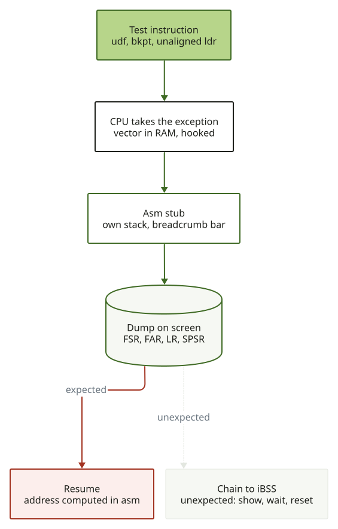

# 2. La console d'exceptions à l'écran

Le 3GS n'a pas de port série accessible ni de débogueur. Quand notre code plante, le téléphone
redémarre sans rien dire. La première chose construite est donc un moyen de *voir*.

## Plan mémoire des payloads (DEVICE)

| Quoi | Adresse | Notes |
|---|---|---|
| Code du payload | `0x41000000` | Thumb, chargé par `send_data` |
| Structure scratch | `0x41080000` | non remise à zéro : la RAM garde les valeurs du payload précédent |
| Sommet de pile des gestionnaires | `0x410f8000` | pile propre aux modes d'exception |
| Framebuffer | `0x4fd00000` | 320x480, RGB888 `0x00RRGGBB`, mappé cachable write-back |
| Page des vecteurs | VA `0x0` | = image iBSS `0x84000000` |

Le framebuffer est en write-back : après dessin on nettoie le cache de données, pour qu'un CPU gelé
laisse un écran fidèle. **Ne jamais lire le framebuffer** (donc pas de défilement).

## Accrocher les vecteurs

Chaque vecteur est `ldr pc,[pc,#0x18]` via un mot pointeur : undef `0x24`, SWI `0x28`, prefetch
abort `0x2c`, data abort `0x30`, IRQ `0x38`, FIQ `0x3c`. On écrase les mots en RAM et on les
restaure à la fin. Undef, prefetch et data sont prouvés sur l'appareil ; les décalages SWI, IRQ
et FIQ suivent la même disposition (**SOURCE**).



La *barre-témoin* (une barre colorée en bas : rouge undef, verte prefetch, bleue data) est dessinée
par de l'assembleur sans pile ni C : même un plantage dans le gestionnaire montre quelle exception
a été prise.

## Ce qui est prouvé (DEVICE, 2026-10-15)

| Exception | Déclencheur | Observé |
|---|---|---|
| UNDEF | `udf #0` Thumb | `LR` = adresse de l'`udf` + 2, `SPSR` avec T=1, retour propre |
| Data abort | `SCTLR.A` armé, `ldr` non aligné | `FSR = 0x1` (alignement), `FAR` = l'adresse fautive, retour propre |
| Prefetch abort | `bkpt #0` Thumb | `IFSR = 0x2` (debug event), `LR` = bkpt + 4, retour propre |
| IRQ | VIC0 `SOFTINT`, source 0, IRQ démasquées | gestionnaire pris une fois (`HITS 1`, `STRAY 0`), `STATUS = 1` vu dedans, interruption acquittée et effacée, retour avec CPSR restauré, activations de l'iBSS revenues (`0x3FFA4040`) |

`IFAR` après un debug event est UNKNOWN selon l'architecture : on ne s'en sert pas. Non testés :
FIQ, SWI. Un `svc` depuis le mode SVC écraserait `SP_svc`/`LR_svc`, donc le test SWI demande
le mode SYS (**HYPOTHESIS**).

## Le test d'IRQ (DEVICE, 2026-10-15)

L'iBSS laisse 14 sources de VIC0 activées et les IRQ démasquées : une interruption parasite pourrait tomber dans
notre gestionnaire à tout moment. Le test (1) masque les IRQ, (2) sauvegarde `ENABLE` de VIC0 et le vide, (3) accroche
le vecteur IRQ, (4) active une source libre (bit 0) et la lève avec `SOFTINT`, (5) démasque et attend notre
gestionnaire, qui acquitte (lecture de `VICADDRESS`), efface l'interruption logicielle et l'activation, puis signale
la fin d'interruption, (6) décroche le vecteur **avant** de restaurer les activations de l'iBSS, puis restaure le masque CPU.
Lu à l'écran : `RAW = STAT = 1` juste après l'écriture de `SOFTINT`, puis `RAW2 = STAT2 = 0` et `EN BCK = 0x3FFA4040`.
`VICADDRESS` a relu `0` pour la source 0 (cohérent avec la convention « la source n a l'adresse de vecteur n »,
**HYPOTHESIS**).

## Pourquoi un défaut d'alignement

La table de pages vivante n'a aucune entrée de faute de traduction (toutes les sections 1..0xfff
sont mappées) et toutes les sections sont en domaine 0 avec `DACR = 3` : ni entrée « fault » ni
domain fault n'était disponible (DEVICE). Un défaut d'alignement est levé avant tout accès au bus :
le test ne touche à rien.

## Reproduire

```sh
cd tools/payloads
make trace.bin trace_pabt.bin trace_irq.bin   # arm-none-eabi-gcc, Thumb
python3 -I render_fb.py trace.bin trace.png   # rendu hors ligne avec Unicorn
```

Limites de l'émulation : Unicorn ne modélise ni `FSR`, `FAR`, `IFSR`, `SCTLR.A`, ni `DACR`. Les
fautes sont simulées par des adresses non mappées : seul le flux de contrôle est vérifié.
