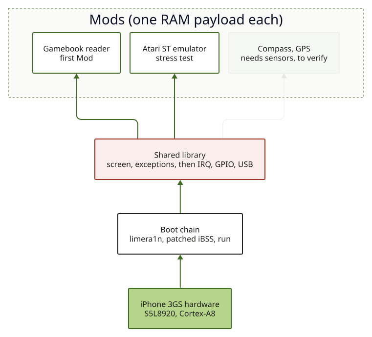

# 4. Mods : construire l'OS un cas d'usage à la fois

**Statut : proposition de conception (HYPOTHESIS). Rien de ceci n'est construit.**

## L'idée

Au lieu d'écrire d'abord un système d'exploitation, écrire de petits programmes autonomes, les
**Mods**, chacun utile seul. Chaque Mod a besoin de capacités (afficher du texte, lire un bouton,
tenir l'heure...). Chaque fois qu'un Mod réclame une capacité absente, on écrit ce pilote, une fois,
dans une bibliothèque partagée. Après quelques Mods, la bibliothèque *est* l'OS, façonné par l'usage
réel plutôt que deviné d'avance.

Cela colle aux contraintes trouvées :

- Le démarrage est **captif** : chaque run envoie déjà un payload RAM par USB. Un Mod est exactement
  cette unité. Pas d'installeur, rien d'écrit dans le téléphone.
- Chaque pilote est prouvé sur l'appareil avant le suivant (la méthode de la
  [console d'exceptions](02-exception-console.md)).
- Le projet reste agnostique en OS : les Mods sont une piste ; démarrer Linux ou un BSD sur A5+ en
  est une autre, et les deux reposent sur la même chaîne de démarrage et la même carte matérielle.

## Échelle de capacités

## Mods candidats

| Mod | Besoins | Pourquoi c'est un bon test |
|---|---|---|
| **Liseuse de livre-jeu** (Markdown, livre dont vous êtes le héros) | L1, L4, L5 | Barre la plus basse : texte, deux boutons, contenu poussé par USB. Premier Mod utile. |
| **Jeu façon Barcode Battler** | L1, L4, L5 | Même pile, ajoute la logique de jeu. Un exemple parmi d'autres, pas le but du projet. |
| **Émulateur Atari ST** | L1, L3 (temps), L4, L5, L6 | Sollicite CPU, affichage et temps. Un cœur de classe 600 MHz est plausible pour un 68000 à 8 MHz (**HYPOTHESIS**). |
| **Boussole / mouvement** | L1, L6 (capteurs I2C) | Demande le câblage du magnétomètre et de l'accéléromètre du 3GS (**à vérifier**, pas encore lu). |
| **Gadget GPS** | L1, L6 | Sur cette génération le GPS est probablement derrière le baseband : possiblement très dur (**à vérifier**). |

## Limites

- Un Mod n'est pas résident : il est envoyé à chaque démarrage. Un gadget de terrain (boussole en
  poche) demande un démarrage autonome, question ouverte
  ([note de recherche](../research/2026-10-13-untethered-boot.md)).
- Un Mod à la fois, sans isolation ni multitâche : une bibliothèque de type unikernel, pas un OS
  généraliste. Suffisant tant qu'un Mod n'exige pas plus.
- Le tactile et les radios sont les barreaux chers. L'échelle est ordonnée pour que des Mods utiles
  existent avant d'en avoir besoin.

## Portabilité entre puces

Un Mod appelle la bibliothèque partagée et ne voit jamais une adresse. Les adresses vivent dans un
fichier de constantes par puce (`soc/<puce>.h`, voir l'[organisation du code](07-code-layout.md)), donc
un Mod tourne sur toute puce qui a un fichier vérifié, et nulle part ailleurs (**HYPOTHESIS**, rien ne
le prouve encore sur une deuxième puce).

## Règle pour ajouter un pilote

Un pilote entre dans la bibliothèque partagée seulement avec (1) les adresses de registres lues sur
l'appareil, (2) un Mod qui l'utilise, (3) l'étiquette de preuve de l'[index](README.md).
