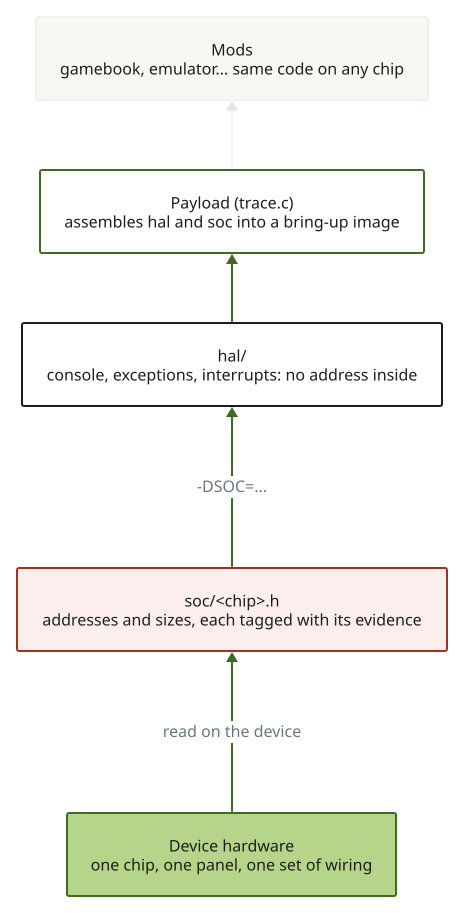

# 7. Code modulaire

**Statut : fait pour les payloads du 3GS (2026-10-15).** Ils sont partis d'un seul fichier, `tools/payloads/trace.c`,
avec les adresses du 3GS écrites en dur, ce qui ne survit pas à une deuxième puce. Le code est maintenant découpé en
`hal/` (portable), `soc/` (constantes par puce) et `trace.c` (le payload). La vérification de non-régression est un
rendu émulé de chaque étape, identique avant et après le découpage (EMU), puis `trace.bin` construit depuis le
code découpé a tourné sur le téléphone et a affiché le même écran qu'avant (**DEVICE**, 2026-10-15). L'en-tête A4 existe mais est volontairement inutilisable tant qu'il n'est pas vérifié.



## Les couches

| Couche | Chemin | Contient | Ne contient pas |
|---|---|---|---|
| **HAL** | `tools/payloads/hal/` | console (texte à l'écran), `exc` (gestionnaires d'exceptions), `vic` (interruptions). Code ARMv7 / Cortex-A8 portable. | **aucune adresse** |
| **Constantes SoC** | `tools/payloads/soc/s5l8920.h` | les adresses, tailles et masques du 3GS, chaque ligne avec son étiquette de preuve | de la logique |
| | `tools/payloads/soc/s5l8930.h` | les constantes de l'A4, **SOURCE seulement** (lues dans OpeniBoot, jamais sur un téléphone) | de la logique |
| **Sélecteur** | `tools/payloads/soc.h` | choisit l'en-tête selon `-DSOC_<NOM>` (`make SOC=s5l8920`) | |
| **Payload** | `tools/payloads/trace.c` | l'image de mise en route : assemble HAL et constantes SoC | de chiffre propre à une puce |

Le HAL demande à `soc.h` des choses comme « où est le framebuffer » et « où est le contrôleur
d'interruptions ». Il n'écrit jamais un chiffre lui-même : le même code HAL se compile donc pour toute puce
qui a un fichier de constantes.

## Les règles

1. **Une constante entre dans `soc/<puce>.h` avec une étiquette de preuve.** `DEVICE` seulement si elle a
   été lue sur un téléphone (voir l'[index](README.md)) ; sinon `SOURCE` ou `HYPOTHESIS`.
2. **Un en-tête non vérifié ne se compile pas par défaut.** `s5l8930.h` ne contient que des valeurs
   **SOURCE**, donc le construire est refusé sauf avec `ALLOW_UNVERIFIED=1`. Une réussite silencieuse sur
   une puce non testée est la panne que ce projet craint le plus ([notes de terrain](05-field-notes.md)).
3. **Une nouvelle puce veut dire un nouveau `soc/<puce>.h`, revérifié constante par constante sur
   l'appareil. Cela ne veut pas dire une réécriture.** Si le HAL a besoin d'un `if` propre à une puce,
   c'est une constante manquante, pas un nouveau chemin de code.
4. **Tout ce qui n'est pas une adresse mais change quand même d'une puce à l'autre** (les offsets de patch
   de l'iBSS, l'adresse d'`env_set`) va aussi dans le fichier de constantes, pas dans le HAL.

## Ce que ça apporte

- Le [banc iPhone 4](06-chips.md) devient « écrire `s5l8930.h`, construire avec `ALLOW_UNVERIFIED=1`, lire
  l'écran ». Si une console apparaît sans rien changer d'autre, le découpage est validé.
- Les [Mods](04-mods.md) restent portables : ils appellent le HAL et ne voient jamais une adresse, donc un
  Mod peut tourner sur toute puce qui a un fichier de constantes vérifié.
- Relire le portage d'une puce, c'est relire un petit en-tête.

## Construire

```sh
cd tools/payloads
make trace.bin                           # puce par défaut : le 3GS
make trace.bin SOC=s5l8930 ALLOW_UNVERIFIED=1   # forme cible, A4 : non vérifié, attendez-vous à corriger des constantes
```

Le build d'une puce non vérifiée s'arrête sur un `#error` ; avec `ALLOW_UNVERIFIED=1` il échoue ensuite sur
chaque constante à trouver (`SOC_SCRATCH`, `SOC_ENV_SET`...), ce qui est la liste de tâches honnête.
