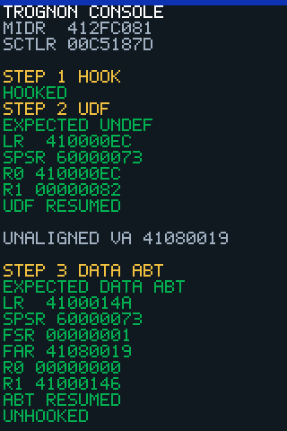

<div class="home-hero" markdown>

<div class="home-hero__text" markdown>

# Trognon

**Un téléphone oublié dans un tiroir, qui exécute du code que nous avons écrit.** Rétro-ingénierie ouverte de
l'iPhone 3GS, documentée jusqu'au registre, chaque affirmation étant marquée selon la façon dont nous la connaissons : observée sur le téléphone, lue dans le code, ou supposée.

[Comprendre le projet](01-boot-chain.md){ .md-button .md-button--primary }
[Explorer le matériel](03-hardware-map.md){ .md-button }
[Suivre le parcours guidé](journey/start.md){ .md-button }

[English documentation](../en/README.md) · [Code source](https://github.com/SebE585/trognon)

</div>

<figure class="phone" markdown>

<figcaption>La console d'exceptions, telle que l'écran du téléphone l'affiche. Reconstituée depuis le tampon
de console du payload, <strong>pas une photographie</strong>.</figcaption>
</figure>

</div>

## Ce qui fonctionne aujourd'hui

Tout ce qui suit a été observé sur un vrai iPhone 3GS (S5L8920, Cortex-A8) ; chaque élément renvoie à sa page, et
les [Preuves](08-evidence.md) relient chaque affirmation à une exécution.

<div class="grid cards" markdown>

- **Notre code s'exécute depuis le DFU**

    La chaîne de démarrage n'écrit rien dans le stockage du téléphone.

    <span class="tag tag-device">DEVICE</span> [Chaîne de démarrage](01-boot-chain.md){ .card-link }

- **Il dessine et survit aux plantages**

    Du texte à l'écran ; trois types d'exceptions CPU attrapées et affichées lisiblement.

    <span class="tag tag-device">DEVICE</span> [Console d'exceptions](02-exception-console.md){ .card-link }

- **Interruptions, horloge et boutons**

    Une interruption logicielle prise, un tick à 24 MHz, cinq boutons repérés par GPIO.

    <span class="tag tag-device">DEVICE</span> [Carte matérielle](03-hardware-map.md#controleurs-dinterruptions){ .card-link }

- **Un accéléromètre qui répond**

    Alimenté, axes lus dans plusieurs positions, environ 56 comptes par g.

    <span class="tag tag-device">DEVICE</span> [Accéléromètre](03-hardware-map.md#accelerometre){ .card-link }

- **Une puce NAND identifiée**

    Toshiba, lue sur deux lignes de sélection ; pas encore d'accès aux pages.

    <span class="tag tag-device">DEVICE</span> [NAND](03-hardware-map.md#nand){ .card-link }

- **Pas encore : tactile, Wi-Fi, stockage**

    En cours d'élucidation, voir plus bas.

    <span class="tag tag-hyp">HYPOTHESIS</span> [Recherche](../research/index.md){ .card-link }

</div>

## Par où commencer

<div class="grid cards" markdown>

- { .card-icon } **Comprendre**

    Du DFU à notre code en RAM, et ce qu'est chaque étape.

    [Chaîne de démarrage](01-boot-chain.md){ .card-link }

- { .card-icon } **Explorer les composants**

    Quels registres et quelles puces sont vérifiés, lesquels ne le sont pas.

    [Carte matérielle](03-hardware-map.md){ .card-link }

- { .card-icon } **Reproduire**

    La commande exacte, le commit et la sortie brute derrière chaque affirmation.

    [Preuves](08-evidence.md){ .card-link }

</div>

## Reproduire une exécution

Une fois la mise en place unique de la [Chaîne de démarrage](01-boot-chain.md#reproduire) faite et le téléphone en mode DFU :

```sh
make -C tools/payloads trace.bin        # compile le payload de la console d'exceptions (arm-none-eabi-gcc)
tools/go.sh tools/payloads/trace.bin    # pwn, envoi, lecture des variables, dossier de preuve
```

L'écran affiche la console ci-dessus, et `evidence/` gagne un dossier daté avec l'empreinte du payload, le commit et
la sortie brute. Les payloads qui **écrivent** dans des registres matériels sont décrits, avec leurs gardes, sur la
[carte matérielle](03-hardware-map.md) ; lisez un payload avant de l'exécuter.

## Recherche en cours

- **Contrôleur tactile.** Sa ligne de reset et sa séquence d'alimentation ont été observées sur l'appareil ; aucun octet n'a encore été échangé avec lui. La recette de transfert du contrôleur SPI est en cours d'établissement.
- **Wi-Fi et coprocesseur.** La séquence de démarrage du coprocesseur impliqué dans le chemin SDIO et Wi-Fi a été lue dans le firmware ; ce coprocesseur ne tourne pas encore, et son rôle dans la chaîne Wi-Fi n'est pas établi.

Les notes datées sont dans l'[index de la recherche](../research/index.md).

## Lire le reste

1. [Chaîne de démarrage : du DFU à notre code](01-boot-chain.md)
2. [La console d'exceptions à l'écran](02-exception-console.md)
3. [Carte matérielle : ce qui est vérifié](03-hardware-map.md)
4. [Mods : construire l'OS un cas d'usage à la fois](04-mods.md)
5. [Notes de terrain : ce qui échoue et comment le voir](05-field-notes.md)
6. [Support par puce : 3GS, 4, 4S, puis le reste](06-chips.md)
7. [Code modulaire](07-code-layout.md)
8. [Preuves : des affirmations aux exécutions reproductibles](08-evidence.md)

Anciennes notes de travail (mêlées au journal) : [`../architecture.md`](../architecture.md).

## Lire les preuves

| Étiquette | Sens |
|---|---|
| <span class="tag tag-device">DEVICE</span> | Observé sur un vrai iPhone 3GS (lu à l'écran ou par USB). |
| <span class="tag tag-emu">EMU</span> | Vu seulement dans notre émulation hors ligne (Unicorn). Prouve la logique, pas le matériel. |
| <span class="tag tag-source">SOURCE</span> | Lu dans OpenIBoot ou dans un désassemblage, pas encore vérifié sur l'appareil. |
| <span class="tag tag-hyp">HYPOTHESIS</span> | Un plan ou une supposition. Ne rien construire dessus sans vérifier. |

État au 2026-10-16, un seul appareil (ECID masqué), iBSS 4.3.5 pour `n88ap` (CPID 0x8920). Tout ce qui a plus de six mois se re-vérifie.

Aucun firmware Apple n'est stocké dans ce dépôt. L'iBSS utilisé ici est déchiffré sur l'appareil du propriétaire et patché en RAM. Projet indépendant, ni affilié à Apple Inc. ni approuvé par elle.

## Provenance et licences

Les adresses de registres et les faits de démarrage ont été *lus* dans OpenIBoot (GPL-3.0,
inactif depuis 2022) puis vérifiés sur l'appareil. Trognon ne copie pas le code d'OpenIBoot :
nos payloads sont écrits de zéro, seuls les adresses et décalages (des faits) sont réutilisés,
chacun marqué **SOURCE** tant qu'il n'est pas lu sur le téléphone. La GPL-3.0 d'OpenIBoot est
incompatible avec les composants GPL-2.0-only et MIT du projet : aucun code d'OpenIBoot ne doit
être collé ici.
