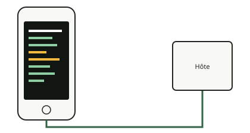

<!-- generated by tools/journey_build.py from docs/journey-src/first-pixel.fr.yaml: do not edit -->

Vous explorez : [Un 3GS dans un tiroir](start.md) → [Le téléphone écoute : le mode DFU](dfu.md) → [Les contrôles de signature sont coupés](pwned.md) → [Une étape de démarrage modifiée](ibss.md) → [Notre code arrive](payload.md) → [La preuve qu'il a tourné](proof.md) → [Le premier pixel](pixel.md) → **Un plantage qu'on peut lire**

# Un plantage qu'on peut lire

<figure class="journey-figure" markdown="1">
{ .journey-visual }
<figcaption>Un plantage finit en vidage lisible, pas en redémarrage.</figcaption>
</figure>

Degré de certitude : DEVICE

Le téléphone n'a ni port série accessible ni débogueur : un plantage ne ferait que le redémarrer. La console accroche
les vecteurs d'exception du processeur, si bien qu'une instruction indéfinie, un abandon de données, un abandon de
prélecture ou une interruption finit en un vidage lisible à l'écran, puis en un retour propre. Ces quatre cas ont été
observés sur le téléphone.

## Et maintenant ?

- [Voir où s'arrête notre connaissanceLes questions encore ouvertes](frontier.md)

Preuves et référence

**Aller plus loin dans la référence :** [La console d'exceptions à l'écran](../../fr/02-exception-console.md)

**Preuves :** [`20261015T050540Z-trace`](https://github.com/SebE585/trognon/tree/main/evidence/20261015T050540Z-trace) · [`20261015T050541Z-trace_irq`](https://github.com/SebE585/trognon/tree/main/evidence/20261015T050541Z-trace_irq)

[← Étape précédente](pixel.md) · [Carte du parcours](index.md) · [Manuel de référence](../README.md)

