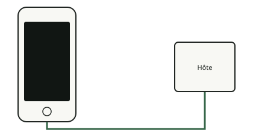

<!-- generated by tools/journey_build.py from docs/journey-src/first-pixel.fr.yaml: do not edit -->

Vous explorez : [Un 3GS dans un tiroir](start.md) → **Le téléphone écoute : le mode DFU**

# Le téléphone écoute : le mode DFU

<figure class="journey-figure" markdown="1">
{ .journey-visual }
<figcaption>Écran noir. Le téléphone répond pourtant en USB.</figcaption>
</figure>

Degré de certitude : DEVICE

En mode DFU, la ROM de démarrage du téléphone attend une image par USB au lieu de lancer son système. La ROM du 3GS
(S5L8920) a une faille connue, appelée limera1n, qui permet à un hôte de couper les contrôles de signature. L'exploit
échoue parfois et on le relance simplement ; aucune carte auxiliaire n'est nécessaire.

## Et maintenant ?

- [Utiliser la failleVoir ce que l'exploit permet](pwned.md)
- [Vérifier ce qui survit à l'extinction du téléphoneComprendre pourquoi le démarrage est captif](persist.md)

Preuves et référence

**Aller plus loin dans la référence :** [Chaîne de démarrage](../../fr/01-boot-chain.md)

**Preuves :** [`20261015T050540Z-trace`](https://github.com/SebE585/trognon/tree/main/evidence/20261015T050540Z-trace)

[← Étape précédente](start.md) · [Carte du parcours](index.md) · [Manuel de référence](../README.md)

