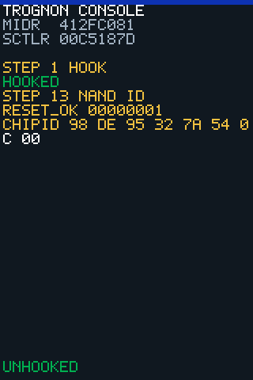

<!-- generated by tools/journey_build.py from docs/journey-src/first-pixel.fr.yaml: do not edit -->

Vous explorez : [Un 3GS dans un tiroir](start.md) → [Le téléphone écoute : le mode DFU](dfu.md) → [Les contrôles de signature sont coupés](pwned.md) → [Une étape de démarrage modifiée](ibss.md) → [Notre code arrive](payload.md) → [La preuve qu'il a tourné](proof.md) → [Le premier pixel](pixel.md) → [Un plantage qu'on peut lire](crash.md) → [Ici, notre connaissance s'arrête](frontier.md) → **Stockage : seulement le nom de la puce**

# Stockage : seulement le nom de la puce

<figure class="journey-figure journey-screen" markdown="1">
{ .journey-capture }
<figcaption>Ce que l'écran du téléphone affichait pendant ce passage (dossier de preuve [`20261015T171033Z-trace_nand`](https://github.com/SebE585/trognon/tree/main/evidence/20261015T171033Z-trace_nand)). L'image est reconstruite depuis le tampon d'écran du payload, pas photographiée.</figcaption>
</figure>

Degré de certitude : HYPOTHESIS

## Ce que nous savons

Le contrôleur flash a répondu sur deux lignes de sélection de puce et a renvoyé un identifiant de puce (Toshiba). Rien
d'autre n'a été lu.

## Ce que nous supposons

Pas encore de supposition : les autres lignes de sélection et le second bus n'ont pas été sondés, donc rien n'est présumé à leur sujet.

## Ce qui permettrait de trancher

Une première lecture de page par le contrôleur. Elle n'a pas encore été conçue.

*Ceci décrit une expérience, pas une procédure à suivre : une étape qui écrit dans le matériel du téléphone n'est exécutée qu'après une description écrite et une décision explicite.*

## Et maintenant ?

- [Voir une autre question ouverteRetour à la liste des questions ouvertes](frontier.md)

Preuves et référence

**Aller plus loin dans la référence :** [Carte matérielle : NAND](../../fr/03-hardware-map.md#nand)

**Preuves :** [`20261015T171033Z-trace_nand`](https://github.com/SebE585/trognon/tree/main/evidence/20261015T171033Z-trace_nand)

[← Étape précédente](frontier.md) · [Carte du parcours](index.md) · [Manuel de référence](../README.md)

