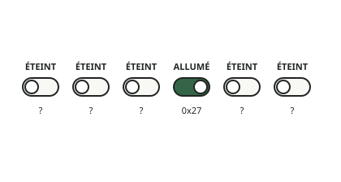

<!-- generated by tools/journey_build.py from docs/journey-src/first-pixel.fr.yaml: do not edit -->

Vous explorez : [Un 3GS dans un tiroir](start.md) → [Le téléphone écoute : le mode DFU](dfu.md) → [Les contrôles de signature sont coupés](pwned.md) → [Une étape de démarrage modifiée](ibss.md) → [Notre code arrive](payload.md) → [La preuve qu'il a tourné](proof.md) → [Le premier pixel](pixel.md) → [Un plantage qu'on peut lire](crash.md) → [Ici, notre connaissance s'arrête](frontier.md) → [Wi-Fi : le coprocesseur n'a pas été démarré](f-wifi.md) → **La fausse porte**

# La fausse porte

<figure class="journey-figure" markdown="1">
{ .journey-visual }
<figcaption>Une rangée d'interrupteurs aux étiquettes incertaines. L'un est allumé ; à qui est-il ?</figcaption>
</figure>

Imaginez une rangée d'interrupteurs aux étiquettes peu fiables. Dans le téléphone, une *porte d'horloge* est un
interrupteur de ce genre : elle laisse passer ou coupe le signal qui donne le rythme à un bloc. Trouver un interrupteur
activé ne suffit pas : il faut encore établir à quel bloc il correspond.

Ceci rejoue une vraie correction, faite le 16 octobre 2026, avec un guide qui s'est déjà trompé, et le dit. La question :
l'horloge du coprocesseur du Wi-Fi (là où dort [le Chuchoteur](../bestiaire.md#le-chuchoteur)) tournait-elle déjà ? Deux
feuilles portent le même numéro, `0x27`.

- **Feuille 1, la carte : le device tree.** Une description des blocs du téléphone, portée par son propre logiciel. Son
  entrée pour le coprocesseur indique une valeur de porte d'horloge de `0x27`.
- **Feuille 2, la trace : une capture.** Notre propre code a lu la liste des portes du téléphone (le tableau de portes) à
  la position `0x27` et obtenu `0xF`, que nous lisons comme « allumée ». Observé sur le téléphone.

Quelqu'un a relié les deux : *« horloge du coprocesseur déjà active ? »* Le point d'interrogation est discret ; tout le
reste sonne comme une certitude.

## Et maintenant ?

- [Partir de la carteLa feuille 1 d'abord : ce que dit le device tree](fg-map.md)
- [Partir de la traceLa feuille 2 d'abord : ce que le téléphone a répondu](fg-trace.md)
- [Retour à la question du Wi-FiRevenir à la page du Wi-Fi](f-wifi.md)

[← Étape précédente](f-wifi.md) · [Carte du parcours](index.md) · [Manuel de référence](../README.md)

