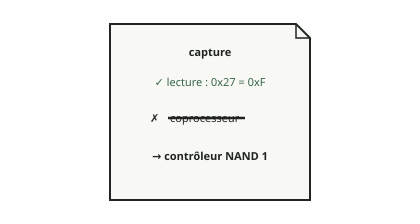

<!-- generated by tools/journey_build.py from docs/journey-src/first-pixel.fr.yaml: do not edit -->

Vous explorez : [Un 3GS dans un tiroir](start.md) → [Le téléphone écoute : le mode DFU](dfu.md) → [Les contrôles de signature sont coupés](pwned.md) → [Une étape de démarrage modifiée](ibss.md) → [Notre code arrive](payload.md) → [La preuve qu'il a tourné](proof.md) → [Le premier pixel](pixel.md) → [Un plantage qu'on peut lire](crash.md) → [Ici, notre connaissance s'arrête](frontier.md) → [Wi-Fi : le coprocesseur n'a pas été démarré](f-wifi.md) → [La fausse porte](fg-intro.md) → [Suivre la carte](fg-map.md) → [Que concluez-vous ?](fg-conclude.md) → [Vous avez relié les deux feuilles](fg-adopted.md) → [Ce que l'étape de démarrage fait de la porte 0x27](fg-reveal.md) → **La lecture tient, l'étiquette non**

# La lecture tient, l'étiquette non

<figure class="journey-figure" markdown="1">
{ .journey-visual }
<figcaption>La lecture reste. L'étiquette « coprocesseur » est barrée.</figcaption>
</figure>

Degré de certitude : SOURCE

Le guide pose les deux feuilles côte à côte.

*« Même numéro. Nous n'avions pas vérifié que c'était la même numérotation. »*

La lecture tient : porte `0x27` du tableau physique de portes, valeur `0xF`, lue comme allumée. L'étiquette ne tient pas :
d'après les deux sources, cette porte est celle du contrôleur NAND, et rien ici ne montre qu'elle alimente aussi le
coprocesseur. Le guide barre « coprocesseur » sur la lecture de la capture seulement, pas sur le device tree.

Le guide ne corrige pas le téléphone. Le guide corrige ce que nous avions conclu de sa réponse.

*« Et le `0x27` de l'autre feuille ? »* Il est toujours là. On ignore si le device tree utilise une autre numérotation qui
donne `0x27` par coïncidence, ou s'il contient une erreur. Dans les deux cas, le Wi-Fi ne fonctionne pas encore, et l'état
de l'horloge du coprocesseur reste inconnu.

## Et maintenant ?

- [Pourquoi l'ancienne ligne resteCe que laisse une piste fermée](fg-after.md)

Preuves et référence

**Aller plus loin dans la référence :** [Carte matérielle : Wi-Fi et SDIO](../../fr/03-hardware-map.md#wi-fi-et-sdio)

[← Étape précédente](fg-reveal.md) · [Carte du parcours](index.md) · [Manuel de référence](../README.md)

