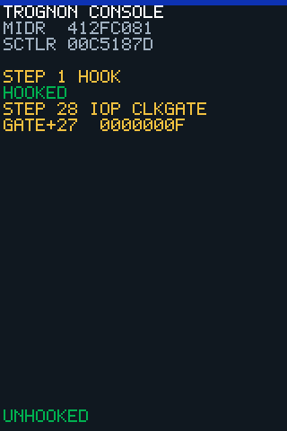

<!-- generated by tools/journey_build.py from docs/journey-src/first-pixel.fr.yaml: do not edit -->

Vous explorez : [Un 3GS dans un tiroir](start.md) → [Le téléphone écoute : le mode DFU](dfu.md) → [Les contrôles de signature sont coupés](pwned.md) → [Une étape de démarrage modifiée](ibss.md) → [Notre code arrive](payload.md) → [La preuve qu'il a tourné](proof.md) → [Le premier pixel](pixel.md) → [Un plantage qu'on peut lire](crash.md) → [Ici, notre connaissance s'arrête](frontier.md) → [Wi-Fi : le coprocesseur n'a pas été démarré](f-wifi.md) → [La fausse porte](fg-intro.md) → **Suivre la trace**

# Suivre la trace

<figure class="journey-figure journey-screen" markdown="1">
{ .journey-capture }
<figcaption>Ce que l'écran du téléphone affichait pendant ce passage (dossier de preuve [`20261016T094945Z-trace_iop_clkgate`](https://github.com/SebE585/trognon/tree/main/evidence/20261016T094945Z-trace_iop_clkgate)). L'image est reconstruite depuis le tampon d'écran du payload, pas photographiée.</figcaption>
</figure>

Degré de certitude : DEVICE

Partons de ce que le téléphone a répondu. Notre code a lu le tableau de portes à la position `0x27` et la console
affiche `GATE+27  0000000F`. Cette lecture est réelle : le dossier de preuve la contient.

Ce qu'elle montre : cette porte se lit allumée. Ce qu'elle ne montre pas : quel bloc cette porte alimente. Une lecture ne
porte pas d'étiquette.

Voici maintenant le device tree : son entrée pour le coprocesseur indique `0x27`. Côte à côte, les deux semblent
s'accorder. Les deux feuilles utilisent le même numéro. Rien, pour l'instant, ne dit qu'elles comptent les portes de la
même façon.

## Et maintenant ?

- [Tirer une conclusionDire ce que vous pensez que cela montre](fg-conclude.md)

Preuves et référence

**Preuves :** [`20261016T094945Z-trace_iop_clkgate`](https://github.com/SebE585/trognon/tree/main/evidence/20261016T094945Z-trace_iop_clkgate)

[← Étape précédente](fg-intro.md) · [Carte du parcours](index.md) · [Manuel de référence](../README.md)

