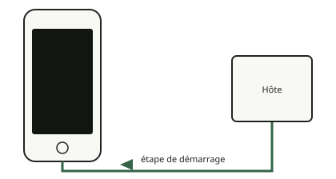

<!-- generated by tools/journey_build.py from docs/journey-src/first-pixel.fr.yaml: do not edit -->

Vous explorez : [Un 3GS dans un tiroir](start.md) → [Le téléphone écoute : le mode DFU](dfu.md) → [Les contrôles de signature sont coupés](pwned.md) → **Une étape de démarrage modifiée**

# Une étape de démarrage modifiée

{ .journey-visual }

*L'étape de démarrage modifiée voyage par USB.*

Degré de certitude : DEVICE

Nous envoyons l'étape de démarrage propre au téléphone (l'iBSS), déchiffrée avec la clé de l'appareil et modifiée pour
que la commande Recovery `run` saute vers notre code. Aucun firmware d'Apple n'est stocké dans ce dépôt : il est pris sur
le téléphone de son propriétaire. L'appareil se ré-énumère ensuite en USB comme un appareil Recovery.

## Et maintenant ?

- [Faire entrer notre propre codeComment il arrive dans la mémoire du téléphone](payload.md)

Preuves et référence

**Aller plus loin dans la référence :** [Chaîne de démarrage : l'iBSS modifié](../../fr/01-boot-chain.md#le-chemin-device-2026-10-1415)

**Preuves :** [`20261015T050540Z-trace`](https://github.com/SebE585/trognon/tree/main/evidence/20261015T050540Z-trace)

[← Étape précédente](pwned.md) · [Carte du parcours](index.md) · [Manuel de référence](../README.md)

