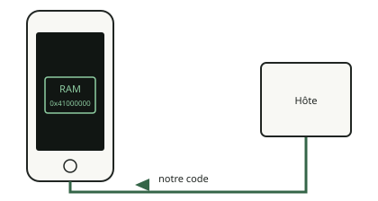

<!-- generated by tools/journey_build.py from docs/journey-src/first-pixel.fr.yaml: do not edit -->

Vous explorez : [Un 3GS dans un tiroir](start.md) → [Le téléphone écoute : le mode DFU](dfu.md) → [Les contrôles de signature sont coupés](pwned.md) → [Une étape de démarrage modifiée](ibss.md) → **Notre code arrive**

# Notre code arrive

{ .journey-visual }

*Notre code atterrit en RAM, à 0x41000000.*

Degré de certitude : DEVICE

`send_data` copie du code Thumb brut en `0x41000000` et `run` y saute. Le code démarre avec la MMU et les caches activés,
en mode superviseur, interruptions non masquées.

## Et maintenant ?

- [S'assurer qu'il a vraiment tournéLe marqueur et le nonce](proof.md)
- [Vérifier ce qui survivra à l'extinctionComprendre pourquoi le démarrage est captif](persist.md)

Preuves et référence

**Aller plus loin dans la référence :** [Chaîne de démarrage : le payload](../../fr/01-boot-chain.md#le-chemin-device-2026-10-1415) · [Plan mémoire des payloads](../../fr/02-exception-console.md#plan-memoire-des-payloads-device)

**Preuves :** [`20261015T050540Z-trace`](https://github.com/SebE585/trognon/tree/main/evidence/20261015T050540Z-trace)

[← Étape précédente](ibss.md) · [Carte du parcours](index.md) · [Manuel de référence](../README.md)

