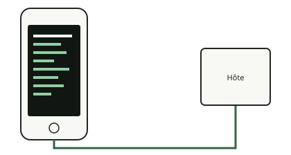

<!-- generated by tools/journey_build.py from docs/journey-src/first-pixel.fr.yaml: do not edit -->

Vous explorez : [Un 3GS dans un tiroir](start.md) → [Le téléphone écoute : le mode DFU](dfu.md) → [Les contrôles de signature sont coupés](pwned.md) → [Une étape de démarrage modifiée](ibss.md) → [Notre code arrive](payload.md) → [La preuve qu'il a tourné](proof.md) → **Le premier pixel**

# Le premier pixel

{ .journey-visual }

*L'écran montre ce que le code dessine.*

Degré de certitude : DEVICE

L'écran est un framebuffer en `0x4fd00000`, de 320 par 480 pixels. Le contrôleur d'affichage avait déjà été réglé par
l'étape de démarrage : notre code ne fait que dessiner. Comme le framebuffer est en écriture différée, le code purge le
cache de données après avoir dessiné, pour qu'un processeur figé laisse tout de même un écran fidèle.

*La console, reconstituée depuis le tampon du payload (pas une photographie).*

## Et maintenant ?

- [Casser quelque chose exprèsÀ quoi ressemble un plantage](crash.md)

Preuves et référence

**Aller plus loin dans la référence :** [Carte matérielle : affichage](../../fr/03-hardware-map.md#affichage)

**Preuves :** [`20261015T050542Z-trace_regs`](https://github.com/SebE585/trognon/tree/main/evidence/20261015T050542Z-trace_regs) · [`20261015T050540Z-trace`](https://github.com/SebE585/trognon/tree/main/evidence/20261015T050540Z-trace)

[← Étape précédente](proof.md) · [Carte du parcours](index.md) · [Manuel de référence](../README.md)

