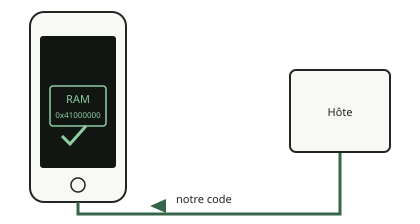

<!-- generated by tools/journey_build.py from docs/journey-src/first-pixel.fr.yaml: do not edit -->

Vous explorez : [Un 3GS dans un tiroir](start.md) → [Le téléphone écoute : le mode DFU](dfu.md) → [Les contrôles de signature sont coupés](pwned.md) → [Une étape de démarrage modifiée](ibss.md) → [Notre code arrive](payload.md) → **La preuve qu'il a tourné**

# La preuve qu'il a tourné

<figure class="journey-figure" markdown="1">
{ .journey-visual }
<figcaption>Le marqueur revient avec le même nonce.</figcaption>
</figure>

Degré de certitude : DEVICE

Le code publie un marqueur dans une variable de l'étape de démarrage et l'hôte le relit. Il y a un piège : cette étape
garde ses variables d'une exécution à l'autre, si bien qu'une valeur périmée peut passer pour un résultat. Trognon ajoute
donc à chaque binaire un nombre aléatoire de 32 bits (un nonce) et n'écrit un dossier de preuve que si ce nombre revient
identique.

## Et maintenant ?

- [Faire apparaître quelque chose à l'écranLe premier pixel](pixel.md)

Preuves et référence

**Aller plus loin dans la référence :** [Preuves : comment un dossier est fait](../../fr/08-evidence.md)

**Preuves :** [`20261015T050540Z-trace`](https://github.com/SebE585/trognon/tree/main/evidence/20261015T050540Z-trace)

[← Étape précédente](payload.md) · [Carte du parcours](index.md) · [Manuel de référence](../README.md)

