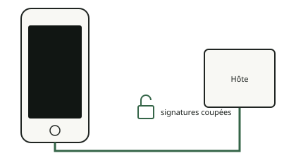

<!-- generated by tools/journey_build.py from docs/journey-src/first-pixel.fr.yaml: do not edit -->

Vous explorez : [Un 3GS dans un tiroir](start.md) → [Le téléphone écoute : le mode DFU](dfu.md) → **Les contrôles de signature sont coupés**

# Les contrôles de signature sont coupés

{ .journey-visual }

*Contrôles de signature coupés : le téléphone accepte du code qu'Apple n'a pas signé.*

Degré de certitude : DEVICE

Après l'exploit, la ROM de démarrage accepte une image qu'Apple n'a pas signée. Cet état s'appelle un DFU « pwned ».
L'outil est `ipwndfu`, utilisé tel quel ; l'exploit lui-même n'est pas de nous.

## Et maintenant ?

- [Lui envoyer quelque chose à exécuterL'étape de démarrage modifiée](ibss.md)

Preuves et référence

**Aller plus loin dans la référence :** [Chaîne de démarrage : le chemin](../../fr/01-boot-chain.md#le-chemin-device-2026-10-1415)

**Preuves :** [`20261015T050540Z-trace`](https://github.com/SebE585/trognon/tree/main/evidence/20261015T050540Z-trace)

[← Étape précédente](dfu.md) · [Carte du parcours](index.md) · [Manuel de référence](../README.md)

