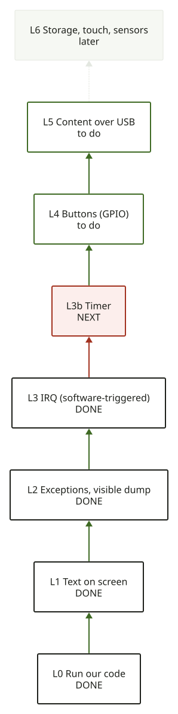

# Trognon

**Open reverse engineering of the iPhone 3GS, so a phone left in a drawer can run code we wrote.**
*Rétro-ingénierie ouverte de l'iPhone 3GS : un téléphone oublié dans un tiroir exécute le code que
nous écrivons.*

[English documentation](en/README.md){ .md-button .md-button--primary }
[Documentation française](fr/README.md){ .md-button }
[Source code](https://github.com/SebE585/trognon){ .md-button }

## Where we are / Où on en est

The first code runs on a real iPhone 3GS (S5L8920, Cortex-A8): it draws on the screen, and it
catches and survives three kinds of CPU exceptions. Everything below was observed on the device.

Le premier code tourne sur un vrai iPhone 3GS : il dessine à l'écran et attrape trois types
d'exceptions CPU sans planter. Tout ce qui suit a été observé sur l'appareil.

| Rung | Status |
|---|---|
| Run our code from DFU, nothing written to the phone | DEVICE |
| Text and shapes on the screen | DEVICE |
| UNDEF, data abort, prefetch abort with a readable dump | DEVICE |
| Interrupts (software-triggered IRQ) | DEVICE |
| Free-running tick (24 MHz, measured) and buttons (GPIO, mapped) | DEVICE |
| Timer interrupt | HYPOTHESIS: a VIC0 line fires, not proven to be the timer |
| Content over USB, storage, touch | HYPOTHESIS |

## By chip / Par puce

Work goes chip family by chip family, reusing what carries over. *On avance famille de puces par famille
de puces, en réutilisant ce qui se reporte.* Colour code: DEVICE verified on a phone, SOURCE read but not yet verified, HYPOTHESIS plan.

| Family | Boot | Status | Overlap |
|---|---|---|---|
| **iPhone 3GS** (S5L8920) | limera1n | DEVICE code runs | the reference |
| **iPhone 4** (A4) | SHAtter | SOURCE next bench | same CPU family: HYPOTHESIS |
| **iPhone 4S** (A5) | checkm8-a5 + Pico | SOURCE | 32-bit, other exploit |
| iPhone 5, 5c (A6) | checkm8 | SOURCE | next to the A5 |
| iPhone 5s to X (A7 to A11) | checkm8, arm64 | SOURCE | 64-bit: another track |

### Timeline / Frise

--8<-- "docs/snippets/timeline.en.html"

[Support by chip](en/06-chips.md), [Par puce](fr/06-chips.md), [Modular code](en/07-code-layout.md), [Code modulaire](fr/07-code-layout.md)

## By intent / Par intention de lecture

The numbered pages below stay in one order; this just groups the same links by what you
are trying to do. *Les pages numérotées ci-dessous gardent un seul ordre ; ceci ne fait
que regrouper les mêmes liens par ce que vous essayez de faire.*

- **Understand the project** (*Comprendre le projet*): this page, then
  [1. Boot chain](en/01-boot-chain.md) / [FR](fr/01-boot-chain.md).
- **Reproduce a specific test** (*Reproduire un test précis*):
  [2. Exception console](en/02-exception-console.md) / [FR](fr/02-exception-console.md),
  [3. Hardware map](en/03-hardware-map.md) / [FR](fr/03-hardware-map.md), then
  [8. Evidence](en/08-evidence.md) / [FR](fr/08-evidence.md) for the exact command and commit.
- **Look up one fact** (*Chercher une preuve précise*):
  [SoC memory map](spec/soc-s5l8920.md) for a base address, otherwise
  [8. Evidence](en/08-evidence.md) / [FR](fr/08-evidence.md) by bundle.
- **Contribute code or a chip** (*Contribuer du code ou une puce*):
  [6. Support by chip](en/06-chips.md) / [FR](fr/06-chips.md), then
  [7. Modular code](en/07-code-layout.md) / [FR](fr/07-code-layout.md).
- **Follow the open research** (*Suivre la recherche en cours*):
  [Research index](research/index.md), [4. Mods](en/04-mods.md) / [FR](fr/04-mods.md),
  [5. Field notes](en/05-field-notes.md) / [FR](fr/05-field-notes.md).

## Read it / Le lire

- **1. Boot chain** (*Chaîne de démarrage*)

    From DFU to our code in RAM. [EN](en/01-boot-chain.md), [FR](fr/01-boot-chain.md)

- **2. Exception console** (*Console d'exceptions*)

    How a crash becomes a readable screen. [EN](en/02-exception-console.md), [FR](fr/02-exception-console.md)

- **3. Hardware map** (*Carte matérielle*)

    Which registers are verified, which are not. [EN](en/03-hardware-map.md), [FR](fr/03-hardware-map.md)

- **4. Mods** (*Mods*)

    Build the OS one use case at a time. [EN](en/04-mods.md), [FR](fr/04-mods.md)

- **5. Field notes** (*Notes de terrain*)

    What fails and how to tell. [EN](en/05-field-notes.md), [FR](fr/05-field-notes.md)

- **6. Support by chip** (*Support par puce*)

    3GS, 4, 4S, then the rest, with overlaps. [EN](en/06-chips.md), [FR](fr/06-chips.md)

- **7. Modular code** (*Code modulaire*)

    One constants file per chip. [EN](en/07-code-layout.md), [FR](fr/07-code-layout.md)

- **8. Evidence** (*Preuves*)

    Every DEVICE claim tied to a reproducible run. [EN](en/08-evidence.md), [FR](fr/08-evidence.md)

- **Research** (*Recherche*)

    Dated surveys of A5 to A11, the legal frame, untethered boot. [Index](research/index.md)

## How to read the evidence / Lire les preuves

| Tag | Meaning |
|---|---|
| DEVICE | observed on a real phone |
| EMU | seen only in our offline emulation |
| SOURCE | read in OpenIBoot or a disassembly, not yet checked |
| HYPOTHESIS | a plan or a guess |

No Apple firmware is stored here. Independent project, not affiliated with or endorsed by Apple Inc.
