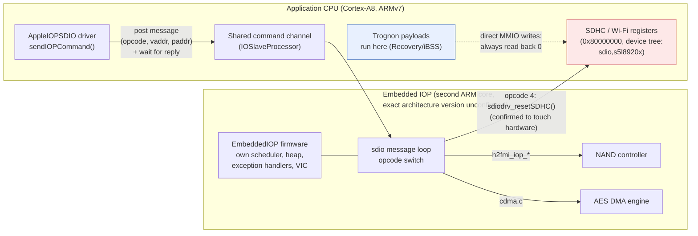
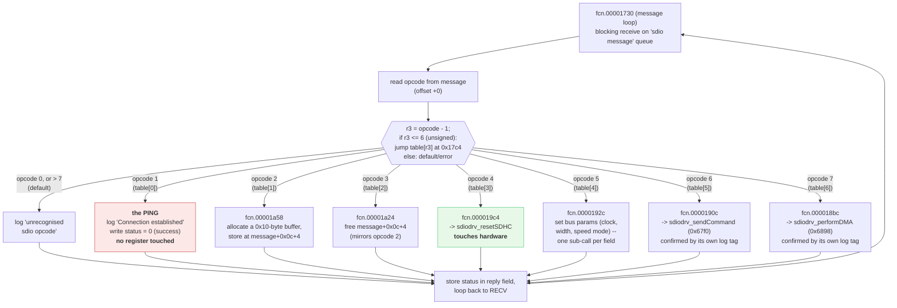

# The 3GS has a second, embedded IOP processor; SDIO/Wi-Fi almost certainly runs through it

Research date: 2026-10-16, revised the same day across several external
reviews. **This is the consolidated, current-state version**: wording
that was later corrected has been rewritten in place rather than left
standing with a patch stacked on top. The error trail itself is kept
deliberately — not as noise to clean up, but because this project
documents mistakes and corrections as part of the research record — in
["Revision history"](#revision-history) at the end, out of the way of the
main narrative.

## Scope, stated precisely

Two separate questions are easy to conflate, and are kept apart
throughout this document:

1. **Architecture** — does a second embedded ARM processor exist on the
   S5L8920, and does it own the SDIO/Wi-Fi hardware? **Established**,
   from the device's own extracted firmware and host driver, not
   inferred from documentation or analogy with other SoCs.
2. **Symptom** — is this architecture *why* every SDHC register read
   back zero and ignored writes from Trognon's own payloads on
   2026-10-15/16? **Not established.** It is the leading explanation,
   ahead of the clock-gate and init-sequence hypotheses already ruled
   out — but the causal chain (is the IOP actually running under
   Trognon's tethered DFU/iBSS path? does it reach SDHC hardware with a
   valid configuration at that point?) has not been traced end to end.

Read every claim below about "the architecture" as settled, and every
claim about "why the symptom happened" as a hypothesis, however well
supported.

## Bottom line

The S5L8920 has a second, embedded 32-bit ARM processor — Apple calls it
an "IOP" (I/O Processor) — running its own small real-time OS: scheduler,
heap, exception handling, an interrupt controller distinct from the
application CPU's own. Its own debug strings show it manages exactly
three subsystems: NAND (`h2fmi`), an AES-capable DMA engine (`cdma`), and
SDIO/Wi-Fi (`sdiodrv`). The application CPU's `AppleIOPSDIO` driver talks
to it over a shared-memory message channel (`sendIOPCommand`) and never
itself maps or writes SDHC registers, as far as its own disassembled code
shows. The IOP-side handler for one specific opcode (real opcode 4) calls
`sdiodrv_resetSDHC`, which accesses a memory region through one pointer
indirection whose offsets and bit masks match the real, standard SDHCI
register layout exactly (a one-to-one match against Linux's own
`sdhci.h`, not a loose pattern resemblance).

**Where that pointer's own value comes from is the open question this
document spends most of its length on, and it remains open.** Every
direct producer checked so far — the host driver's message-send path,
generic queue creation, all seven opcode handlers, the task scheduler's
first-dispatch chain — turns out not to write it. A real, confirmed
mechanism, not merely hypothesized, is that the firmware's own wrapper
carries a property dictionary (`HeapBaseOffset`/`HeapSizeOffset`, after
correcting an initial key/value misreading — see
["The missing producer"](#the-missing-producer-everything-checked-for-the-real-sdhc-base-pointer))
pointing at two locations inside the firmware image that the firmware's
own boot code dereferences directly to seed its heap allocator — **the
consumer side of this, confirmed**. Both currently hold the firmware's
own "value not set" sentinel, which implies a producer exists on the
host side, but that producer itself has not been found or traced — an
earlier version of this document overstated this as "confirmed", which
was premature. Whether the same mechanism also supplies the SDHC base
pointer is not shown either way.



*Solid lines: confirmed from the disassembled driver and firmware. Dotted
line: the application CPU's path to the same registers reads back zero
in practice, but whether it is architecturally blocked, or simply never
configured by the time it is probed, is not established.*

## What's established

- A second ARM core exists on this SoC, confirmed by disassembling its
  own raw firmware directly — not inferred from a wrapper header or
  documentation. Its exact instruction-set *version* is not established:
  "ARM7" (a core family, hinted by the dependency name `AppleARM7M`) and
  "ARMv7" (the instruction-set version the main Cortex-A8 uses) name
  different things, and this document conflated them in an earlier
  version.
- It runs a genuine small OS: a task scheduler (`task_create`,
  `task_yield`, `idle_task_routine`), a heap allocator, ARM exception-mode
  dump strings, and its own interrupt-enable/status registers distinct
  from the application CPU's VIC — read directly from the firmware's own
  strings and code.
- Its own debug strings name exactly three subsystems: NAND (`h2fmi_*`,
  39 strings), an AES DMA engine (`cdma`, 7 strings), SDIO/Wi-Fi
  (`sdiodrv_*`, 6 strings). An explicit search for every other peripheral
  family (audio, USB, UART, I2C, SPI, backlight, PMU, touch, accelerometer,
  baseband, Bluetooth, camera, display) found zero matches. **This is a
  string census of one extracted firmware build, not a code-coverage
  analysis or a claim about historical design intent** — a subsystem with
  no descriptive debug strings would not show up in this count, and
  "NAND is the largest subsystem by debug-string count" is a different,
  narrower claim than "the IOP was built primarily for NAND."
- The host driver (`AppleIOPSDIO`) posts messages to the IOP over a
  shared buffer (`sendIOPCommand`) and waits for a reply; its own
  disassembled code never maps or writes an SDHC register directly, and
  contains no call resembling `getDeviceMemoryWithIndex`/
  `mapDeviceMemory` (the IOKit calls that would resolve the SDHC device
  tree node into a host-usable address).
- The IOP's own SDIO message loop dispatches seven opcodes, confirmed by
  reading the jump table's raw bytes rather than a disassembler's case
  label (see "Decisive evidence snippets" below). Real opcode 1 is a
  ping that only acknowledges a logical connection — no register is
  touched. Real opcode 4 reaches `sdiodrv_resetSDHC`, which performs real
  SDHCI-layout register access through one level of pointer indirection
  (see "The SDHCI register mapping").

## Open questions

Each of these is genuinely unresolved. They are listed once, here, rather
than scattered through the narrative under different wording:

1. **Who writes the real SDHC base pointer, and when?** See
   ["The missing producer"](#the-missing-producer-everything-checked-for-the-real-sdhc-base-pointer)
   for the full, bounded trace of everything checked.
2. ~~Host opcode 0 vs. IOP opcode 1~~ — **resolved**: the "opcode 0"
   claim was never actually verified in `sendIOPCommand`'s own code; its
   one caller sends a hardcoded opcode `1`, matching the IOP's real
   opcode 1 (the ping) exactly. See
   ["Reconciling host and IOP opcode numbering"](#reconciling-host-and-iop-opcode-numbering).
3. **Is the IOP actually running under Trognon's own tethered DFU/iBSS
   path?** Everything in this document describes what the firmware
   *would* do while executing. Nothing here establishes that it is
   actually executing — as opposed to merely being present as a loaded,
   inert binary — at the point Trognon's own payloads run and probe the
   SDHC registers.
4. **What is actually zeroed, and when, in the IOP's own memory?**
   Several findings below describe a location as "should be zero" based
   on the raw firmware *file's* contents, assuming standard
   load-time-zero semantics. The IOP's actual runtime memory/load map —
   what the loader clears, what it patches, what might already carry a
   host-prepared value before the firmware's own code runs even once —
   has not been independently established. Read "should be zero" in this
   document as a statement about the static file, not a confirmed
   runtime fact.
5. **`AppleARM7M`'s exact relationship to the physical IOP core** is
   inferred from its name and its shared `IOSlaveProcessor` dependency,
   not confirmed from its own code.
6. **The IOP firmware's own load path**: who copies its bytes, to what
   address, whether anything verifies them (signature, hash, a
   memory-protection boundary), and what write releases the IOP's reset.
   Partially traced: the concrete driver is `AppleARM7M`
   (`role = "IOP"`), and its `startCPU(IOSlaveFirmware*)` method reads
   the firmware's raw bytes and length and writes a real hardware
   address (`0x86300000`, matching the firmware's own hardcoded value)
   into a companion structure — but what actually copies the bytes,
   where the `ConfigurationOffset`/`HeapBaseOffset` values get consumed,
   and what releases the reset remain unread. This is question (1) from
   a different angle, and is the most direct remaining research
   target — both for the SDHC-base question and for whether Trognon
   could ever load its own code onto the IOP (see "Two different goals"
   below).
7. **The exact wire format of the host/IOP message struct.** Only the
   outer shape (opcode byte, pending flag, a vaddr/paddr pair) is known;
   the full byte-for-byte layout `sendIOPCommand`'s `cmd` argument uses
   was not reverse-engineered.
8. **The class backing the actual command-channel object**
   (`this+0x24` in `AppleIOPSDIO`) was identified by dependency
   (`IOSlaveProcessor`, most likely its `IOSlaveEndpoint` class) but its
   own code was not located or disassembled.

## How this was found: a second opinion, then a real disassembler

After three clean, carefully isolated negatives from direct register
experiments (two clock-gate hypotheses, a full SDHC-style init sequence,
and a raw write-then-readback test that showed the write never landed;
see the 2026-10-15/16 journal), a summary of the investigation was given
to another LLM for review. Three corrections came back, all valid — kept
here as the turning point they were, not as something to re-litigate:

1. A zero readback does not by itself prove a write was ignored — an
   MMIO register can be write-only, carry reserved bits, or trigger an
   action.
2. Two incompatible register-layout hypotheses had been mixed without
   noticing: writes used the older, simple `CTRL`/`CMD` layout (from
   `plat-s5l8900`/`iDroid-kernel`), while a separate argument assumed an
   SDHCI-standard layout. Only one of the two could be right (it turned
   out to be SDHCI — see below).
3. The MMU page table cited as evidence was the one **OpeniBoot** builds
   for itself at its own boot — but OpeniBoot never runs on this device.
   Trognon's payloads execute inside Apple's own patched iBSS, whose real
   MMU state had never been captured directly.

The review's own strongest lead: real iOS kernelcache restore logs for
the 3GS name an actual Apple driver class, and that kernelcache is inside
an IPSW already in hand.

## Extracting and reading the real driver

The kernelcache (`kernelcache.release.n88` inside
`iPhone2,1_4.3.5_8L1_Restore.ipsw`, SHA-256
`ed3a62f4c581a8f500303d4d8e0976dd84bfb5d1f39c83d884b6564a7ecb4ab2` for the
IPSW) is an encrypted IMG3 container, same shape as the device tree
handled on 2026-10-15: `TYPE`/`DATA`/`SEPO`/`KBAG`x2/`SHSH`/`CERT` tags,
`DATA` encrypted (`KBAG` present). Decrypted the same way, with the 3GS
back in pwned DFU (not Recovery): `axi0mX/ipwndfu`'s `image3.py`,
`Image3.getDecryptedPayload()` ->
`dfuexec.PwnedDFUDevice().decrypt_keybag()` (the chip's own hardware
AES/GID primitive, a pure read, nothing written). The decrypted payload
(SHA-256 `487bcf47e494c1cd3e57f347e9b1a8cba90576c78b6a0752e0b2a60a76ed4a00`)
starts with the ASCII tag `complzss`: Apple's standard LZSS kernelcache
compression. No existing decompressor was available locally, so one was
written from the publicly documented algorithm (4096-byte dictionary
initialised to spaces, 18-byte max match, length = 3 + low nibble, exact
parameters confirmed against `malus-security/lzssdec`'s own README rather
than guessed) and validated: it reproduced the exact expected
uncompressed size (10,047,488 bytes) and produced a structurally valid
ARMv7 Mach-O.

The kernelcache's own `__PRELINK_INFO` plist lists the real driver class:
**`AppleIOPSDIO`**, matching `IONameMatch = "sdio,s5l8920x"` (the exact
`compatible` string already found in the device tree on 2026-10-15) and
`IOProviderClass = "AppleARMIODevice"`, loaded at `0x80579000`. Its
`__PRELINK_TEXT` slice is itself a small, complete Mach-O (a prelinked
kext), parsed directly rather than guessed at (segment/section load
commands read with a small script): `__text` at `0x8057a000` (0x343c
bytes), `__cstring` at `0x8057d43c` (0x175d bytes).

A first pass with `arm-none-eabi-objdump` (`-b binary -m arm -M
force-thumb`) decoded cleanly from the start, confirming the code is
Thumb throughout this function range, but manual string-cross-reference
by literal-pool scanning found zero matches against the target debug
strings at first — an off-by-8-bytes error in how the target string's own
address had been computed, not a tooling limitation. Once `radare2` was
installed (`brew install radare2`) and run with full analysis (`aaa`),
its own `axt` cross-reference command found the right function
immediately once the correct string address was used: `fcn.8057c424`.

## What `sendIOPCommand` actually does

Disassembled in full (`radare2`, Thumb, relocations applied; see "Tooling
notes" for why the Thumb flag matters). In short:

1. Checks the command pointer passed in against a stored "allocated
   buffer" pointer (`this+0x14`); mismatches fail with "Command is not
   from the command buffer."
2. Checks it is running on the right IOKit workloop gate (two virtual
   calls through the object at `this+0x18`); failing that logs "Must
   have workloop gate to send a command."
3. Fills in the command structure: writes the opcode byte, sets a
   "pending" flag, stores the current command pointer at `this+0x30`.
4. Logs `"Sending command @ vaddr = %p, paddr = 0x%lX, opcode = %lu"` —
   the logged "vaddr" is the command buffer's own address, "paddr" its
   own physical address: a real shared-memory message between two
   processors, not a register poke.
5. **The actual send** is a virtual call through a *different* object,
   at `this+0x24`, vtable slot `+0x84` — this is the one that actually
   hands the message to the IOP; `AppleIOPSDIO` itself never touches an
   SDHC register for this step.
6. On success, loops re-reading `this+0x30` until it is cleared —
   presumably by the completion handler (`handleIOProcCmdResp`, named in
   the kext's own strings) once the IOP actually answers.

`sendIOPCommand` has exactly one caller in the kext. That caller passes,
as the real argument to the step-5 send call, the command buffer's own
physical address — the same value logged as `paddr` above. This is the
host side's entire contribution to the message's contents for this call
path; see "The missing producer" for what this does and does not rule
out.

## The generic channel, and who else uses it

The object at `this+0x24` is backed by a genuinely separate kernel
extension, confirmed by searching the full kernelcache's
`__PRELINK_INFO` (not just this one kext) for every driver that lists it
as a library dependency:

| `OSBundleLibraries` client of `com.apple.driver.IOSlaveProcessor` | Role |
|---|---|
| `com.apple.driver.AppleARM7M` | names an ARM7-class core directly |
| `com.apple.driver.AppleIOPFMI` | the NAND/flash driver (`h2fmi`) |
| `com.apple.driver.AppleIOPSDIO` | this investigation's Wi-Fi/SDIO driver |
| `com.apple.driver.EmbeddedIOP` | the generic IOP management framework |
| `com.apple.driver.IOP_s5l8920x_firmware` | **the firmware image itself** |

`IOP_s5l8920x_firmware` is not a thin wrapper: `_PrelinkExecutableSize =
0x1d000` (116 KB), `IOProviderClass = IOResources` (a global resource,
not a per-device driver). Extracted (SHA-256
`b8af809426e15cd23b5247a15c7ee950843aa893f8bdc7b4e2cc9e018100cd37`), it
is **two layers**, not one:

- A wrapper: a Mach-O container (`cputype=12`, `cpusubtype=9` — ARMv7)
  describing what the **host** CPU needs to load the file with XNU's
  normal kext mechanism. It carries real executable code (not just
  metadata) and a property dictionary — `ConfigurationOffset`,
  `HeapBaseOffset`, `HeapSizeOffset`, `HeapRequired`, `PageTableBase`,
  `PageTableSize`, `MessageChannelSize`, `PanicString`, `PanicFunction`,
  `PanicLog*` — whose actual role is traced in "The missing producer"
  below. This Mach-O header says nothing about the embedded core's own
  instruction set.
- The actual payload: a `fwFirmwareImage` section (0x1b000 bytes, SHA-256
  `02397017927bfa05d23f77b9e76e9a3e7c73711806c0a230780136af7f7d8bfc`), a
  *raw* binary with no Mach-O header of its own, starting with a genuine
  ARM32 exception vector table (confirmed byte-for-byte: its first word,
  `0e0000ea`, decodes as a `B` branch instruction) and self-identifying,
  once disassembled, as `"EmbeddedIOP for s5l8920x, Copyright 2010, Apple
  Inc."`, built alongside `iBoot-1072.61`. This is the code disassembled
  throughout the rest of this document — directly, with `radare2` told to
  decode it as 32-bit ARM, not inferred from the wrapper's own header.

Its own debug strings establish a real dialogue between host and IOP for
SDHC, NAND, and DMA:

- `"SDHC: Ping received, IOKit <--> IOP Connection established"` — a
  ping/connection handshake exists. Traced in full below: it does not
  activate SDHC hardware, only acknowledges a logical connection.
- `sdiodrv_resetSDHC`, `sdiodrv_sendCommand`, `sdiodrv_performDMA`,
  `sdiodrv_completeTransfer` — a real low-level SD protocol driver, using
  the exact register names Trognon's own earlier hypotheses used (`cmd`,
  `arg`, `resp0`, `normalInt`, `errorInt`, `state`), runs on the IOP.
- `h2fmi_iop_read_multiple`, `h2fmi_erase_blocks`, `h2fmi_nand_reset_all`,
  and the rest of the `h2fmi_*` family: NAND's real driver lives here
  too. One possible explanation for why Trognon's own NAND chip-ID read
  (2026-10-15) worked without ever pinging anything is that NAND is
  needed to boot iOS, so the IOP's NAND component might already be live
  by the time Recovery mode is reached — **not established**: the needs
  of a normal iOS boot do not by themselves prove the IOP's actual state
  along Trognon's own tethered DFU/iBSS path, which skips most of that
  normal boot.
- `drivers/apple/cdma/cdma.c`: the AES-capable DMA engine already seen
  referenced in `h2fmi.c`'s source is also IOP-managed.

## The IOP's SDIO message loop: opcodes, dispatch, and the SDHCI mapping

The message loop (`fcn.00001730`, a queue named `"sdio message"`) reads
an incoming message's opcode byte, computes `r3 = opcode - 1`, and if
`r3 <= 6` (unsigned), jumps through a 7-entry table at `r3`'s index —
the table covers **real opcodes 1 to 7**; opcode 0 underflows `r3` and
falls to the same default/error path as any opcode above 7. This
indexing was checked against the table's own raw bytes (see "Decisive
evidence snippets"), not inferred from a case label.

| Real opcode | Function | Role |
|---|---|---|
| 1 | `fcn.00001844` | **The ping.** Logs "Connection established", writes success, returns. No register access, no call into any `sdiodrv_*` function. |
| 2 | `fcn.00001a58` | Allocates a 16-byte buffer, stores it at `message+0x0c+0x04`. Reads and null-checks `message+0x0c+0x00` (see below) but never writes it. |
| 3 | `fcn.00001a24` | Frees that same field — the mirror of opcode 2. |
| 4 | `fcn.000019c4` | Reaches `sdiodrv_resetSDHC` — the opcode that actually touches hardware. |
| 5 | `fcn.0000192c` | A compound dispatcher over the message's bus-parameter fields — matches the `setClockRate`/`setBusWidth`/`setBusSpeedMode` family named in the firmware's own strings. |
| 6 | `fcn.0000190c` | Tail-calls into `sdiodrv_sendCommand`/`sdiodrv_completeCommand` (`0x67f0`), identified by its own log-tag strings, not a signature guess. |
| 7 | `fcn.000018bc` | Calls `sdiodrv_performDMA`/`sdiodrv_transferData` (`0x6898`), likewise identified by its own log-tag strings. |

Every non-ping handler (opcodes 2–7) receives the identical argument
pair `(message+0x0c, message+0x14)` from the dispatcher — confirmed in
all six cases, not assumed. There is one message buffer, not a separate
"device struct"; every offset below is relative to it.

### The SDHCI register mapping

`sdio_op4_reset` (`0x19c4`) opens with `r4 = [r0]` — it dereferences
`message+0x0c` **once**, and passes that dereferenced *value* (not the
address `message+0x0c` itself) into the functions that build the reset
bitmasks. `sdio_op6`'s wrapper (`0x190c`) does the identical `r0 = [r0]`
before tail-calling `sdiodrv_sendCommand`. Three distinct things, kept
separate with consistent names throughout this document:

- `message+0x0c` — a *location* inside the firmware's own 64-byte message
  slot.
- `base = *(message+0x0c)` — the *value* stored there: a pointer,
  null-checked before use exactly like a driver checking its mapped
  register window.
- `base+N` — real SDHCI registers, reached through `base`, **not**
  `message+0x0c+N`.

Every offset accessed through `base` lines up exactly with the real,
standard SDHCI register layout (the one Linux's own `sdhci.h` uses):

| `base+N` | What the firmware does there | Real SDHCI register |
|---|---|---|
| `+0x08` | read/logged as `arg` in `sendCommand` | `SDHCI_ARGUMENT` |
| `+0x0e` | 16-bit, logged as `cmd` | `SDHCI_COMMAND` |
| `+0x10` | — | `SDHCI_RESPONSE` (0–3) |
| `+0x24` | `&1` checked in a retry loop, error string "Command inhibited!" | `SDHCI_PRESENT_STATE`, bit 0 = `CMD_INHIBIT` — exact match |
| `+0x2f` | byte access, mask `7` | `SDHCI_SOFTWARE_RESET` (bit0=all, bit1=CMD, bit2=DAT — mask 7 = "reset everything") |
| `+0x30`, `+0x32` | logged as `normalInt`/`errorInt` | `SDHCI_INT_STATUS` (normal/error) |
| `+0x34`, `+0x36` | bits set by the reset path | `SDHCI_INT_ENABLE` (normal/error) |

This is the standard SDHCI layout, offset for offset, not a pattern-match
coincidence — too precise and too complete to be one. The reset path is
very plausibly writing a real, self-clearing hardware reset register
directly (`SOFTWARE_RESET`'s bits clear themselves once the reset
completes).

### Decisive evidence snippets

- **The jump table off-by-one, checked against raw bytes**, not a case
  label: the 7-entry table lives at file offset `0x17c4`; the dispatcher
  computes `r3 = opcode - 1` before indexing it, so table index 0 is
  real opcode 1 (the ping), and an opcode-0 message underflows `r3`
  instead of hitting the ping.
- **`base` is a pointer, not a flag**, confirmed instruction by
  instruction at `sdio_op4_reset` (`0x19c4`):
  ```
  0x000019cc  ldr r4, [r0]       ; r4 = *(message+0x0c)  -- dereference, once
  0x000019d0  cmp r4, 0
  0x000019e4  mov r0, r4         ; r4 (the dereferenced VALUE), not r0 (the address), passed onward
  0x000019ec  bl fcn.000064b0    ; -> generic_poll_retry_100x, eventually sdiodrv_resetSDHC
  ```
- **The scheduler's first-dispatch**, confirmed rather than assumed from
  a disassembler-chosen argument name, at `fcn.00009ff4`:
  ```
  0x0000a000  ldr r3, [0xa018]   ; r3 = *(0xf0a8)  -- global "current task" TCB pointer
  0x0000a004  ldr r3, [r3]
  0x0000a008  ldr r0, [r3, 0x74] ; R0 = TCB's own per-priority context-slot address
  0x0000a00c  mov lr, pc
  0x0000a010  ldr pc, [r3, 0x70] ; jump to the task's entry point
  ```
  `+0x74` traces back to `fcn.00008988` (task init), which stores the
  per-priority context-slot address (`0xf028 + priority*8`, computed by
  the task-creation loop at `fcn.0000080c`, `0xf000`–`0xf00c`) there.

## Reconciling host and IOP opcode numbering

**Resolved — the earlier "opcode 0" claim was never actually verified,
and checking it directly removes the apparent mismatch.** Across several
revisions, this document stated that `sendIOPCommand` has "special
handling of a host-side opcode 0", guessed early on (before the IOP-side
jump table was disassembled) as a plausible match for the ping, and then
carried forward as an unreconciled inconsistency once the IOP's own
table placed the ping at real opcode 1 instead. Re-reading
`sendIOPCommand`'s own body end to end shows **no comparison against 0
anywhere** — the opcode byte (`uxtb r6, r2` at entry) is simply stored
into the command structure and used as-is; the "special handling of
opcode 0" was never actually there.

Checked at the opcode's real producer instead: `sendIOPCommand` has
exactly one caller, inside a function named by its own log string
`runIOPCommandSyncGated`. The opcode value it passes is not read from a
parameter — it is a hardcoded immediate:

```
0x8057cb94  mov r1, r5
0x8057cb96  movs r2, 1          ; opcode = 1, a literal constant
0x8057cb98  bl fcn.8057c424     ; sendIOPCommand
```

**The host sends opcode `1` here, which is exactly the IOP's real opcode
1 (the ping).** There is no off-by-one, no translation layer, and no
unresolved mismatch for this call path — the numbering lines up 1:1
because it was never actually different; the earlier "opcode 0" wording
was an unverified assumption that stuck around through several
corrections instead of being checked against the disassembly directly.
This does not confirm the numbering for every other command type (reset,
sendCommand, etc. may be issued through a different call path not traced
here), only that the specific inconsistency named in earlier revisions of
this document does not exist.

## The missing producer: everything checked for the real SDHC base pointer

This section states precisely what has and has not been ruled out for
`base`'s own producer — the question "who writes `message+0x0c`, and
with what value" — rather than letting that scope creep across several
separately-worded findings.

**Checked, and ruled out for this specific path**: the host writing it
directly into the message before calling `sendIOPCommand`. That function
has exactly one caller, and it passes the command buffer's own physical
address as the real transport argument — standard shared-memory IPC, not
a separate hardware address. `sendIOPCommand` also requires its command
argument to be exactly one single, fixed, pre-allocated buffer (checked
by pointer identity), and the kext contains no call resembling
`getDeviceMemoryWithIndex`/`mapDeviceMemory`. **This rules out one
specific path** — the buffer-allocation and `sendIOPCommand`-transport
code examined — not every conceivable host-side producer. Other command
constructors, other virtual methods on the channel object (`this+0x24`,
not itself disassembled — see "Open questions" #8), and pre-boot
configuration (see below, which turned out to be exactly this) remain
outside this specific check's scope.

**Checked, and ruled out**: `sdio`'s own task entry writing it at
creation time. Compared `sdio_message_loop`'s entry (`0x1730`)
instruction-by-instruction against `fmi0`/`fmi1`'s shared entry
(`0x1114`). Real structural difference: `fmi0`/`fmi1` allocate a
`0x1b8`-byte instance struct and register it into a global array that the
firmware's own two-phase boot-init dispatcher iterates; `sdio`'s entry
does none of this, going straight to generic queue creation. That generic
queue-creation code (`fcn.00000db4`) writes the literal value `1` into
every new slot's offset `+0` (almost certainly the opcode byte, a safe
default matching real opcode 1 = ping) and never touches `+0x0c`.

**Checked, and ruled out**: a split/computed-constant construction of
`base` inside the SDIO code path. Grepped a full linear disassembly for
every `0x80000000`/`0x81000000`-prefixed immediate in the whole firmware.
Several exist, but every one inspected is a status/error code built
right before a function return inside NAND functions, not a hardware
address — and none fall inside any SDIO-related function.

**Checked, and ruled out**: that the task scheduler's own first-dispatch
mechanism supplies `base`. Traced the actual chain, not just the
argument's name (see "Decisive evidence snippets"): R0 at a task's first
entry is the *address* of its own 8-byte context slot in a table at
`0xf028`. That slot's two words read `0, 0` in the static firmware file.
Searched for *indexed* writes into that slot range too, not only literal
addresses: the only other `str` to a `+0x74` offset anywhere in the
firmware is inside `fcn.00001ac4`, called from `fmi0`/`fmi1`'s shared
entry (NAND, not SDIO), building an unrelated record for NAND's own
registration mechanism. **This search covered writes at the `+0x74`
offset itself and at the slot's base address; it does not cover every
possible write through a pointer loaded *from* that slot via a
register-to-register copy or a multi-register `stm`, which was not
separately enumerated.** Treat "nobody writes the slot" as checked for
the mechanisms listed, not as an exhaustive proof covering every
addressing mode.

**The property-dictionary table below was first misread, and a reviewer
was right to insist on checking it against the wrapper's own consuming
code rather than trusting the data layout.** The first pass assumed a
uniform 8-byte `{key_ptr, value_ptr}` stride; the compiler's literal pool
is not laid out that cleanly — an extra value slot is inserted early for
a property (`PanicLogBytesMax`) that is actually consumed much later, via
a register held live across several intervening calls. This shifts every
property from `ConfigurationOffset` through `PageTableBase` by one slot
relative to the naive reading. Redone by tracing, for each of the
wrapper's ~14 `setProperty`-shaped calls, exactly which literal-pool
address feeds the value register and which key string loads immediately
before the matching call:

| Key | Value (corrected) |
|---|---|
| `ConfigurationOffset` | `0xf018` |
| `HeapBaseOffset` | `0xf0a0` |
| `HeapSizeOffset` | `0xf0a4` |
| `HeapRequired` | `0xa000` |
| `PageTableBase` | `0xffffffff` |
| `PageTableSize` | `0xffffffff` |
| `MessageChannelSize` | `0x8` |

Every value changed except by coincidence. **Do not reuse the previous
table** from any earlier revision of this document.

`ConfigurationOffset` (`0xf018`) is a real, host-checkable configuration
struct — just not an SDHC-related one. Two of its three literal-address
references (the task-creation loop and `iop_control_task`'s boot-init
dispatcher) use it only as a callback-table's upper bound; the third,
checked afterward per a reviewer's push not to stop at that reading,
shows the firmware testing bit 0 of `*(0xf01c)` (spawns an extra debug
task if set) and calling a one-line function with `*(0xf024)` if non-zero
(it just seeds a global variable read elsewhere). Both fields read zero
in the shipped image, so neither fires as shipped, and neither is
SDHC-related in anything traced so far — but the structure is real, not
a boundary-only false lead as an earlier version of this report
concluded.

A second reframing, from re-tracing the raw receive call
(`fcn.00000eb0`) instruction by instruction rather than trusting the
earlier summary: the value `sdio_message_loop` passes into the
physical→local address translator is **the *content* of the queue
slot's first word** (`*(slot) & ~3`), not the slot's own address. The
64-byte ring slot is a pointer-holder, initialised to the placeholder
value `1` at queue creation — some sender is expected to overwrite it
with a real pointer before a message can be received. Combined with the
host side (`sendIOPCommand` hands the IOP its command buffer's physical
address), the most direct reading is that **`message` — and therefore
`message+0x0c` — is the translated view of the host's own shared command
buffer, not IOP-internal firmware RAM as an earlier version of this
report implied.** This does not relocate `base`'s producer by itself (a
search for a write to `command_buffer+0x0c` in `AppleIOPSDIO.kext` did
not resolve cleanly), but it reopens, rather than closes, whether the
host writes it — through the narrower question of whether anything
writes to that specific offset of the host's own buffer.

**`HeapBaseOffset`/`HeapSizeOffset` (`0xf0a0`/`0xf0a4`) are the real,
confirmed injection point** — and unlike the first pass, this is now
backed by finding the actual consumer, not an inference from a sentinel
pattern. Both addresses are referenced exactly once each in the
firmware, both inside `fcn.00008254`, called from the firmware's own
early boot routine (`fcn.0000080c`) at its very first call:

```
ldr r0, [0x8280]   ; r0 = 0xf0a0 (HeapBaseOffset's own address)
ldr r1, [0x8284]   ; r1 = 0xf0a4 (HeapSizeOffset's own address)
ldr r0, [r0]       ; r0 = *(0xf0a0)  -- the actual heap base VALUE
ldr r1, [r1]       ; r1 = *(0xf0a4)  -- the actual heap size VALUE
bl fcn.00007794    ; the generic allocator this whole firmware uses everywhere
```

This is the firmware's own heap-allocator initialisation, seeded directly
from these two locations. Both currently hold `0xffffffff` in the static
file — a value that would make the allocator fail immediately if left
unpatched. **Precision, corrected after an earlier overclaim**: what is
actually confirmed is the *consumer* side — the firmware reads and
dereferences these two offsets at boot and feeds the result to its
generic allocator. That strongly implies a producer exists, but the
producer itself — which code writes `0xf0a0`/`0xf0a4` before this boot
code runs, and when — has not been found or traced; see "Open questions"
#6. Whether `AppleARM7M::startCPU`'s own computed size and hardware
address (below) end up written into these same two offsets is plausible,
not confirmed.

**Found: `AppleARM7M`, the concrete IOP-management driver, and its
`startCPU(IOSlaveFirmware*)` method.** Rather than searching the whole
kernel by string, checked the `__PRELINK_INFO` plist's own IOKit matching
(as suggested): `AppleARM7M`'s personality has `IOProviderClass =
AppleARMIODevice`, **`role = "IOP"`**, `IONameMatch = "iop,s5l8920x"` —
matched directly against the IOP's own device-tree node, parallel to how
`AppleIOPSDIO` matches `"sdio,s5l8920x"`. Extracted it
(`_PrelinkExecutableLoadAddr = 0x80712000`, SHA-256
`f286d9fb9b05f3802dbe2bccef2a4e329bcddd41ee85748d7fadc0789a7fa2e1`). Its
own strings confirm the role: `mapDeviceMemoryWithIndex(0)`/`(1)`
(`_arm7mRegisterMap`/`_vicRegisterMap`), `function-device_reset`,
`arm7m-enable-jtag`, `iop-version`, and `"virtual IOReturn
AppleARM7M::startCPU(IOSlaveFirmware*)"`.

Located and disassembled `startCPU` (reached only through a vtable slot,
not a direct call — `radare2`'s automatic function detection missed it;
found instead via a literal-pool byte search for its own error-string's
address), and separately traced `AppleARM7M::start(IOService*)` (the
larger function that runs first) to identify `this+0x58` precisely
rather than leaving it as "a companion structure":

```
r0 = [this+0x50]       ; _provider (AppleARMIODevice)
bl vtable+0x208         ; mapDeviceMemoryWithIndex(0)
str r0, [this+0x54]     ; the IOMemoryMap object
...
r0 = [this+0x54]
bl vtable+0x4c          ; getVirtualAddress()
str r0, [this+0x58]     ; <-- the raw virtual address, cached
```

**`this+0x58` is `_arm7mRegisterMap`'s raw virtual address — a real,
mapped hardware register window, not a C++ object** — `startCPU` writes
directly into it (`+0x100`, `+0x110`, `+0x114`, `+0x118`) with no
intervening virtual call, consistent with that.

**Cross-confirmed independently, not just asserted from the driver's own
code**: parsed the `iop,s5l8920x` device-tree node's `reg` property
directly. It gives two 0x1000-byte regions — index 0 at physical
`0x06300000` (CPU-visible with the standard high bit set:
**`0x86300000`**), index 1 at `0x3f300000` (`0xbf300000`). Index 0 is
the exact same address independently found hardcoded in the IOP
firmware's own generic log function (`fcn.000074d4`). Two separate
sources — host driver code and the device tree — now agree; this is as
solid as static analysis gets without running it.

The hardware sequence `startCPU` performs through this window: writes
`base+0x100 = 0x10`, re-reads and tests bit 1 (logs an error but
*continues* if clear — non-fatal, reads as a stale-session sanity check
rather than a hard precondition), writes `base+0x118 = 0x86300000` (the
window's own base, written back as data — role not fully resolved),
`base+0x110 = ` the firmware's raw **host-virtual** bytes pointer (not
obviously translated to a physical address first — whether that happens
inside one of two un-individually-resolved provider calls made just
before is open), `base+0x114 = ` the rounded/masked length, and finally,
after a few more provider/VIC calls, `base+0x100 = 1` (a second,
different control write — "go" after "configure") immediately followed
by marking the CPU object started. No readback step in this function
confirms the IOP core itself reached a running state; the "started" flag
is host-side bookkeeping that the sequence completed, not proof of
execution.

**Checked, and still not found**: the numeric values `0xf018`, `0xf0a0`,
`0xf0a4`, `0xa000` (the corrected table above) do not appear as literals
in `AppleARM7M.kext` either, and neither does the string
`"ConfigurationOffset"`, `"HeapBaseOffset"`, or `"getProperty"`. The
property-dictionary values must be consumed through
the same opaque vtable call on the `IOSlaveFirmware` object — a generic
accessor whose real implementation was not found in any of the three
kexts checked (`AppleIOPSDIO`, `IOSlaveProcessor`, `AppleARM7M`). It is
plausibly compiled directly into the kernel's own platform-expert/
IOResources support rather than a separate kext — reaching it would need
either a slower, targeted disassembly of specific kernel functions
(not attempted this session) or dynamic tracing on real hardware, now
narrowed to a precise question: which function copies the IOP image and
what configuration address does it associate with it, inside
`startCPU`'s own call chain.

**A related structural finding, not just an absence**: searched
`AppleIOPSDIO.kext` exhaustively for `sendIOPCommand`'s own address
stored as a function pointer anywhere (not just a direct call) — none
found. The one call site sends a hardcoded opcode of `1` from inside a
function that only logs itself as `runIOPCommandSyncGated` under an
error condition; the only other notable string in the kext is
`"setPowerStateGated"`, a power-management callback, with no
`externalMethod`/`IOUserClient`-style dispatcher found either. This
driver, as extracted, may genuinely only ever ping the IOP as part of
power-state bring-up and never issue the higher opcodes (reset,
bus-params, send-command, perform-DMA) from the host side at all — those
may be driven by the IOP's own internal logic, or by a separate path
(`AppleBCMWLAN`, the actual Wi-Fi chip driver layered above this one,
not extracted) outside this kext.

A weaker, secondary lead, not yet connected to any of the above: the
task table's fourth, highest-priority entry, `"iop"` (`0xafc`), is a
dispatcher for commands the host sends on a *separate* "iop control"
channel. Its `"inst"` ("install") command builds a per-client config
struct whose last copied field is the "iop" task's own third
creation-time parameter. Followed its destination: that struct is the
"iop control" channel's own ephemeral received message, replied to the
host immediately afterward (`fcn.00000f70`) — nothing found keeps it
alive or forwards it to the "sdio message" channel. This is a real,
checked negative on the *persistence* question, not a disproof of every
possible connection (the two channels' underlying ring buffers could
still alias, which was not checked); it stays secondary because it
requires an extra, unconfirmed hop compared to the direct
`message+0x0c` dereference above.

`fcn.00006580`, `fcn.000063d0` and `fcn.0000638c` (opcode 5's three
sub-calls), and `sendCommand`/`performDMA`'s own further sub-calls
(`0x6c70`, `0x6c90`, `0x6cf0`, `0x6c00`, `0x6f18`, `0x6804`, `0x6d50`,
`0xa7d8`, `0x8dfc`) remain undisassembled.

All of the above is also stored, reusable, in
[`tools/iop_analysis/`](https://github.com/SebE585/trognon/tree/main/tools/iop_analysis)
(an r2 naming script plus a fuller prose reference), so this call graph
does not need re-deriving from scratch in a future session.



## What would be needed to actually drive Wi-Fi from a Trognon payload

The message-channel wire format, precisely enough to construct and send
both the ping (real opcode 1, now known to be a no-op connection
handshake) *and* real opcode 4 (the one that actually calls into
`sdiodrv_resetSDHC`) — the command/message structure seen in
`sendIOPCommand`, plus whatever the real low-level kickoff write at
`this+0x24`'s vtable `+0x84` does on the host side (a separate class,
not yet located or disassembled). Sending only the ping is now known to
be insufficient on its own. Not attempted this session; a deliberate
stopping point, not an unfinished attempt.

### The transport, traced further: `this+0x20` is found by waiting for a `role="IOP"` service

Re-read the setup code (`fcn.8057c6e0`) instruction by instruction rather
than summarising from an earlier pass. `this+0x20` is not obtained by a
simple cast of the immediate provider; `AppleIOPSDIO` actively **waits**
for it:

1. Reads a property from its own provider (likely `"EmbeddedIOP-role"`,
   compared against the string `"IOP"` found right next to it in the
   same code).
2. Enters a retry loop with a real timeout (`0x3b9aca00` = one second in
   nanoseconds, used as the polling granularity), logging `"Failed to
   get IOP after %llu sec."` if it never succeeds — i.e. it is actively
   *waiting for a matching service to appear* in the registry, not just
   reading an already-attached object.
3. Once found, casts the result via a generic kernel helper
   (`OSMetaClassBase`-style safe cast, `0x801aeec1`) against a metaclass
   pointer stored in `IOSlaveProcessor.kext`'s own data
   (`*(0x80399bfc)`) — failing with `"...service is not an instance of
   IOSlaveProcessor"` if the cast fails. The result becomes `this+0x20`.

**This strongly suggests `this+0x20` ends up being the `AppleARM7M`
instance itself** (or an interface view of it) — `AppleARM7M` is the
concrete driver matched against `role = "IOP"` in the device tree (see
"The missing producer"), and this wait-for-a-role-IOP-service pattern is
exactly how one driver finds a sibling driver through the IORegistry
rather than a direct provider/client link.

The subsequent factory call, read precisely rather than assumed: `this+0x20`'s
vtable slot `0x350` is called with **three real arguments** — the
`AppleIOPSDIO` instance itself, a small callback/action object built via
a local helper (`fcn.8057c354`, the same wrapper used elsewhere for
`handleIOProcCmdResp`), and the literal string `"sdio"`. This rules out
one specific wrong hypothesis considered and rejected before writing
anything down: slot `0x350` is *not* the generic, well-known
`IOService::getDeviceMemoryWithIndex(unsigned int)` (a real kernel
symbol, confirmed in the kernelcache at a different address entirely) —
that would take one integer argument, not three, and the call site's own
arguments don't match. The genuine three-argument shape is consistent
with a real "open or create a named channel, with a completion callback"
factory, matching the original reading. Its result becomes `this+0x24`,
and `vtable+0x84` on *that* object is the real send.

**Where static analysis hit its practical limit**: finding slot `0x350`
and `0x84`'s own concrete implementations requires correctly reconstructing
`IOSlaveProcessor`'s (or `AppleARM7M`'s) real C++ vtable layout, which
these binaries don't carry symbols for and which a blind offset-into-`__const`
read cannot reliably reconstruct (tried, and the numbers didn't match the
call site's own argument count — caught before being written down as a
finding). `IOSlaveProcessor.kext` (`0x80398000`, 0x3000 bytes, SHA-256
`abff4df9877f8c83a899de4f2308bca80f556478790b982d1823d39fd366a0c9`) names
five classes (`IOSlaveProcessor`, `IOSlaveEndpoint`, `IOSlaveMemory`,
`IOSlaveMemoryBuffer`, `IOSlaveCPU`, `IOSlaveFirmware`) but its own code
is almost entirely generic IOKit boilerplate (metaclass registration, a
generic allocate-and-`init` factory) with no method bodies distinctive
enough to assign to a specific named class with confidence. **This is
exactly the kind of question dynamic inspection answers directly** — reading
the live object's actual vtable pointer and its slots from a running
system is far more reliable here than further static guessing, and is
deferred to the hardware-testing phase.

`IOSlaveCPU` and `IOSlaveFirmware` remain a direct hit on "Open questions"
#6 (how `IOP_s5l8920x_firmware`'s bytes are loaded, verified, and
started) — not disassembled, but a named, concrete target.

## Two different goals, often conflated: commanding it vs. programming it

It is tempting to read "there's a second ARM core" as "we have a second,
programmable processor on this device" — worth separating explicitly
into two distinct, unequally-supported goals:

| Goal | What is known today |
|---|---|
| Drive the IOP's *existing* firmware (send it a ping, a reset, real SDIO commands) | The message protocol exists and its outer shape is partly understood (this document); the transport still needs reconstructing, and whether the IOP is actually running under Trognon's tethered path is unverified |
| Run Trognon's *own* code on the IOP (turn it into a small programmable coprocessor) | Not demonstrated at all. Would require understanding how `IOP_s5l8920x_firmware`'s own bytes are loaded, by what, to what address, whether anything verifies them, and what write actually releases the IOP's reset. None of this was traced — it is the next concrete research target. |

Even if the main CPU turns out to be free to load arbitrary bytes into
the IOP's memory and release its reset — a real possibility, not yet
ruled out — that would still depend on `limera1n`'s own hold over the
main CPU to get there in the first place. It would not be an independent
exploitation path beyond the phone's bootrom bug; it would be a new
capability unlocked *through* the same `limera1n`-pwned state Trognon
already has, not a separate escape hatch from it.

## Tooling notes, for reproducibility

- `radare2` (`brew install radare2`, 6.2.4) was needed: manual
  `objdump`-based literal-pool resolution looked correct but silently
  missed the target function because of a small, easy-to-make address
  arithmetic mistake. `r2`'s own `aaa` analysis plus `axt` found the
  right function immediately once the mistake was caught.
- `AppleIOPSDIO.kext`'s code is Thumb-2, not plain 32-bit ARM. A pass
  over it with `r2 -a arm -b 32` (no Thumb flag) produced disassembly
  that *looked* plausible (valid-seeming mnemonics, no errors) but was
  wrong — caught only because the surrounding context stopped making
  sense. Correct invocation: `-e asm.bits=16` (or load it as the Mach-O
  it is, so r2's own symbol-table CPU-subtype detection picks Thumb
  automatically). The raw `fwFirmwareImage.bin` IOP payload, by contrast,
  is plain 32-bit ARM throughout — don't apply this flag there.
- The LZSS decompressor parameters (4096-byte window, 18-byte max match,
  space-filled dictionary, length threshold 3) came from
  `malus-security/lzssdec`'s README, not from memory or a guess — an
  earlier attempt using remembered classic-LZSS parameters (zero-filled
  dictionary, different length threshold) decoded structurally but
  produced garbage.
- Extracted binaries (kernelcache, device tree, IOP firmware, the small
  kext slices) were kept outside this repository (a temporary working
  directory, not committed), consistent with this project's rule against
  ever hosting Apple firmware: every fact above is cited as a finding
  (string, struct offset, behaviour, instruction sequence), never as a
  redistributed blob.
- To reproduce the SDHCI-mapping and scheduler-trace findings:
  `r2 -q -a arm -b 32 -c "aaa; pdr @ <addr>" fwFirmwareImage.bin` for any
  address named above (file offset = vaddr, no base). For the host-side
  kexts, add `-e bin.relocs.apply=true -e asm.bits=16`.

## Revision history

This research moved fast, across several external reviews in one day,
and several earlier claims in this area were wrong before being
corrected. They are listed here, chronologically, rather than left as
patches inside the main text above — kept because this project documents
the error trail as part of the record, not to re-litigate them:

1. **Ping assumed to activate hardware.** First read of the host driver
   guessed that `sendIOPCommand`'s special "opcode 0" handling, matched
   against the "Connection established" log line, meant the ping
   initialised SDHC hardware. Disproven once the IOP-side ping handler
   was disassembled: it only acknowledges a logical connection, no
   register touched.
2. **Opcode off-by-one.** The ping was first labelled table index 0 /
   "opcode 0", and the reset "opcode 3", from the switch's case labels.
   Reading the jump table's own raw bytes showed the dispatcher computes
   `opcode - 1` before indexing — the real opcodes are 1 (ping) and 4
   (reset), not 0 and 3.
3. **`dev` treated as a separate struct.** An early pass through the
   opcode handlers called the first argument to opcodes 2–7 `dev`, as if
   it were a distinct device struct. The dispatcher's own code passes the
   identical pair `(message+0x0c, message+0x14)` to all six handlers —
   there is one buffer, not two.
4. **Deep register-like offsets (`+0x2f`, `+0x34`, `+0x36`, etc.) called
   "software state".** Read as RAM bookkeeping fields of the message
   struct, not real hardware, because the buffer they appeared to belong
   to was shown to live in ordinary firmware RAM. A later, closer
   instruction-level read showed these offsets are reached through one
   additional pointer dereference (`base = *(message+0x0c)`) that was
   missed the first time — `base` is the real SDHC register window;
   `message+0x0c` is merely where that pointer's value is stored.
5. **ARM7 vs. ARMv7 conflated.** The dependency name `AppleARM7M` (an
   ARM7-core-family hint) was read as confirming the IOP uses the ARMv7
   instruction set (the main Cortex-A8's architecture version) — two
   different claims, wrongly treated as one.
6. **"An OS built for Wi-Fi" overclaim avoided, then almost reintroduced
   in reverse.** Once the NAND string count turned out to dominate, an
   earlier draft of this document drifted from "NAND dominates the
   identified debug strings" (defensible) toward "the IOP was built
   primarily for NAND" (a claim about historical design intent that a
   string census cannot support either way) — corrected in this
   revision.
7. **"Host never supplies `base`" stated too broadly.** A specific,
   narrow check (the buffer-allocation and `sendIOPCommand`-transport
   code) was at one point summarised as if it ruled out every
   conceivable host-side producer. The configuration-injection finding
   later in the same investigation shows a host-side mechanism *does*
   patch values into the firmware image before boot — just not through
   the path that was checked. The scope of what was actually ruled out
   is now stated explicitly in "The missing producer".
8. **Indirect-write search treated as exhaustive.** An early summary of
   the search for writes into the per-task context slot (via the `+0x74`
   offset) was phrased as if it closed the question entirely. It covers
   writes at that specific offset and the slot's own base address; it
   does not cover every register-to-register copy or multi-register
   `stm` that could write through a pointer obtained from that slot by
   another route — now stated as a bounded, not exhaustive, result.
