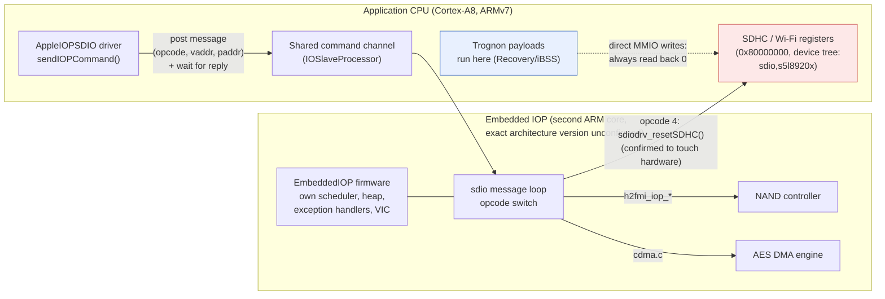
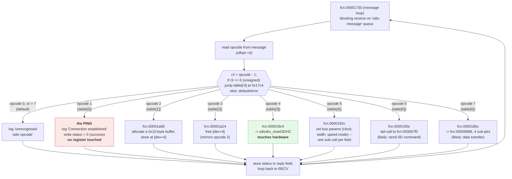

# The 3GS has a second, embedded IOP processor; it likely — not yet proven — owns Wi-Fi/SDIO

Research date: 2026-10-16. This moves the SDIO investigation started on
2026-10-15 (`docs/research/2026-10-15-touch-wifi-nand-recon.md`) a long way
forward, but does not close it: after extensive register-level probing from
Trognon's own payloads produced only clean negatives, binary reverse
engineering of the device's own firmware (extracted and decrypted from the
owner's IPSW, never redistributed) found a strong architectural candidate
explanation. A second review (see "Known gaps" below) correctly pointed out
that the evidence so far establishes the architecture, not yet the causal
chain for the specific symptom observed on 2026-10-15/16. This document
states both clearly, rather than overclaiming the second.

## Bottom line

The S5L8920 has a second, embedded ARM processor (32-bit ARM instruction
set, confirmed by directly disassembling its own raw firmware; the specific
architecture version, e.g. ARMv7, is not established — see "Known gaps")
— Apple calls it an "IOP" (I/O Processor) — running its own small real-time
OS with its own
scheduler, heap, exception handlers and interrupt controller. **This part is
established.** What is still a working hypothesis, strongly supported but
not proven: that this second processor, not the application CPU Trognon's
payloads run on, is the exclusive owner of the SDIO/Wi-Fi host controller's
registers, and that this is specifically why those registers read back zero
and ignored writes on 2026-10-15/16. The application CPU does post messages
to the IOP over a shared command channel and wait for a reply — that part is
confirmed from the disassembled driver. The same IOP firmware also drives
the NAND controller (`h2fmi`) and the AES-capable DMA engine (CDMA). The
leading explanation for the 2026-10-15/16 negatives is that every SDIO
register write attempted from the application CPU reached an address whose
real owner never received a wake-up signal — not a wrong register, a wrong
processor — but this causal link has not itself been traced; see "Known
gaps" below.

*Established (solid, confirmed from the disassembled driver and firmware):
the message channel exists, and the IOP's own `sdiodrv_resetSDHC` is the
function that touches SDHC hardware. Still a hypothesis, not yet proven
(dotted line): that the application CPU's direct path to those same
registers is actually blocked — only that it reads back zero in practice.*

## How this was found: a second opinion, then a real disassembler

After three clean, carefully isolated negatives from direct register
experiments (two clock-gate hypotheses, a full SDHC-style init sequence, and
a raw write-then-readback test that showed the write never landed; see the
2026-10-15/16 journal), a summary of the investigation was given to another
LLM for review. Three corrections came back, all valid:

1. A zero readback does not by itself prove a write was ignored — an MMIO
   register can be write-only, carry reserved bits, or trigger an action,
   and the AMBA AXI specification explicitly treats these as different from
   plain memory behaviour.
2. Two incompatible register-layout hypotheses had been mixed without
   noticing: writes used the older, simple `CTRL`/`CMD` layout (from
   `plat-s5l8900`/`iDroid-kernel`), while the "the Capabilities register
   should read non-zero" argument assumed an SDHCI-standard layout. Only one
   of the two can be right.
3. The most important: the MMU page table cited as evidence was the one
   **OpeniBoot** builds for itself at its own boot — but OpeniBoot never
   runs on this device. Trognon's payloads execute inside Apple's own
   patched iBSS, whose real MMU state had never been captured directly.

The review's own strongest lead: real iOS kernelcache restore logs for the
3GS name an actual Apple driver class, and that kernelcache is inside the
IPSW already in hand.

## Extracting and reading the real driver

The kernelcache (`kernelcache.release.n88` inside
`iPhone2,1_4.3.5_8L1_Restore.ipsw`, SHA-256
`ed3a62f4c581a8f500303d4d8e0976dd84bfb5d1f39c83d884b6564a7ecb4ab2` for the
IPSW) is an encrypted IMG3 container, same shape as the device tree handled
on 2026-10-15: `TYPE`/`DATA`/`SEPO`/`KBAG`x2/`SHSH`/`CERT` tags, `DATA`
encrypted (`KBAG` present). Decrypted the same way, with the 3GS back in
pwned DFU (not Recovery): `axi0mX/ipwndfu`'s `image3.py`,
`Image3.getDecryptedPayload()` -> `dfuexec.PwnedDFUDevice().decrypt_keybag()`
(the chip's own hardware AES/GID primitive, a pure read, nothing written).
The decrypted payload (SHA-256
`487bcf47e494c1cd3e57f347e9b1a8cba90576c78b6a0752e0b2a60a76ed4a00`) starts
with the ASCII tag `complzss`: Apple's standard LZSS kernelcache
compression. No existing decompressor was available locally, so one was
written from the publicly documented algorithm (4096-byte dictionary
initialised to spaces, 18-byte max match, length = 3 + low nibble, exact
parameters confirmed against `malus-security/lzssdec`'s own README rather
than guessed) and validated: it reproduced the exact expected uncompressed
size (10,047,488 bytes) and produced a structurally valid ARMv7 Mach-O.

The kernelcache's own `__PRELINK_INFO` plist lists the real driver class:
**`AppleIOPSDIO`**, matching `IONameMatch = "sdio,s5l8920x"` (the exact
`compatible` string already found in the device tree on 2026-10-15) and
`IOProviderClass = "AppleARMIODevice"`, loaded at `0x80579000`. Its
`__PRELINK_TEXT` slice is itself a small, complete Mach-O (a prelinked kext),
parsed directly rather than guessed at (segment/section load commands read
with a small script): `__text` at `0x8057a000` (0x343c bytes), `__cstring`
at `0x8057d43c` (0x175d bytes).

A first pass with `arm-none-eabi-objdump` (`-b binary -m arm -M
force-thumb`) decoded cleanly from the start, confirming the code is Thumb
throughout this function range, but manual string-cross-reference by
literal-pool scanning (first by hand, then checked twice) found zero
matches against the target debug strings — not a tooling limitation, an
off-by-8-bytes error in how the target string's own address had been
computed (the substring searched for was offset into the real string, not
its start). Once `radare2` was installed (`brew install radare2`) and run
with full analysis (`aaa`), its own `axt` cross-reference command found the
right function immediately once the correct string address was used:
`fcn.8057c424`.

## What `sendIOPCommand` actually does

Disassembled in full (`radare2`, Thumb, relocations applied). In short:

1. Checks the command pointer passed in against a stored "allocated buffer"
   pointer (`this+0x14`); mismatches fail with "Command is not from the
   command buffer."
2. Checks it is running on the right IOKit workloop gate (two virtual calls
   through the object at `this+0x18`); failing that logs "Must have
   workloop gate to send a command."
3. Fills in the command structure: writes the opcode byte, sets a
   "pending" flag, stores the current command pointer at `this+0x30`.
4. Logs `"Sending command @ vaddr = %p, paddr = 0x%lX, opcode = %lu"`
   (confirming the command descriptor itself carries a virtual *and* a
   physical address — this is a real shared-memory message, not a register
   poke).
5. **The actual send** is a virtual call through a *different* object, at
   `this+0x24`, vtable slot `+0x84` — this is the one that actually talks
   to hardware; `AppleIOPSDIO` itself never touches the SDHC registers for
   this step.
6. On success, loops re-reading `this+0x30` until it is cleared — presumably
   by the completion handler (`handleIOProcCmdResp`, named in the kext's own
   strings) once the IOP actually answers.

## The generic channel, and who else uses it

The object at `this+0x24` is backed by a genuinely separate kernel
extension, confirmed by searching the full kernelcache's `__PRELINK_INFO`
(not just this one kext) for every driver that lists it as a library
dependency:

| `OSBundleLibraries` client of `com.apple.driver.IOSlaveProcessor` | Role |
|---|---|
| `com.apple.driver.AppleARM7M` | names an ARM7-class core directly |
| `com.apple.driver.AppleIOPFMI` | the NAND/flash driver (`h2fmi`) |
| `com.apple.driver.AppleIOPSDIO` | this investigation's Wi-Fi/SDIO driver |
| `com.apple.driver.EmbeddedIOP` | the generic IOP management framework |
| `com.apple.driver.IOP_s5l8920x_firmware` | **the firmware image itself** |

`IOP_s5l8920x_firmware` is not a thin wrapper: `_PrelinkExecutableSize =
0x1d000` (116 KB), `IOProviderClass = IOResources` (a global resource, not a
per-device driver). Extracted (SHA-256
`b8af809426e15cd23b5247a15c7ee950843aa893f8bdc7b4e2cc9e018100cd37`), it
turns out to be **two layers**, not one, and the distinction matters for
what each fact actually proves:

- A wrapper: a Mach-O container (`cputype=12`, `cpusubtype=9` — ARMv7) with
  its own tiny `__text`/`__cstring`, holding config keys
  (`ConfigurationOffset`, `HeapBaseOffset`, `PageTableBase`,
  `MessageChannelSize`, ...) that tell the host how to load what follows.
  This Mach-O header describes what the **host** (an ARMv7 Cortex-A8) needs
  to load the file with XNU's normal kext mechanism — it says nothing about
  the embedded core's own instruction set.
- The actual payload: a `fwFirmwareImage` section (0x1b000 bytes, SHA-256
  `02397017927bfa05d23f77b9e76e9a3e7c73711806c0a230780136af7f7d8bfc`), a
  *raw* binary with no Mach-O header of its own, starting with a genuine
  ARM32 exception vector table (confirmed byte-for-byte: its first word,
  `0e0000ea`, decodes as a `B` branch instruction) and self-identifying,
  once disassembled, as `"EmbeddedIOP for s5l8920x, Copyright 2010, Apple
  Inc."`, built alongside `iBoot-1072.61`. This is the code that was
  actually disassembled below — directly, with `radare2` told to decode it
  as 32-bit ARM, not inferred from the wrapper's own header.

Its own debug strings strongly support this reading, but by themselves they
establish a dialogue, not yet a proven causal chain to the specific symptom:

- `"SDHC: Ping received, IOKit <--> IOP Connection established"` — this
  establishes that a ping/connection handshake exists between IOKit and the
  IOP firmware for SDHC. `sendIOPCommand`'s special handling of opcode 0
  (seen above) was first guessed as a plausible match for this ping; the
  IOP-side disassembly below instead identifies the ping as opcode 1, so
  this specific host/IOP opcode correspondence is not yet established either
  — see "Known gaps". **What is not yet shown**:
  whether this handshake is itself what activates the SDHC hardware, or
  merely opens a logical connection on top of hardware that is initialised
  some other way — that distinction requires tracing the ping's handler
  (transport used, expected message, response, and which initialisations it
  actually triggers), not inferring it from the log line's wording.
- `sdiodrv_resetSDHC`, `sdiodrv_sendCommand`, `sdiodrv_performDMA`,
  `sdiodrv_completeTransfer`: a real low-level SD protocol driver, using the
  exact register names Trognon's own hypotheses used (`cmd`, `arg`, `resp0`,
  `normalInt`, `errorInt`, `state`), runs on the IOP. That it runs there is
  established; that the application CPU is *excluded* from reaching the same
  registers, and that this exclusion is specifically why 2026-10-15/16's
  reads came back zero, is plausible but not proven by this string alone.
- `h2fmi_iop_read_multiple`, `h2fmi_erase_blocks`, `h2fmi_nand_reset_all`,
  and the rest of the `h2fmi_*` family: NAND's real driver lives here too.
  One possible explanation for why Trognon's own NAND chip-ID read
  (2026-10-15) worked without ever pinging anything is that NAND is needed
  to boot iOS and so the IOP's NAND component is already live by the time
  Recovery mode is reached. **This is not established**: the needs of a
  normal iOS boot do not by themselves prove the IOP's actual state along
  Trognon's own tethered DFU/iBSS path, which skips most of that normal
  boot. The chip-ID read succeeding is a fact; why it succeeded is still a
  hypothesis.
- `drivers/apple/cdma/cdma.c`: the AES-capable DMA engine already seen
  referenced in `h2fmi.c`'s source is also IOP-managed.
- `task_create`, `task_yield`, `idle_task_routine`, a heap allocator, ARM
  exception-mode dump strings (`"ARM %s abort in %s mode at 0x%08x"`), and
  its own interrupt-enable/status registers (`rVICINTENABLE`,
  `rVICIRQSTATUS`, distinct from the application CPU's own VIC0/1/2): this
  part is a plain reading of the firmware's own strings, not an inference —
  a complete small embedded OS, not a thin relay.

## What this settles, and what it reopens

What is now established: the S5L8920 has a second embedded processor
running real, separate firmware, and a message-passing dialogue exists
between the application CPU's `AppleIOPSDIO` driver and that firmware for
SDIO. What is not yet established: that this is *why* `0x80000000` ignored
reads and writes from the application CPU on 2026-10-15/16. The architecture
makes that explanation plausible and is now the leading hypothesis, ahead of
the clock-gate and init-sequence hypotheses already ruled out — but it has
not itself been traced end to end.

The ambiguous dynamic-clock-16 read from 2026-10-15 (`0xF18` instead of an
expected `0x718`) is in the same position: the IOP architecture makes it
plausible that clocking this block is not something the application CPU's
clock-gate table alone controls end to end, but this has not been confirmed
either.

### Known gaps (raised by a second review, 2026-10-16)

A second review of this writeup, after the IOP finding, flagged exactly the
two points above as conclusions stated too strongly, and named the decisive
next step precisely: **trace the ping's own handler** — which transport it
uses, what message it expects, what it replies, and which initialisations
it actually triggers before and after the "Connection established" log
line. Until that is traced, "the application CPU cannot reach the block
because only the IOP can" remains the leading hypothesis, not a proven
fact, and the two softened bullets above should be read as open questions,
not settled ones.

### The ping handler, traced: it does not activate hardware

Following a detailed six-step plan (from the same review) for rebuilding
the IOP dialogue, step 2 was completed: the ping's own handler, inside the
IOP's *raw* firmware image (not the ARMv7 Mach-O wrapper kext that merely
carries it — a distinct 0x1b000-byte section, starting with a genuine ARM32
exception vector table, confirmed byte-for-byte: `0e0000ea` decodes as a
`B` instruction), was located (via `radare2`, cross-referencing the "Ping
received" string) and disassembled in full.

It is a message-processing loop (a queue named `"sdio message"`) that reads
an incoming message's opcode field, computes `r3 = opcode - 1`, and if
`r3 <= 6` (unsigned), jumps through a 7-entry table at `r3`'s index —
so the table covers **opcodes 1 to 7**; opcode 0 underflows `r3` and falls
to the same default/error path as any opcode above 7 ("unrecognised sdio
opcode"). This indexing was checked directly against the table's own raw
bytes (7 pointers at file offset `0x17c4`), not inferred from a case
label, after a second review flagged exactly this kind of off-by-one as a
real risk. **Table index 0 (real opcode 1)** — the ping — logs the
"Connection established" string, writes a success status back into the
message's response field, and returns to wait for the next message.
**Nothing else.** No register access, no call into any `sdiodrv_*`
function. This directly answers the determining question flagged above:
**the ping does not initialise the SDHC hardware; it only acknowledges a
logical connection.** The earlier hypothesis assuming a direct causal link
between the ping and hardware activation is wrong as stated.

Table index 3 (**real opcode 4**) calls a function that references the
`sdiodrv_resetSDHC` string — this, not the ping, is the opcode that
actually touches hardware. The other five were disassembled too, each
guarded by the same pattern seen in the ping handler (read `[message+0]`,
the device's "configured" state; bail with a generic `0x401` error if it
is zero — not opcode-specific, the same guard in all seven):

- **Opcode 2** (`fcn.00001a58`): allocates a 16-byte buffer and stores it
  at `[dev+4]` — opens a resource.
- **Opcode 3** (`fcn.00001a24`): frees exactly that same field — the
  mirror of opcode 2, a clean open/close pair.
- **Opcode 5** (`fcn.0000192c`): a compound dispatcher checking the
  message's `+4`, `+8`, `+0x10` and `+0xc` fields in turn, one distinct
  sub-call per field, stopping at the first failure — matches the
  `setClockRate`/`setBusWidth`/`setBusSpeedMode` family named in the
  firmware's own debug strings; likely "set bus parameters" as a bundle.
- **Opcode 6** (`fcn.0000190c`): a thin tail-call (a jump, not a call) into
  `fcn.000067f0` with two pointers (the message, and message+8) — a
  signature consistent with sending an SD command (index/argument in,
  response out), not yet confirmed further.
- **Opcode 7** (`fcn.000018bc`): passes four distinct sub-pointers
  (message+8, +0x18, +0x28, +0x34→+0x38) into `fcn.00006898` — a signature
  consistent with a data transfer (buffer, block size, block count,
  direction), not yet confirmed further.

None of `fcn.00006580`, `fcn.000063d0`, `fcn.0000638c`, `fcn.000067f0` or
`fcn.00006898` — the functions that would hold the real MMIO register
accesses — were disassembled this session; that is the next concrete step
for actually recovering the addresses the IOP itself uses. The host
driver's own opcode numbering
(`sendIOPCommand`'s special handling of "opcode 0", noted above as a
plausible ping match) has not been reconciled with this IOP-side numbering
— whether the host's opcode byte maps 1:1 to the IOP's, or through some
other translation, is open; see "Known gaps".

*The ping (real opcode 1) and the reset (real opcode 4) are two different,
unrelated branches of the same switch — confirmed by reading the jump
table's own bytes, not inferred from a case label or the log message's
wording. An earlier version of this document mislabelled these as opcodes
0 and 3 respectively, off by one for the reason the switch's `opcode - 1`
subtraction makes easy to miss; corrected 2026-10-16.*

Updated evidence table (format suggested by the review):

| Claim | Status |
|---|---|
| The IOP is running | **Not confirmed** — firmware identified and its message loop disassembled; whether it is actually executing under Trognon's own tethered DFU/iBSS path (as opposed to merely being present as a loaded binary) is not verified |
| The transport works | Partial — the message's opcode/status fields are understood; the full shared-buffer format is not |
| The ping activates the SDHC | **Disproven** — the ping handler never touches a register |
| The SDHC works | Not tested — real opcode 4 (reset) has not been sent from a payload |

What would be needed to actually drive Wi-Fi from Trognon's own payloads:
the message-channel wire format precisely enough to construct and send both
the ping (real opcode 1, now known to be a no-op connection handshake) *and*
real opcode 4 (the one that actually calls into `sdiodrv_resetSDHC`) — the
command/message structure seen in `sendIOPCommand`, plus whatever the real
low-level kickoff write at `this+0x24`'s vtable `+0x84` does on the host
side (a separate class, not yet located or disassembled). Sending only the
ping, as the architecture doc first assumed might be enough, is now known
to be insufficient on its own. Not attempted this session; this is a
deliberate stopping point, not an unfinished attempt.

### The transport, partially traced: a generic IOKit queue, and a second kext worth its own look

Step 3 of the plan (rebuild both ends of the transport) was started on the
host side. `sendIOPCommand`'s real send (`this+0x24`'s vtable `+0x84`,
left unlocated in the previous section) is not something `AppleIOPSDIO`
constructs itself: disassembling its `init()` function shows it obtained by
calling a factory method (vtable offset `0x350`) on the `IOSlaveProcessor`
*provider* object (`this+0x20`), passing the literal string `"sdio"` as an
argument. Whatever class that factory returns is defined entirely inside a
**separate, generic kext**, `com.apple.driver.IOSlaveProcessor`
(`0x80398000`, 0x3000 bytes, SHA-256
`abff4df9877f8c83a899de4f2308bca80f556478790b982d1823d39fd366a0c9`), not
inside `AppleIOPSDIO` at all — which is exactly why no "channel" class name
string exists in the SDIO kext's own strings.

That kext's own strings name five classes: `IOSlaveProcessor`,
`IOSlaveEndpoint`, `IOSlaveMemory`, `IOSlaveMemoryBuffer`, `IOSlaveCPU`,
`IOSlaveFirmware`. `IOSlaveEndpoint` is the strongest candidate for the
command channel (the factory call's purpose and the name both point the
same way), but the exact vtable slot was not pinned down this session — a
scan for code pointers inside this kext's own `__const` found only a short,
6-entry run, too short to reach byte offset `0x350` on its own; the
rest of `IOSlaveProcessor`'s vtable is almost certainly inherited `IOService`
slots living in the main kernel, not in this small kext, which is
consistent with but does not prove the `IOSlaveEndpoint` identification.

The other two names, `IOSlaveCPU` and `IOSlaveFirmware`, are a direct hit
on the *other* open question from "known gaps" above (how
`IOP_s5l8920x_firmware`'s bytes are loaded, verified, and started) — they
were not disassembled this session, but they are now a named, concrete
target rather than an unlocated one.

### Two different goals, often conflated: commanding it vs. programming it

It is tempting to read "there's a second ARM core" as "we have a second,
programmable processor on this device" — worth separating explicitly into
two distinct, unequally-supported goals:

| Goal | What is known today |
|---|---|
| Drive the IOP's *existing* firmware (send it a ping, a reset, real SDIO commands) | The message protocol exists and its outer shape is partly understood (this document); the transport still needs reconstructing, and whether the IOP is actually running under Trognon's tethered path is unverified |
| Run Trognon's *own* code on the IOP (turn it into a small programmable coprocessor) | Not demonstrated at all. Would require understanding how `IOP_s5l8920x_firmware`'s own bytes are loaded, by what, to what address, whether anything verifies them (a signature check, a hash, a memory-protection boundary), and what write actually releases the IOP's reset. None of this was traced this session — it is the next concrete research target, not an open question idly raised. |

Even if the main CPU turns out to be free to load arbitrary bytes into the
IOP's memory and release its reset — a real possibility, not yet ruled
out — that would still depend on `limera1n`'s own hold over the main CPU to
get there in the first place. It would not be an independent exploitation
path beyond the phone's bootrom bug; it would be a new capability unlocked
*through* the same `limera1n`-pwned state Trognon already has, not a
separate escape hatch from it.

## Tooling notes, for reproducibility

- `radare2` (`brew install radare2`, 6.2.4) was needed: manual
  `objdump`-based literal-pool resolution looked correct but silently
  missed the target function because of a small, easy-to-make address
  arithmetic mistake. `r2`'s own `aaa` analysis plus `axt` found the right
  function immediately once the mistake was caught.
- The LZSS decompressor parameters (4096-byte window, 18-byte max match,
  space-filled dictionary, length threshold 3) came from
  `malus-security/lzssdec`'s README, not from memory or a guess — an
  earlier attempt using remembered classic-LZSS parameters (zero-filled
  dictionary, different length threshold) decoded structurally but produced
  garbage.
- Extracted binaries (kernelcache, device tree, IOP firmware, the small
  kext slice) were kept outside this repository (a temporary working
  directory, not committed), consistent with this project's rule against
  ever hosting Apple firmware: every fact above is cited as a finding
  (string, struct offset, behaviour), never as a redistributed blob.

## Not verified

- The exact wire format of the IOP command/message structure (what each
  byte of the struct pointed to by `sendIOPCommand`'s `cmd` argument means)
  was not reverse-engineered; only its outer shape (opcode byte, pending
  flag, vaddr/paddr pair) is known.
- The class backing the object at `this+0x24` (the actual command channel)
  was identified by dependency (`IOSlaveProcessor`) but its own code was
  not located or disassembled this session.
- Whether the IOP is already initialised/running by the time Trognon's
  iBSS-based payloads execute, or needs to be booted by something the
  normal iOS boot chain does that Trognon's tethered path skips, is not
  established either way.
- `AppleARM7M`'s exact relationship to the physical IOP core (whether it
  names the core itself or a related peripheral) is inferred from its name
  and its shared dependency on `IOSlaveProcessor`, not confirmed from its
  own code. The name is a hint toward an ARM7-family core, which is a
  different thing from the ARMv7 *architecture version* the main Cortex-A8
  uses — "ARM7" and "ARMv7" name different things, and conflating them was
  an earlier mistake in this document, corrected 2026-10-16.
- The IOP firmware's own *load path* — who copies `IOP_s5l8920x_firmware`'s
  bytes, to what address, whether anything verifies them (signature, hash,
  a memory-protection boundary) before or after, and what write actually
  releases the IOP's reset — was not traced this session. This is the
  specific next target for deciding whether the IOP could ever run
  Trognon's own code rather than just being sent messages its existing
  firmware understands.
